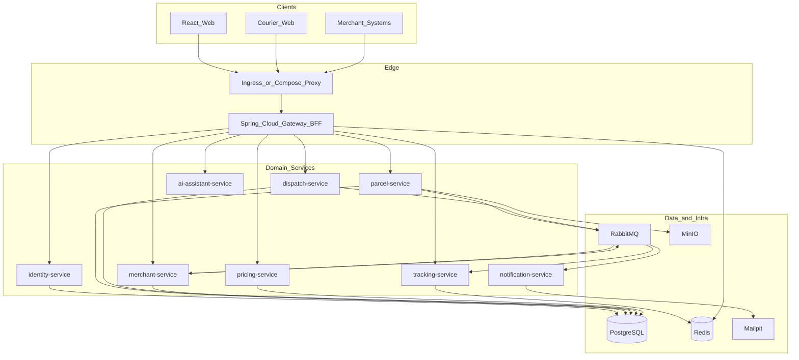

# SwiftDrop — Complete Enterprise Implementation Plan

Greenfield repo. Spec: [Group Assignment.pdf](Group Assignment.pdf). First implementation artifact after approval: a full markdown architecture/implementation guide at [docs/SWIFTDROP.md](docs/SWIFTDROP.md) (also summarized in [README.md](README.md)).

## Recommended stack (locked unless you reject this plan)

Chosen for a 10-person University of Moratuwa EAD group, assignment constraints, and Kubernetes bonus marks.

| Layer | Technology |
|---|---|
| Frontend | React 18 + TypeScript + Vite + Tailwind + shadcn/ui + React Query |
| BFF / Gateway | Spring Cloud Gateway (JWT validation, routing, rate limit) |
| Backend | Java 21, Spring Boot 3.3, Spring Security, Spring Data JPA, MapStruct |
| Auth | JWT (access + refresh) + Google OAuth 2.0 (OIDC) + merchant API keys + OAuth2 client-credentials |
| Real-time | Spring WebSocket (STOMP over SockJS) + public tracking via SSE fallback |
| Database | PostgreSQL 16 (schema-per-service in one cluster locally) |
| Cache / sessions | Redis 7 |
| Message broker | RabbitMQ 3 (topic exchange `parcel.events`) — simpler than Kafka at this scale, still pub/sub |
| Object storage | MinIO (proof-of-delivery photos, receipt PDFs) |
| Notifications | Spring AMQP consumer + Mailpit (local) / SMTP (prod); mock SMS adapter |
| AI assistant | Spring AI + OpenAI-compatible API; MCP tools wrapping parcel/pricing APIs |
| PDF receipts | OpenPDF / Flying Saucer |
| Observability | Micrometer + Prometheus + Grafana + Loki + Tempo (OpenTelemetry) |
| API docs | OpenAPI 3 (springdoc) per service, aggregated at gateway `/docs` |
| Local orchestration | Docker Compose (all services + infra) |
| Kubernetes | Kind/Minikube locally; Helm charts; Ingress-NGINX; ConfigMaps + Secrets |
| CI/CD | GitHub Actions (build, test, coverage, image scan, helm lint) |
| Quality | JUnit 5, Testcontainers, JaCoCo, ESLint, Playwright smoke tests |
| Security extras | CORS, CSRF off for APIs + cookie flags, Bean Validation, hashed passwords (BCrypt), PII redaction in logs, OWASP headers |

**Architecture style:** microservices with an API Gateway/BFF — justified for 10 contributors, independent deployability, and the K8s bonus. Bounded contexts stay small so the demo remains runnable on a laptop via Compose.



## Repository layout

```
enterpriseProject/
  docs/SWIFTDROP.md          # full architecture + setup (created first)
  docs/diagrams/             # mermaid sources used in the MD
  apps/web/                  # React SPA (customer, merchant, courier, admin)
  services/
    gateway/
    identity-service/
    parcel-service/
    dispatch-service/
    merchant-service/
    pricing-service/
    notification-service/
    tracking-service/
    ai-assistant-service/
  infra/
    docker/                  # Dockerfiles, compose, Mailpit, MinIO init
    k8s/helm/swiftdrop/      # umbrella Helm chart
    observability/           # Grafana dashboards, Prometheus scrape
  packages/common/           # shared DTOs, error codes, event contracts (Java lib)
  .github/workflows/
  README.md
  docker-compose.yml
```

## Domain model (ER — to be fully drawn in the MD)

Core entities:

- `users` (id, email, password_hash, name, phone, google_sub, status)
- `roles` / `user_roles` — CUSTOMER, MERCHANT, COURIER, DISPATCHER, ADMIN
- `merchants` (org name, webhook_url, status PENDING/APPROVED/SUSPENDED, owner_user_id)
- `api_keys` (hashed key, merchant_id, scopes, last_used)
- `oauth_clients` (client_id, client_secret_hash) for client-credentials
- `zones` (name, polygon/city list, active)
- `pricing_rules` (zone_from, zone_to, size_band, base_fee, per_kg)
- `couriers` (user_id, vehicle, current_zone, active)
- `parcels` (tracking_number, customer_id, merchant_id, pickup/dropoff JSON, size, weight, fee, status, assignee)
- `parcel_status_history` (parcel_id, from, to, actor, note, proof_url, failed_reason, timestamp)
- `addresses` stored as structured fields on the parcel (not free-text only) for PII control
- `webhook_deliveries` (event_id, url, attempts, last_status, next_retry)
- `notifications` (channel, recipient, template, payload_ref, status)

**Parcel state machine:** `CREATED → PICKED_UP → IN_TRANSIT → OUT_FOR_DELIVERY → DELIVERED | FAILED` (FAILED may allow reattempt back to OUT_FOR_DELIVERY).

**Pricing Strategy pattern:** `PricingStrategy` implementations (distance/zone-band + weight). Estimate endpoint is request/reply; confirmed fee is snapshotted on the parcel.

## Service responsibilities

- **gateway** — JWT/API-key authn at the edge, `/api/v1/**` versioning, rate limits, CORS, WebSocket upgrade proxy, OpenAPI aggregator, BFF aggregation for dashboards.
- **identity-service** — signup/login, Google OAuth (authorization-code + PKCE from SPA), refresh tokens in HttpOnly cookies (or rotation store in Redis), RBAC, user admin APIs.
- **pricing-service** — zone CRUD, fee estimate, persisted pricing rules.
- **parcel-service** — customer bookings, tracking numbers (`SD-XXXXXXXX`), status commands, receipt PDF generation, history.
- **dispatch-service** — unassigned queue, assign courier, workload counts, daily courier lists.
- **merchant-service** — merchant registration/approval, API-key issuance (show once), OAuth2 client-credentials, outbound webhooks with exponential retry + DLQ.
- **tracking-service** — consumes status events, pushes STOMP topics `/topic/parcels.{trackingNumber}`, public read-only tracking API (no PII beyond masked names).
- **notification-service** — consumes `parcel.status.changed`, sends email (and mock SMS), never logs full addresses/phones.
- **ai-assistant-service** — chat UI backend; tools: `getParcelByTrackingNumber`, `estimateFee`, `listMyParcels` (user-scoped). MCP server exposing the same tools.

## Integration patterns (assignment requirement)

| Flow | Pattern | Why |
|---|---|---|
| Login, create delivery, estimate fee, assign courier | Request/reply (REST) | Synchronous user-facing |
| Google login | OAuth 2.0 authorization code + OIDC | Assignment social login |
| Merchant create order | Request/reply + API key / client-credentials | Partner systems |
| Status change → notify + webhook + live UI | Pub/sub via RabbitMQ topic | Decouple producers from consumers; retry independently |
| Webhook delivery | Broker + competing consumers + retry/DLQ | At-least-once, resilient partners |
| Live tracking | Observer (events) + WebSocket | Push without polling |

**Event contract (example):** `parcel.status.changed` v1 `{ eventId, occurredAt, trackingNumber, parcelId, fromStatus, toStatus, actorId, merchantId }`. Idempotency via `eventId`.

## Security (enterprise + assignment)

- Passwords BCrypt; API keys SHA-256 hashed; never return secrets after creation.
- JWT short-lived access (15m) + refresh rotation.
- Method security: courier can only PATCH own assignments (explicit authz tests).
- Bean Validation on all inputs; centralized `ProblemDetail` (RFC 7807) errors without stack traces/PII.
- Log masking for phone/address; structured JSON logs.
- Secrets only via env / K8s Secrets / Compose `.env` (gitignored).
- HTTPS at Ingress; security headers; file upload type/size limits for proof photos.

## Frontend app map

Single SPA with route guards:

- Public: `/login`, `/signup`, `/track/:trackingNumber`, `/oauth/callback`
- Customer: `/deliveries/new`, `/deliveries`, `/deliveries/:id`, receipts
- Merchant: `/merchant/orders`, `/merchant/webhooks`, `/merchant/api-keys`
- Courier: `/courier/today`, status update + photo + fail reason
- Dispatcher/Admin: unassigned board, courier workload, users, merchants approval, zones/pricing, reports
- All: AI chat widget (bonus)

Mobile-friendly tracking page is a first-class public route (responsive).

## Containers and Kubernetes

**Local:** `docker-compose.yml` starts Postgres, Redis, RabbitMQ, MinIO, Mailpit, all 9 Java services, and the Nginx-served SPA. One command: `docker compose up --build`.

**K8s (bonus):** umbrella Helm chart `infra/k8s/helm/swiftdrop`:

- Deployments + Services per app
- ConfigMaps for non-secret config
- Secrets for DB, JWT, Google client, SMTP, MinIO, OpenAI key
- Ingress (`swiftdrop.local`) with TLS optional
- HPA on gateway + parcel-service
- RabbitMQ and Postgres via Bitnami charts (or single-replica for demo)
- Init jobs for Flyway migrations
- NetworkPolicies (default deny + allow gateway→services)

## Testing (15 marks)

- Unit: pricing strategy, state machine, webhook retry policy
- Slice/integration: Testcontainers (Postgres + RabbitMQ) for status-change → notification consumer
- Authz: courier A cannot read courier B deliveries; customer cannot assign parcels
- API contract tests via Spring MockMvc / WebTestClient
- Frontend: React Testing Library for critical forms; Playwright happy-path smoke
- JaCoCo + coverage badge in CI; HTML report committed under `docs/test-reports/` at submission

## Design documentation (20 marks) — all inside `docs/SWIFTDROP.md`

The MD file is the assignment-ready design pack (exportable to PDF later):

1. Use case diagrams (customer, merchant, courier, dispatcher)
2. ER diagram
3. Architecture + layer justification
4. Integration patterns table
5. Sequence diagrams: create delivery, merchant API order, courier status → notifications, Google OAuth
6. SOLID / DRY / Repository / Strategy / Observer note
7. Security decisions
8. 10-member contribution sheet template
9. Local + K8s setup instructions (copied into README)

## Implementation order (so the demo stays always runnable)

1. Write `docs/SWIFTDROP.md` + README + Compose skeleton + shared error/event contracts.
2. identity-service + gateway + login/signup/Google OAuth + RBAC.
3. pricing-service + parcel-service booking + fee estimate + tracking number.
4. React customer flows + public track page (polling first).
5. RabbitMQ events + tracking-service WebSockets + notification-service email.
6. dispatch-service assignment + courier status + proof upload (MinIO).
7. merchant-service API keys, order API, webhooks with retry, merchant dashboard.
8. Admin: users, merchants, zones, reports.
9. Receipt PDF, history, hardening, env-based config.
10. Tests + coverage reports.
11. Helm/K8s + GitHub Actions.
12. AI assistant + MCP tools.

## 10-member split (contribution sheet)

- M1 Gateway + Compose/K8s platform
- M2 Identity + Google OAuth + JWT
- M3 Pricing + zones
- M4 Parcel booking + receipts
- M5 Dispatch + courier workload
- M6 Merchant API + webhooks
- M7 Tracking realtime + notification consumer
- M8 React customer + public tracking
- M9 React courier + dispatcher/admin
- M10 Testing, CI, AI assistant/MCP, docs polish

## Out of scope (keep demo honest)

- Native mobile apps (responsive web only)
- Real SMS gateway (mock adapter)
- Multi-region / multi-cluster
- Blockchain / crypto payments
- True Kafka cluster (RabbitMQ satisfies the brief)
