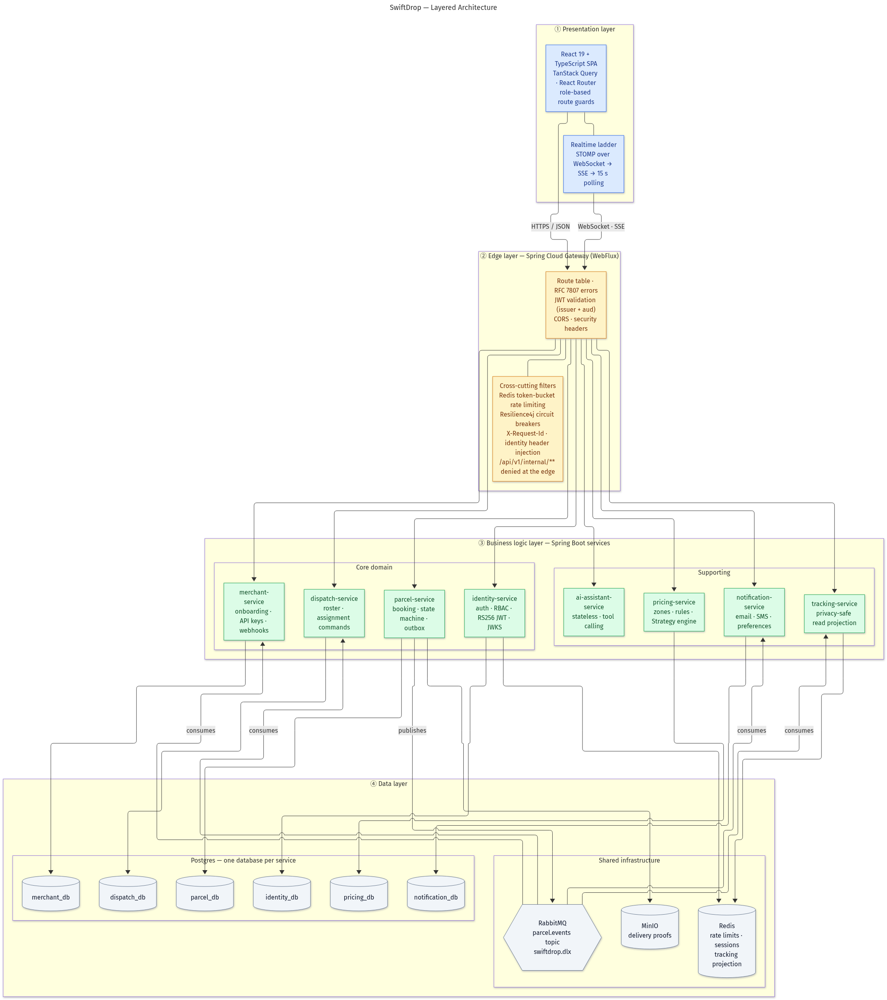

# SwiftDrop

A cloud-native parcel delivery and courier management platform, built as a distributed
microservices system on Java 21 / Spring Boot with a React single-page application.

Customers book deliveries and track them live. Merchants place orders through a web console or a
scoped REST API and receive signed webhooks. Couriers work a daily manifest and capture proof of
delivery. Dispatchers assign work and monitor courier load. An AI assistant answers questions about
the system in natural language.



---

## Contents

- [What it does](#what-it-does)
- [Architecture](#architecture)
- [Technology stack](#technology-stack)
- [Repository layout](#repository-layout)
- [Quick start](#quick-start)
- [Local URLs](#local-urls)
- [Running tests](#running-tests)
- [Documentation](#documentation)
- [Project status](#project-status)

---

## What it does

| Role | Capabilities |
|---|---|
| **Guest** | Track any parcel by tracking number, no sign-in required (rate limited) |
| **Customer** | Estimate a fee, book a delivery, track it live, download a PDF receipt, cancel while pending, manage notification preferences |
| **Merchant** | Register an organisation, await approval, place orders through the console or REST API, issue and revoke scoped API keys, configure webhooks and replay failed deliveries |
| **Courier** | Work a daily manifest, advance parcel status through guarded transitions, upload photographic proof of delivery, record failure reasons |
| **Dispatcher** | Monitor the unassigned queue, inspect courier workload, request assignment suggestions, assign and unassign parcels, manage the courier roster |
| **Admin** | Everything a dispatcher can do, plus approve merchants, manage users and roles, configure zones and pricing, audit the notification log |

Cross-cutting behaviour worth knowing:

- **Fees are never trusted from the browser.** The price shown while typing is a preview; the
  server re-quotes it inside the booking transaction and snapshots the result on the parcel.
- **Bookings are idempotent.** A retried request returns the original parcel rather than creating
  a duplicate.
- **Live tracking degrades gracefully.** STOMP over WebSocket falls back to Server-Sent Events,
  then to 15-second polling, so updates survive proxies that break WebSockets.
- **Status changes fan out asynchronously.** One courier update reaches the dispatch board, the
  tracking projection, the notification pipeline and merchant webhooks without the courier's
  request waiting on any of them.

---

## Architecture

Microservices behind an API gateway that also acts as a backend-for-frontend. Nine deployable
units: eight Spring Boot services plus the gateway.

**Database per service.** Six services own a PostgreSQL database each, tracking-service keeps its
read projection entirely in Redis, and the AI assistant holds no durable state. No service has a
foreign key into another service's database; cross-boundary references are UUID columns enforced in
application code.

**Event-driven integration.** parcel-service is the only producer. It writes events to a
transactional outbox in the same transaction as the business change, and a scheduled publisher
drains that outbox to the `parcel.events` topic exchange. Four consumers react independently, each
deduplicating on the event id because delivery is at-least-once.

| Service | Responsibility |
|---|---|
| `gateway` | Edge routing, JWT validation, CORS, rate limiting, circuit breaking, identity header injection, aggregated API docs |
| `identity-service` | Registration, login, Google OIDC, RS256 token issuance, JWKS, refresh rotation, role administration |
| `parcel-service` | Parcel aggregate, booking, guarded state machine, proof upload, PDF receipts, transactional outbox |
| `pricing-service` | Zones, city resolution, temporal pricing rules, Strategy-based fee engine |
| `dispatch-service` | Courier roster, dispatch queue projection, assignment commands, workload accounting |
| `merchant-service` | Merchant onboarding and approval, API key lifecycle, order ingestion, signed outbound webhooks |
| `tracking-service` | Privacy-reduced read projection in Redis, STOMP and SSE push |
| `notification-service` | Event-driven email and SMS, per-user preferences, delivery log, retry scheduler |
| `ai-assistant-service` | Conversational assistant exposing read-oriented domain tools over SSE |

### Parcel lifecycle

```
CREATED ──► PICKED_UP ──► IN_TRANSIT ──► OUT_FOR_DELIVERY ──► DELIVERED
   │                                            ▲      │
   │                                            └──────┤
   ▼                                           (reattempt)
CANCELLED                                             FAILED
```

Cancellation is legal only from `CREATED`. `DELIVERED` requires a proof of delivery belonging to
that parcel, and `FAILED` requires a reason. `FAILED` is **not** terminal: a failed delivery can be
reattempted, so the graph contains a cycle.

---

## Technology stack

| Layer | Technology |
|---|---|
| Frontend | React 18.3, TypeScript, Vite, Tailwind CSS, TanStack Query, React Router |
| Edge | Spring Cloud Gateway (WebFlux / Netty), Redis token-bucket rate limiting, Resilience4j |
| Backend | Java 21, Spring Boot 4.1.1, Spring Security, Spring Data JPA, Bean Validation |
| Persistence | PostgreSQL (Neon), one database per service, Flyway migrations |
| Cache / projection | Redis 7 |
| Messaging | RabbitMQ 3, topic exchange `parcel.events`, dead-letter exchange `swiftdrop.dlx` |
| Object storage | MinIO (proof-of-delivery photos) |
| Mail | Mailpit locally, SMTP in deployed environments |
| AI | Spring AI with an OpenAI-compatible provider |
| Orchestration | Docker Compose |

---

## Repository layout

```
enterpriseProject/
├── apps/web/                 React SPA (customer, merchant, courier, admin)
├── services/
│   ├── gateway/              Spring Cloud Gateway edge
│   ├── identity-service/     Auth, RBAC, JWT, Google OIDC
│   ├── parcel-service/       Booking, lifecycle, proofs, receipts
│   ├── pricing-service/      Zones and the Strategy pricing engine
│   ├── dispatch-service/     Courier roster and assignment
│   ├── merchant-service/     Merchant API keys, orders, webhooks
│   ├── tracking-service/     Redis projection, STOMP and SSE
│   ├── notification-service/ Email and SMS pipeline
│   └── ai-assistant-service/ Spring AI tool-calling assistant
├── packages/common/          Shared event contracts, enums, error codes
├── infra/
│   ├── docker-compose.yml          Full local stack
│   ├── docker-compose.parcel.yml   MinIO overlay for proof storage
│   └── minio/                      Bucket bootstrap
├── docs/
│   ├── DESIGN.md             Full design pack (use cases, ER, sequences, patterns)
│   └── diagrams/             18 rendered diagrams (PNG)
├── report/                   Academic project report (LaTeX + PDF)
└── tests/                    End-to-end harness
```

---

## Quick start

### Prerequisites

- Docker with Compose v2
- JDK 21 and Node.js 20+ (only if running services outside Docker)
- Six PostgreSQL databases. The stack is configured against [Neon](https://neon.tech) branches,
  one per service; any reachable PostgreSQL 16 will do.

### 1. Configure the environment

Create `infra/.env`. There is no committed template, so these are the variables Compose requires:

```bash
# One connection triplet per service database
IDENTITY_DB_URL=jdbc:postgresql://<host>/<db>
IDENTITY_DB_USERNAME=...
IDENTITY_DB_PASSWORD=...
# repeat for PARCEL_, MERCHANT_, DISPATCH_, PRICING_, NOTIFICATION_

# Infrastructure
REDIS_PASSWORD=...
RABBITMQ_USERNAME=...
RABBITMQ_PASSWORD=...

# Identity: RSA keypair used to sign and verify access tokens
IDENTITY_JWT_PRIVATE_KEY=...
IDENTITY_JWT_PUBLIC_KEY=...

# Google OAuth 2.0
GOOGLE_CLIENT_ID=...
GOOGLE_CLIENT_SECRET=...

# AI assistant (service will not start without it)
SPRING_AI_OPENAI_API_KEY=...
```

Never commit `infra/.env`.

### 2. Start the stack

```bash
# Core stack
docker compose --env-file infra/.env -f infra/docker-compose.yml up --build

# With MinIO, needed for proof-of-delivery uploads
docker compose --env-file infra/.env \
  -f infra/docker-compose.yml \
  -f infra/docker-compose.parcel.yml up --build
```

The gateway is the only public entry point. It reports `DEGRADED` with HTTP 200 when an optional
downstream is unavailable, and unavailable routes return an RFC 7807 problem document rather than
preventing startup.

### 3. Frontend in development

```bash
cd apps/web
npm install
npm run dev          # Vite dev server on :5173
```

Point it at the gateway by setting the API base URL to `http://localhost:8081`, and make sure that
origin is in the gateway's allowed CORS origins.

### Building without Docker

```bash
./mvnw clean install                      # all modules, including shared contracts
./mvnw -pl services/gateway -am spring-boot:run
```

---

## Local URLs

| Purpose | URL |
|---|---|
| Web application (container) | `http://localhost:5174` |
| Web application (Vite dev) | `http://localhost:5173` |
| API gateway | `http://localhost:8081` |
| Gateway health | `http://localhost:8081/actuator/health` |
| Aggregated Swagger UI | `http://localhost:8081/docs` |
| RabbitMQ management | `http://localhost:15673` |
| Mailpit inbox | `http://localhost:8025` |
| MinIO console | `http://localhost:9001` (loopback only) |

All APIs are versioned under `/api/v1/**`. Routes under `/api/v1/internal/**` are rejected at the
edge and reachable only service-to-service.

---

## Running tests

```bash
./mvnw test                                   # every module
./mvnw -pl services/gateway -am test          # one service and its dependencies

cd apps/web
npm run test                                  # Vitest
npm run typecheck                             # TypeScript project references
npm run lint                                  # ESLint
```

Integration tests use Testcontainers and start real PostgreSQL and RabbitMQ instances, so Docker
must be running. Tests that require Docker skip themselves when it is unavailable.

---

## Documentation

| Document | Contents |
|---|---|
| [`docs/DESIGN.md`](docs/DESIGN.md) | Full design pack: use case diagrams, ER model, architecture and justification, integration patterns, sequence diagrams, design patterns, and a record of known defects |
| [`docs/diagrams/`](docs/diagrams/) | 18 rendered diagrams as PNG. The Mermaid or PlantUML source for each is embedded in `DESIGN.md` |
| [`report/SwiftDrop_Project_Report.pdf`](report/SwiftDrop_Project_Report.pdf) | Academic project report, 46 pages, all diagrams embedded |
| Service READMEs | Each service documents its own API contracts and configuration |

Every claim in the design pack and report was verified against the source code. Where behaviour
diverges from the intended design, it is recorded rather than smoothed over.

---

## Project status

The platform runs end to end: authentication, pricing, booking, dispatch, courier workflow, live
tracking, notifications and the merchant API are all implemented and covered by tests.

Designed and documented, but not yet built:

- Kubernetes deployment via an umbrella Helm chart, with autoscaling on the edge and tracking
  workloads
- Playwright browser end-to-end smoke tests
- Write-capable AI assistant tools (booking, dispatch assignment, merchant operations); the three
  existing tools are read-only
- Volumetric dimension-based pricing and merchant volume discounts
- A production SMS provider behind the existing channel abstraction

Known defects found during documentation review are listed in
[`docs/DESIGN.md` §7](docs/DESIGN.md#7-known-gaps).

---