# SwiftDrop — Design Documentation

SwiftDrop is a courier and parcel-delivery platform. Customers book deliveries, merchants place orders through a web console or a REST API, couriers move parcels and record proof of delivery, and dispatchers assign work and run the network.

This document covers the six design deliverables: use case diagrams, the entity-relationship model, the architecture proposal and its justification, the integration design, sequence and activity diagrams for the four key flows, and the design patterns and principles applied.

**Every diagram and claim here was derived from the implementation**, not from an intended design. Where the code diverges from the design, §7 says so rather than drawing the system as it was meant to work.

### How to read this document

| | |
|---|---|
| **Diagrams** | Every diagram is embedded as a rendered image, with its editable source in a collapsed block directly beneath. All 18 live in [`docs/diagrams/`](./diagrams/) as source (`.mmd` or `.puml`) plus `.png` and `.svg`. |
| **Notation** | Use case diagrams are UML (PlantUML). Everything else is Mermaid, matching the convention already used elsewhere in this repository. |
| **Export** | Because the diagrams are images, this document exports cleanly to PDF or Word with no diagram-rendering support required. Use the `.svg` files where print quality matters. |
| **Scope** | Nine deployable units: eight Spring Boot services plus an API gateway, and a React single-page application. |

### Contents

1. [Use case diagrams](#1-use-case-diagrams)
2. [Entity-relationship model](#2-entity-relationship-model)
3. [Architecture proposal](#3-architecture-proposal)
4. [Integration design](#4-integration-design)
5. [Sequence and activity diagrams](#5-sequence-and-activity-diagrams)
6. [Design patterns and principles](#6-design-patterns-and-principles)
7. [Known gaps](#7-known-gaps)
8. [Service-level design notes](#8-service-level-design-notes)

---

## 1. Use case diagrams

### 1.1 Actors

Authorisation is role-based. The five roles are defined once in a shared enum (`packages/common/.../contracts/domain/Role.java`) and carried in the `roles` claim of every access token, so the actors below are the system's real authorisation boundaries rather than an analyst's abstraction.

| Actor | Role | Notes |
|---|---|---|
| **Guest** | — | Unauthenticated. Public parcel tracking is the only capability available without signing in. |
| **Customer** | `CUSTOMER` | Assigned automatically at registration. |
| **Merchant** | `MERCHANT` | Granted only after an administrator approves the organisation. A merchant's *backend system* is a second, non-human actor that authenticates with an API key. |
| **Courier** | `COURIER` | Granted by an administrator; also requires a courier profile in dispatch-service. |
| **Dispatcher** | `DISPATCHER` | Operations staff. |
| **Admin** | `ADMIN` | Holds every dispatcher capability plus platform administration. |

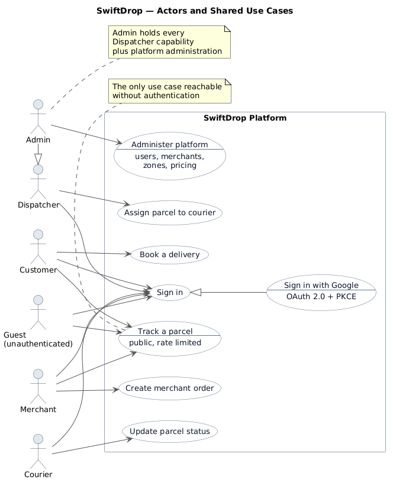

<details>
<summary>Diagram source — <code>uc-00-system-overview.puml</code></summary>

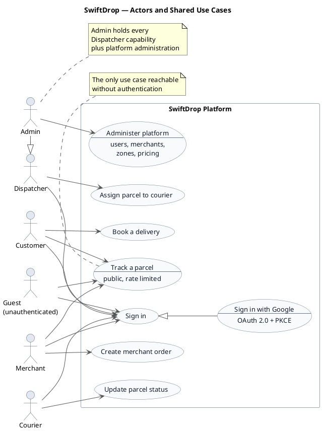

</details>

### 1.2 Customer

The customer journey is booking-centred. Two relationships are worth noting: booking *includes* fee estimation, because parcel-service re-quotes the price from pricing-service during booking rather than trusting the figure the browser submitted; and viewing a delivery *includes* tracking it, because the detail screen subscribes to the same live projection the public tracking page uses.

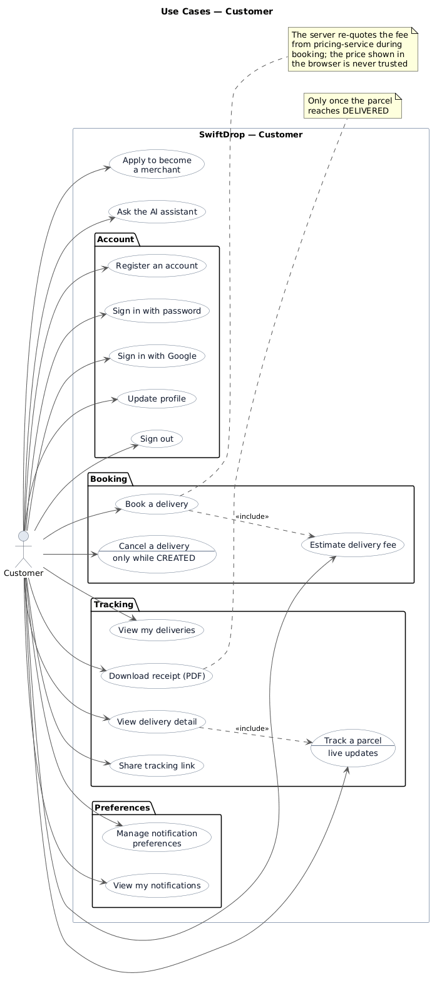

<details>
<summary>Diagram source — <code>uc-01-customer.puml</code></summary>

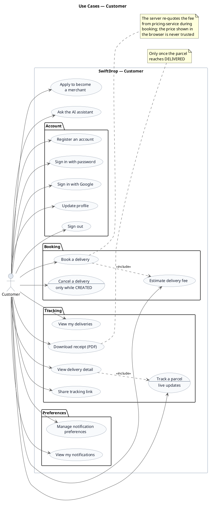

</details>

### 1.3 Merchant

Merchants have two distinct entry points, and the difference matters architecturally. A human merchant uses the web console with a normal user session. A merchant's *backend system* calls the REST API with a hashed API key carrying explicit scopes — no user login is involved. Both paths converge on the same order-creation logic.

Merchant onboarding is gated: an organisation registers, an administrator approves it, and only then can it issue API keys or create orders.

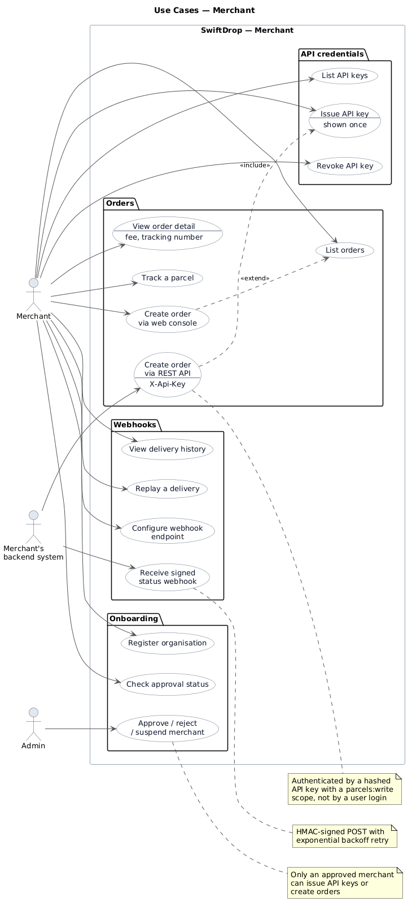

<details>
<summary>Diagram source — <code>uc-02-merchant.puml</code></summary>

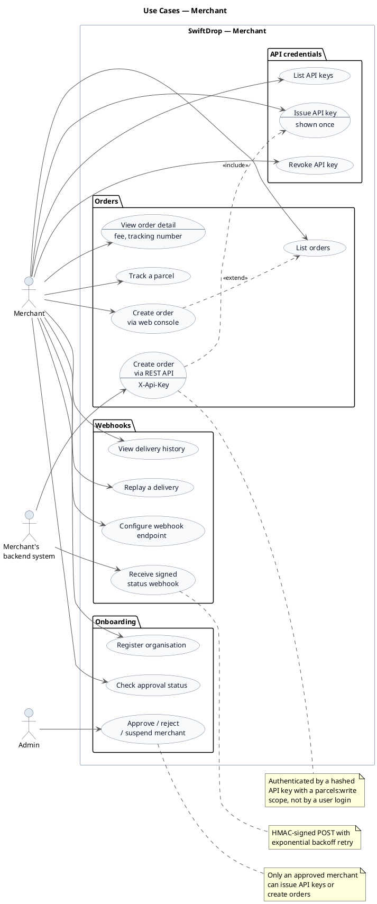

</details>

### 1.4 Courier

Every courier use case is a guarded state transition. The transitions are not free-form: parcel-service validates each one against an explicit state machine, rejects a `DELIVERED` transition that is not accompanied by a proof of delivery belonging to that parcel, and requires a reason on `FAILED`. Only the assigned courier or a dispatcher may change a parcel's status.

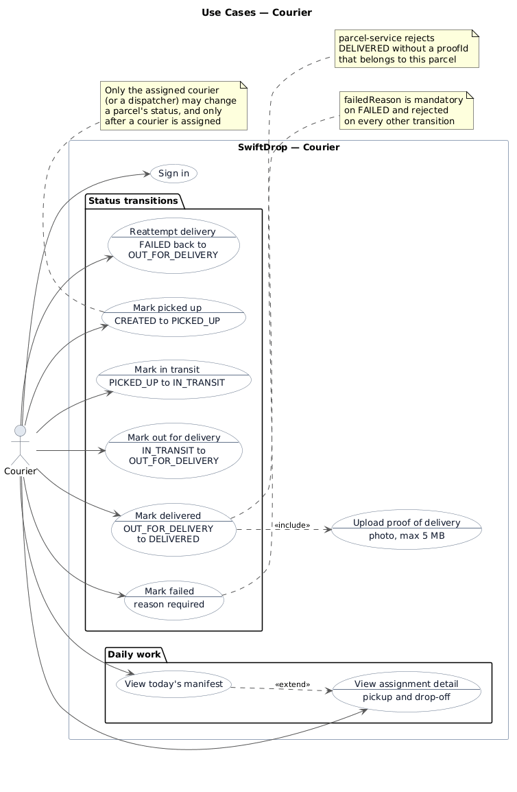

<details>
<summary>Diagram source — <code>uc-03-courier.puml</code></summary>

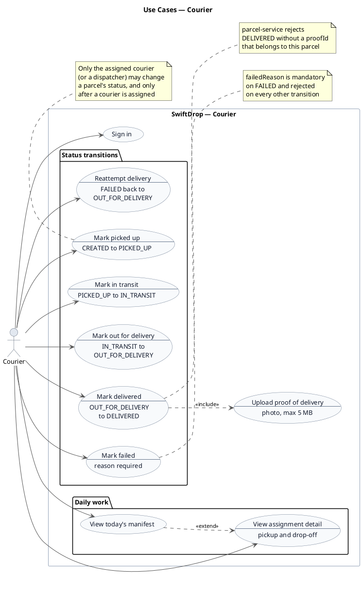

</details>

### 1.5 Dispatcher and Admin

`ADMIN` generalises `DISPATCHER`: an administrator can do everything a dispatcher can, plus manage merchants, users, zones, pricing and notifications. The diagram shades the admin-only region to make the boundary explicit.

Assignment is not a simple write. Dispatch-service validates the courier against identity-service, then applies a compare-and-set against the parcel aggregate, recording the attempt as a command so it can be retried or reconciled. The dispatcher's view of parcels is a local read-model projection rather than a live query into parcel-service.

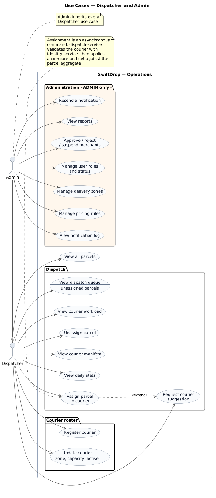

<details>
<summary>Diagram source — <code>uc-04-dispatcher.puml</code></summary>

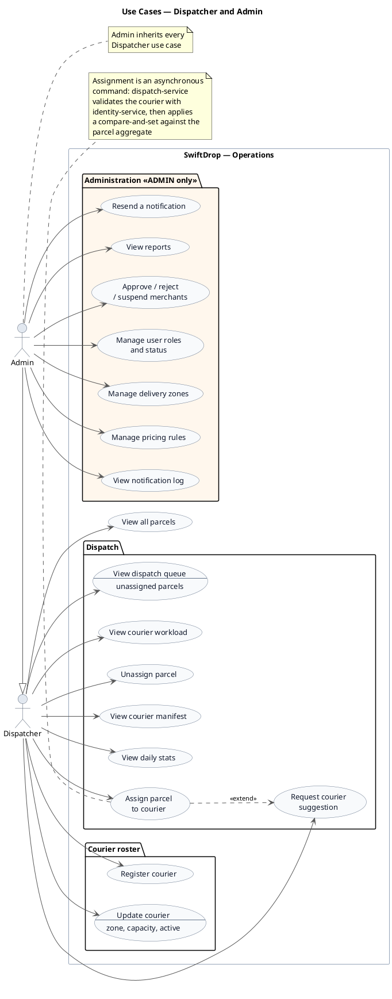

</details>

---

## 2. Entity-relationship model

### 2.1 Database per service

SwiftDrop uses **one database per service**. Six services own a PostgreSQL database each; tracking-service holds its read projection entirely in Redis, and ai-assistant-service has no persistence at all.

The consequence that shapes the whole model: **no service holds a foreign key into another service's database.** Relationships that cross a service boundary exist only as UUID columns, enforced in application code. `identity.users.id` is the most-referenced value in the system — thirteen columns across four other databases point at it — and it has zero inbound foreign keys.

Both diagrams below use this convention:

- **Solid line** — a real foreign key, enforced by PostgreSQL.
- **Dashed line** — a cross-database logical reference, enforced only by application code.

### 2.2 Core domain

This diagram covers the entities the brief calls for: users, roles, merchants, parcels, status history, couriers, zones and pricing.

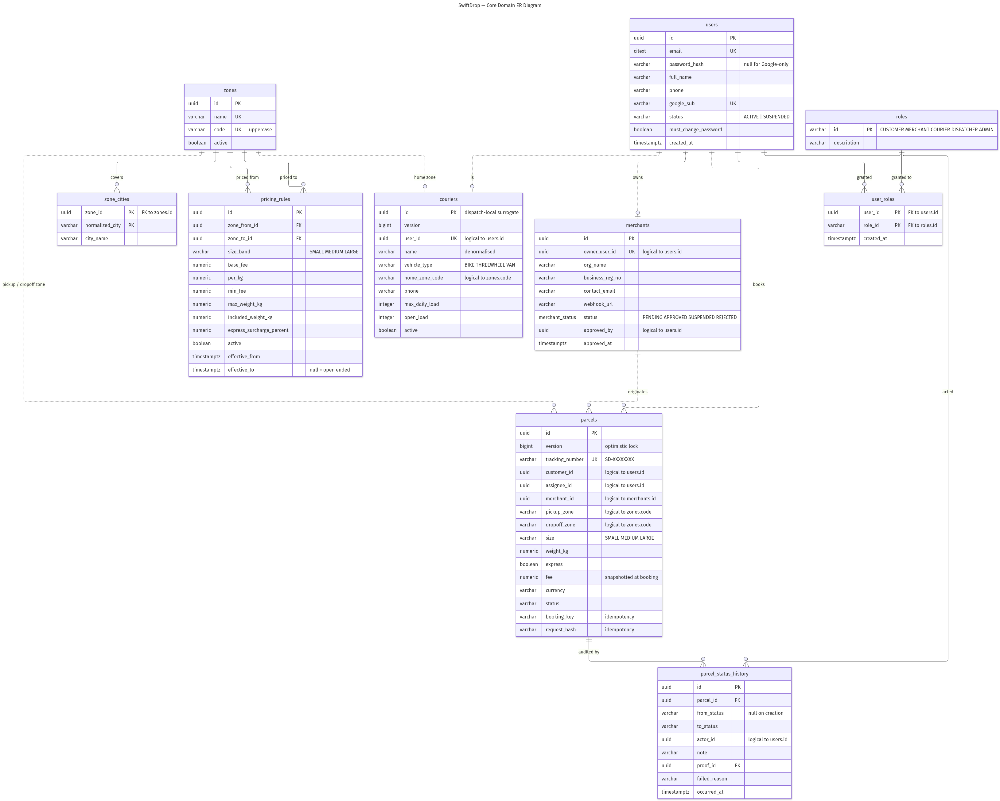

<details>
<summary>Diagram source — <code>er-01-core.mmd</code></summary>

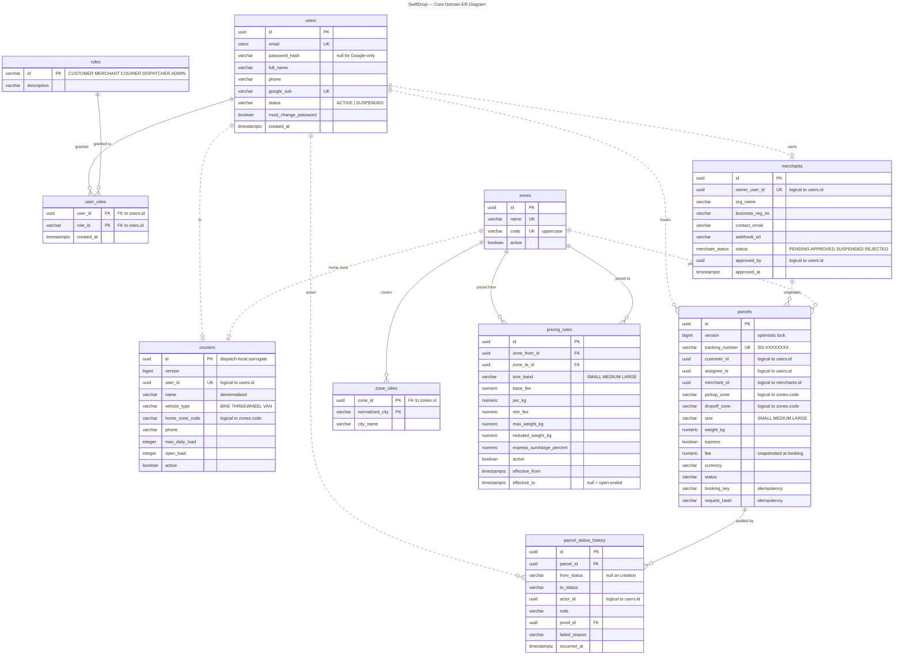

</details>

Points worth drawing out:

- **Role-based access control** is a classic three-table design — `users`, `roles`, and a `user_roles` join table with a composite key. Role identifiers are the enum names themselves (`CUSTOMER`, `ADMIN`, …), so a token's `roles` claim maps directly onto rows.
- **`parcels` snapshots its fee.** The `fee` and `currency` columns record what was quoted at booking time. Re-reading a parcel years later yields the price actually charged, not whatever the current pricing rules would produce.
- **`parcel_status_history` is an append-only audit trail**, recording the from-status, to-status, the acting user, and an optional proof or failure reason for every transition.
- **`couriers.id` is not `users.id`.** A courier has a dispatch-local surrogate key, and `parcels.assignee_id` points at the *user*, not at the courier row — so joining a parcel to a courier always goes through the user id.
- **Pricing is temporal.** Each rule carries `effective_from` / `effective_to`, and a database trigger forbids overlapping active periods for the same route and size band. Pricing history is preserved rather than overwritten.
- **`zone_cities` is a weak entity** whose `normalized_city` is a generated lower-cased key, with a trigger ensuring a city belongs to at most one *active* zone.

### 2.3 Complete model

All 24 tables, including the infrastructure tables that make the asynchronous integration safe — the outbox, the inbox dedupe table, the webhook delivery log and the assignment command tables.

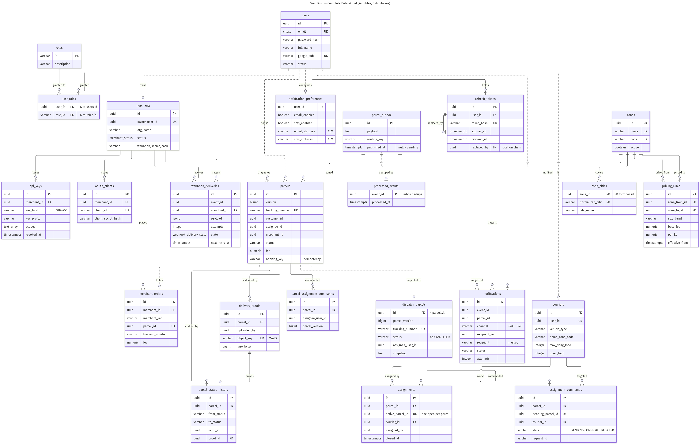

<details>
<summary>Diagram source — <code>er-02-full.mmd</code></summary>

```mermaid
---
title: SwiftDrop — Complete Data Model (24 tables, 6 databases)
---
erDiagram

    users ||--o{ user_roles : "granted"
    roles ||--o{ user_roles : "granted to"
    users ||--o{ refresh_tokens : "holds"
    refresh_tokens ||--o| refresh_tokens : "replaced_by"

    parcels ||--o{ parcel_status_history : "audited by"
    parcels ||--o{ delivery_proofs : "evidenced by"
    delivery_proofs ||--o| parcel_status_history : "proves"
    parcels ||--o{ parcel_assignment_commands : "commanded"

    merchants ||--o{ api_keys : "issues"
    merchants ||--o{ oauth_clients : "issues"
    merchants ||--o{ merchant_orders : "places"
    merchants ||--o{ webhook_deliveries : "receives"

    couriers ||--o{ assignments : "works"
    dispatch_parcels ||--o{ assignments : "assigned by"
    dispatch_parcels ||--o{ assignment_commands : "commanded"
    couriers ||--o{ assignment_commands : "targeted"

    zones ||--o{ zone_cities : "covers"
    zones ||--o{ pricing_rules : "priced from"
    zones ||--o{ pricing_rules : "priced to"

    users ||..o{ parcels : "books"
    users ||..o| merchants : "owns"
    users ||..o| couriers : "is"
    users ||..o{ notifications : "notified"
    users ||..o| notification_preferences : "configures"
    merchants ||..o{ parcels : "originates"
    zones ||..o{ parcels : "zoned"

    parcels ||..o| merchant_orders : "fulfils"
    parcels ||..o| dispatch_parcels : "projected as"
    parcels ||..o{ notifications : "subject of"

    parcel_outbox ||..o{ notifications : "triggers"
    parcel_outbox ||..o{ webhook_deliveries : "triggers"
    parcel_outbox ||..o| processed_events : "deduped by"

    users {
        uuid id PK
        citext email UK
        varchar password_hash
        varchar full_name
        varchar google_sub UK
        varchar status
    }
    roles {
        varchar id PK
        varchar description
    }
    user_roles {
        uuid user_id PK "FK to users.id"
        varchar role_id PK "FK to roles.id"
    }
    refresh_tokens {
        uuid id PK
        uuid user_id FK
        varchar token_hash UK
        timestamptz expires_at
        timestamptz revoked_at
        uuid replaced_by FK "rotation chain"
    }

    parcels {
        uuid id PK
        bigint version
        varchar tracking_number UK
        uuid customer_id
        uuid assignee_id
        uuid merchant_id
        varchar status
        numeric fee
        varchar booking_key "idempotency"
    }
    parcel_status_history {
        uuid id PK
        uuid parcel_id FK
        varchar from_status
        varchar to_status
        uuid actor_id
        uuid proof_id FK
    }
    delivery_proofs {
        uuid id PK
        uuid parcel_id FK
        uuid uploaded_by
        varchar object_key UK "MinIO"
        bigint size_bytes
    }
    parcel_outbox {
        uuid id PK
        text payload
        varchar routing_key
        timestamptz published_at "null = pending"
    }
    parcel_assignment_commands {
        uuid id PK
        uuid parcel_id FK
        uuid assignee_user_id
        bigint parcel_version
    }

    merchants {
        uuid id PK
        uuid owner_user_id UK
        varchar org_name
        merchant_status status
        varchar webhook_secret_hash
    }
    api_keys {
        uuid id PK
        uuid merchant_id FK
        varchar key_hash "SHA-256"
        varchar key_prefix
        text_array scopes
        timestamptz revoked_at
    }
    oauth_clients {
        uuid id PK
        uuid merchant_id FK
        varchar client_id UK
        varchar client_secret_hash
    }
    merchant_orders {
        uuid id PK
        uuid merchant_id FK
        varchar merchant_ref
        uuid parcel_id UK
        varchar tracking_number
        numeric fee
    }
    webhook_deliveries {
        uuid id PK
        uuid event_id
        uuid merchant_id FK
        jsonb payload
        integer attempts
        webhook_delivery_state state
        timestamptz next_retry_at
    }

    couriers {
        uuid id PK
        uuid user_id UK
        varchar vehicle_type
        varchar home_zone_code
        integer max_daily_load
        integer open_load
    }
    dispatch_parcels {
        uuid id PK "= parcels.id"
        bigint parcel_version
        varchar tracking_number UK
        varchar status "no CANCELLED"
        uuid assignee_user_id
        text snapshot
    }
    assignments {
        uuid id PK
        uuid parcel_id FK
        uuid active_parcel_id UK "one open per parcel"
        uuid courier_id FK
        uuid assigned_by
        timestamptz closed_at
    }
    assignment_commands {
        uuid id PK
        uuid parcel_id FK
        uuid pending_parcel_id UK
        uuid courier_id FK
        varchar state "PENDING CONFIRMED REJECTED"
        varchar request_id
    }
    processed_events {
        uuid event_id PK "inbox dedupe"
        timestamptz processed_at
    }

    zones {
        uuid id PK
        varchar name UK
        varchar code UK
        boolean active
    }
    zone_cities {
        uuid zone_id PK "FK to zones.id"
        varchar normalized_city PK
        varchar city_name
    }
    pricing_rules {
        uuid id PK
        uuid zone_from_id FK
        uuid zone_to_id FK
        varchar size_band
        numeric base_fee
        numeric per_kg
        timestamptz effective_from
    }

    notifications {
        uuid id PK
        uuid event_id
        uuid parcel_id
        varchar channel "EMAIL SMS"
        uuid recipient_ref
        varchar recipient "masked"
        varchar status
        integer attempts
    }
    notification_preferences {
        uuid user_id PK
        boolean email_enabled
        boolean sms_enabled
        varchar email_statuses "CSV"
        varchar sms_statuses "CSV"
    }
```

</details>

### 2.4 Ownership and boundaries

Because Mermaid's ER notation cannot group entities into packages, this diagram carries the service-boundary view: which service owns which tables, and every logical reference that crosses a database.

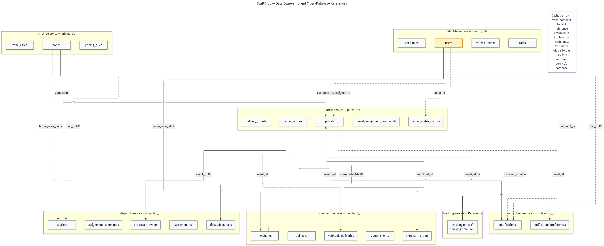

<details>
<summary>Diagram source — <code>er-03-ownership.mmd</code></summary>

```mermaid
---
title: SwiftDrop — Data Ownership and Cross-Database References
---
flowchart TB

    subgraph IDENT["identity-service — identity_db"]
        I1["users"]
        I2["roles"]
        I3["user_roles"]
        I4["refresh_tokens"]
    end

    subgraph PARCEL["parcel-service — parcel_db"]
        P1["parcels"]
        P2["parcel_status_history"]
        P3["delivery_proofs"]
        P4["parcel_outbox"]
        P5["parcel_assignment_commands"]
    end

    subgraph MERCH["merchant-service — merchant_db"]
        M1["merchants"]
        M2["api_keys"]
        M3["oauth_clients"]
        M4["merchant_orders"]
        M5["webhook_deliveries"]
    end

    subgraph DISP["dispatch-service — dispatch_db"]
        D1["couriers"]
        D2["dispatch_parcels"]
        D3["assignments"]
        D4["assignment_commands"]
        D5["processed_events"]
    end

    subgraph PRICE["pricing-service — pricing_db"]
        R1["zones"]
        R2["zone_cities"]
        R3["pricing_rules"]
    end

    subgraph NOTIF["notification-service — notification_db"]
        N1["notifications"]
        N2["notification_preferences"]
    end

    subgraph TRACK["tracking-service — Redis only"]
        T1["tracking:parcel:*<br/>tracking:timeline:*"]
    end

    I1 -.->|"customer_id, assignee_id"| P1
    I1 -.->|"actor_id"| P2
    I1 -.->|"owner_user_id UK"| M1
    I1 -.->|"user_id UK"| D1
    I1 -.->|"recipient_ref"| N1
    I1 -.->|"user_id PK"| N2

    P1 -.->|"parcel_id UK"| M4
    P1 -.->|"shared identity PK"| D2
    P1 -.->|"parcel_id"| N1
    P1 -.->|"tracking_number"| T1

    P4 -.->|"event_id"| N1
    P4 -.->|"event_id"| M5
    P4 -.->|"event_id PK"| D5

    R1 -.->|"zone code"| P1
    R1 -.->|"home_zone_code"| D1

    M1 -.->|"merchant_id"| P1

    classDef svc fill:#F8FAFC,stroke:#64748B,color:#0F172A
    classDef hub fill:#FEF3C7,stroke:#D97706,color:#0F172A
    class I2,I3,I4,P2,P3,P4,P5,M2,M3,M4,M5,D1,D2,D3,D4,D5,R1,R2,R3,N1,N2,T1,P1,M1 svc
    class I1 hub

    LEGEND["Dashed arrow = cross-database logical reference,<br/>enforced in application code only.<br/>No service holds a foreign key into<br/>another service's database."]

    style LEGEND fill:#FFFFFF,stroke:#94A3B8,color:#334155
```

</details>

| Service | Database | Tables |
|---|---|---|
| identity-service | `identity_db` | `users`, `roles`, `user_roles`, `refresh_tokens` |
| parcel-service | `parcel_db` | `parcels`, `parcel_status_history`, `delivery_proofs`, `parcel_outbox`, `parcel_assignment_commands` |
| merchant-service | `merchant_db` | `merchants`, `api_keys`, `oauth_clients`, `merchant_orders`, `webhook_deliveries` |
| dispatch-service | `dispatch_db` | `couriers`, `dispatch_parcels`, `assignments`, `assignment_commands`, `processed_events` |
| pricing-service | `pricing_db` | `zones`, `zone_cities`, `pricing_rules` |
| notification-service | `notification_db` | `notifications`, `notification_preferences` |
| tracking-service | Redis only | `tracking:parcel:*`, `tracking:timeline:*` (90-day TTL) |
| ai-assistant-service | none | in-memory conversations, 24-hour expiry |

Two asymmetries are visible in the migrations and are worth flagging as model drift:

1. `dispatch_parcels.status` has a check constraint that rejects `CANCELLED`, while `parcels.status` accepts it. A cancelled parcel therefore cannot be projected into the dispatch read model.
2. `parcels.pickup_zone` is `VARCHAR(80)` while its logical source `zones.code` is `VARCHAR(12)` — the consumer's column is wider than the producer's.

---

## 3. Architecture proposal

### 3.1 The proposal

**Microservices behind an API gateway that doubles as a backend-for-frontend, with a strict three-layer structure inside every service.**

Nine deployable units: eight Spring Boot services organised around business capabilities, and one Spring Cloud Gateway at the edge. A React single-page application is the only first-party client. Services communicate synchronously over HTTP for request/reply, and asynchronously through a RabbitMQ topic exchange for event notification.

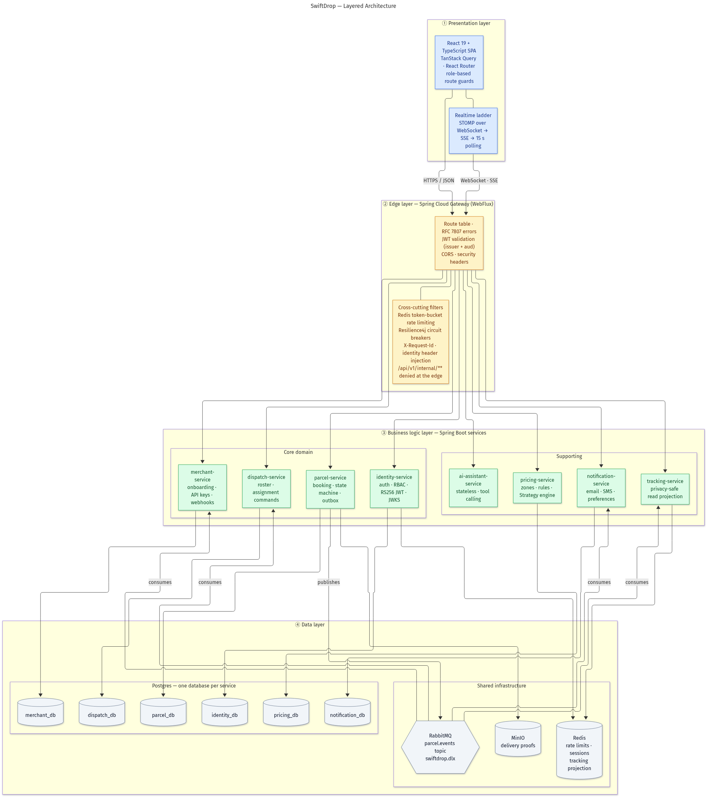

<details>
<summary>Diagram source — <code>arch-01-layers.mmd</code></summary>

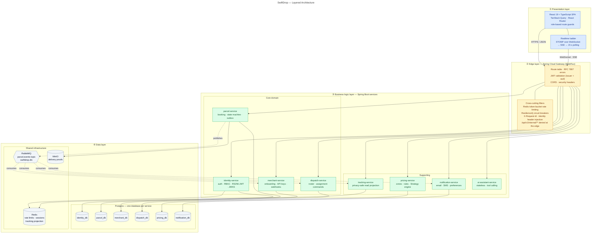

</details>

### 3.2 The layers

**① Presentation.** A React 19 + TypeScript SPA. It holds no business rules — route guards mirror the server's roles for user experience, but every decision is re-made server-side. Server state lives in TanStack Query rather than a client-side store, so the cache is the source of truth and live updates are applied by writing into it. The access token is held in memory only, never in `localStorage`.

**② Edge.** Spring Cloud Gateway on WebFlux. It is the only publicly reachable component and the single place where cross-cutting concerns are implemented: JWT validation (issuer *and* audience), CORS, security headers, Redis-backed token-bucket rate limiting, Resilience4j circuit breakers per route, request-id propagation, and identity header injection. It strips any client-supplied `X-User-Id` / `X-User-Roles` / `X-Merchant-Id` header and re-adds them only from a validated token, so a downstream service can trust them. `/api/v1/internal/**` is denied outright at the edge.

It also acts as a BFF: `GET /api/v1/dashboard/summary` fans out to three services and composes one response, so the SPA makes a single call instead of three.

**③ Business logic.** Eight services, each owning a bounded context. Internally every service follows the same package layering, which keeps the codebase navigable despite eight separate deployables:

```
api/          controllers, request/response DTOs, exception handlers
service/      business rules, transaction boundaries, orchestration
repository/   Spring Data interfaces
domain/       JPA entities and value objects
config/       security, messaging, caching
```

Dependencies point inward only: `api` depends on `service`, `service` depends on `repository` and `domain`. Controllers contain no business rules, and entities never leak past the service layer — every endpoint returns a DTO.

**④ Data.** Six PostgreSQL databases (one per service, schema-managed by Flyway with `ddl-auto: validate`), Redis for rate-limit buckets and the tracking projection, RabbitMQ for events, and MinIO for proof-of-delivery images.

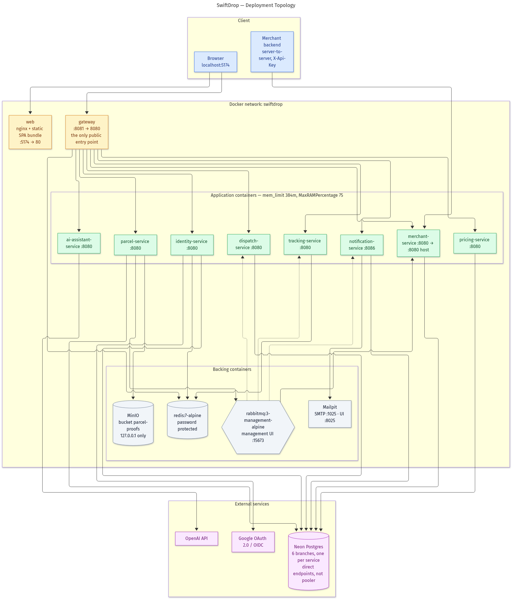

<details>
<summary>Diagram source — <code>arch-02-deployment.mmd</code></summary>

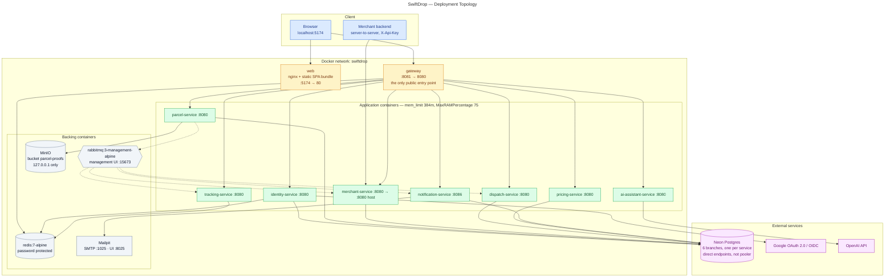

</details>

### 3.3 Justification

**Why the boundaries fall where they do.** Each service owns a capability that changes for its own reasons. Pricing rules change when commercial terms change; the parcel lifecycle changes when operations change; notification channels change when a provider changes. Splitting along these seams means a pricing change touches one deployable. The boundaries were derived from the domain, not from the layer diagram — there is no "controller service" or "database service".

**Why independent data stores.** Giving every service its own database is what makes the boundaries real. A shared schema would let any service reach into any table and the separation would erode within weeks. It also allows genuinely different storage choices: tracking-service needs a fast, expiring, read-optimised projection and uses Redis with a TTL, which would be awkward to justify inside a shared relational schema.

**Why a gateway.** Eight services each implementing CORS, rate limiting and circuit breaking would be eight chances to get it wrong. Centralising them means the browser sees one origin, and the identity-header contract is established in exactly one place.

**Why asynchronous events for fan-out.** A status change has four interested parties — dispatch, tracking, notification and merchant webhooks — and none of them should be able to fail or slow down a courier's status update. Publishing one event and letting consumers react keeps the write path short and lets a consumer be added without touching parcel-service. Synchronous calls are reserved for cases where the caller genuinely cannot proceed without the answer, such as needing an authoritative fee before persisting a parcel.

### 3.4 Alternatives considered, and the honest cost

**A modular monolith with the same internal boundaries would have been a defensible — arguably better — choice for a system at this stage.** It would preserve the package structure and the domain seams while removing most of the operational burden, and it could be split later once a specific service demonstrably needed independent scaling. The costs that microservices actually imposed here are visible in the code:

| Cost | Where it shows up |
|---|---|
| **No cross-service transactions** | Creating a merchant order writes to two databases through an HTTP call. Consistency is recovered with a transactional outbox, deterministic idempotency keys and compensating reads — all of which a single transaction would have given for free. |
| **Eventual consistency is now a user-visible concern** | The dispatch board and the tracking page are projections fed by events. They are correct eventually, and the UI has to tolerate the gap. |
| **Duplicated cross-cutting configuration** | Every service repeats JWT decoder and resource-server setup. A change to token validation is an eight-service change. |
| **Contracts are not compiler-checked** | §7.1 is a live bug where one service writes a JWT claim as `merchantId` and three others read `merchant_id`. In a single codebase this is a compile error; across services it is a runtime failure that type-checking cannot catch. Golden-file contract tests in `packages/common` exist precisely to claw some of this safety back. |
| **Operational surface** | Six databases, a broker, Redis, an object store and a mail server must all be running before the system works end to end. |

The mitigation actually applied is a shared contracts module (`packages/common`) holding event schemas, shared enums and error codes, with golden-file tests pinning the JSON shapes. It narrows the gap but does not close it — §7.1 is the proof.

---

## 4. Integration design

### 4.1 The map

Thick solid edges are synchronous request/reply. Dashed edges are asynchronous publish/subscribe through the broker.

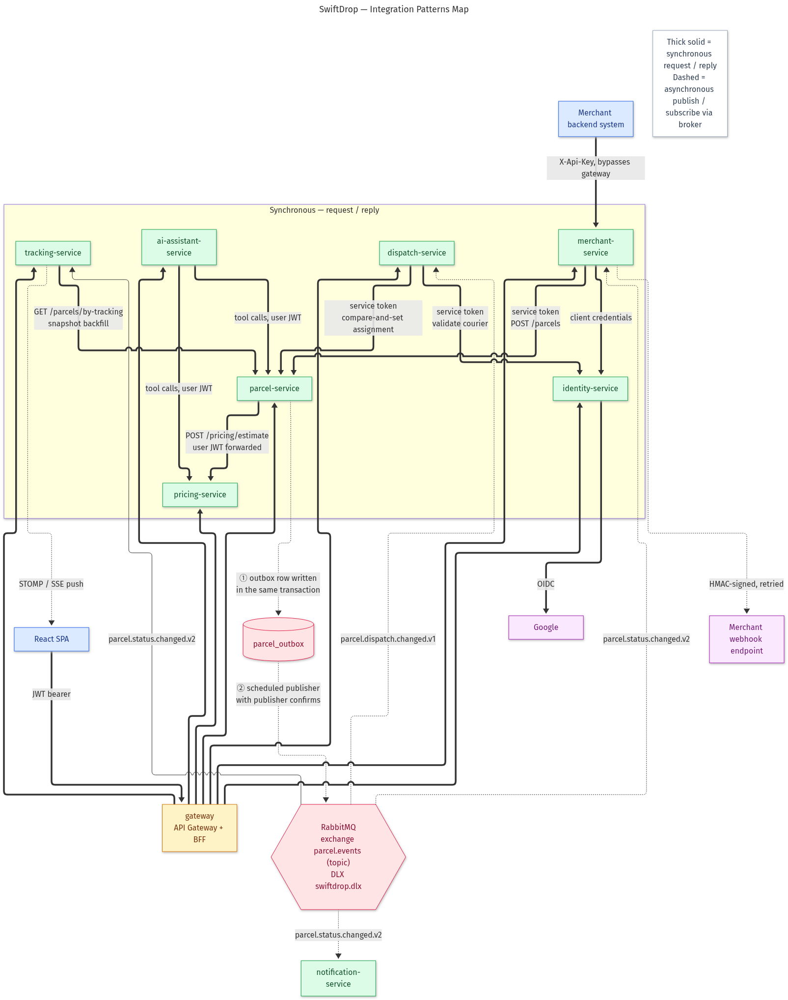

<details>
<summary>Diagram source — <code>int-01-patterns-map.mmd</code></summary>

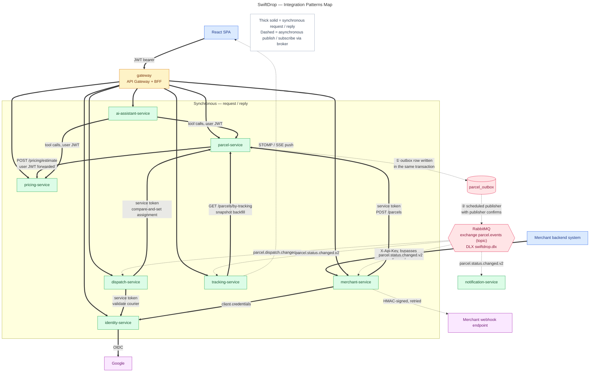

</details>

### 4.2 Patterns used, and why

| Pattern | Where it is used | Why this pattern |
|---|---|---|
| **Request/reply (synchronous)** | parcel → pricing; dispatch → identity and parcel; tracking → parcel; gateway → all | The caller cannot proceed without the answer. A parcel cannot be persisted before an authoritative fee exists, and a courier cannot be assigned before identity-service confirms the account is active and holds the `COURIER` role. |
| **Publish/subscribe** | `parcel.events` topic exchange — one producer, four consumers | A status change has several independent audiences. The producer should not know who they are, and a new consumer should not require a change to parcel-service. |
| **Message broker** | RabbitMQ topic exchange plus a `swiftdrop.dlx` dead-letter exchange | Durable, routable fan-out with retry and dead-lettering. Routing keys are versioned (`parcel.status.changed.v2`), so a schema change can run both versions side by side. |
| **Transactional outbox** | `parcel_outbox` written inside the business transaction; a scheduled publisher drains it | Removes the dual-write problem. The state change and the intent to publish commit atomically; if the broker is down the row simply stays unpublished and is retried. |
| **Idempotent consumer** | `processed_events` (dispatch), a Redis key with TTL (tracking), a unique constraint on event + channel + recipient (notification), an event + merchant lookup (merchant) | Publisher confirms give at-least-once delivery, so every consumer must tolerate a replay. Each service dedupes using whatever its own store makes cheap. |
| **Idempotency key** | `Idempotency-Key` header on booking; `(customer_id, booking_key)` unique constraint; a deterministic `m_<hash>` key for merchant orders | A retried booking returns the original parcel instead of creating a duplicate. Because the merchant key is derived from the merchant reference, a retry from the merchant's own system is safe too. |
| **CQRS / read-model projection** | `dispatch_parcels`; the Redis tracking projection | The dispatch board and the tracking page need fast reads with a different shape from the write model, without querying parcel-service on every page load. The tracking projection is deliberately privacy-reduced — city names and a courier's first name only, no addresses or phone numbers. |
| **API gateway / BFF** | Spring Cloud Gateway, plus the dashboard fan-out endpoint | One edge for authentication, CORS, rate limiting and circuit breaking; one composed response instead of three round trips. |
| **Circuit breaker** | Resilience4j on every gateway route, each with a fallback | Stops a sick upstream from consuming gateway threads and cascading into unrelated routes. |
| **Client credentials** | `POST /api/v1/auth/service-token`, used by dispatch-service and merchant-service | Privileged internal calls should not impersonate a user. Service tokens carry a `client_id` and a scope but no human roles, and `/api/v1/internal/**` endpoints authorise on exactly those claims. |
| **Token forwarding** | parcel → pricing; assistant → parcel and pricing | Where a call is made strictly on a user's behalf, forwarding their token preserves their authorisation rather than escalating to a service identity. |
| **Outbound webhook** | merchant-service → the merchant's endpoint, HMAC-signed | Merchants who cannot poll need push. The signature lets them verify authenticity; retries back off as `min(3600, 30 << (n−1))` seconds, and an SSRF guard requires a public HTTPS target. |
| **Fallback ladder** | STOMP over WebSocket → SSE → 15-second polling | Live tracking must survive proxies that break WebSockets. The client walks the ladder and reports which transport it landed on, so the UI can tell the user whether it is live or polling. |

### 4.3 Event topology and delivery guarantees

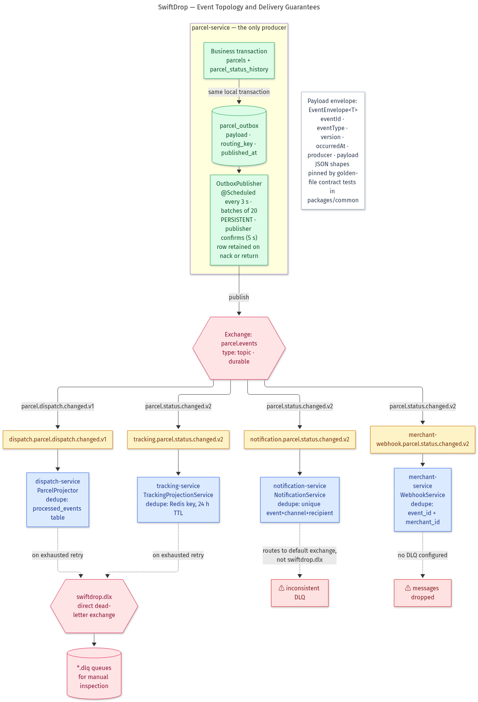

<details>
<summary>Diagram source — <code>int-02-event-topology.mmd</code></summary>

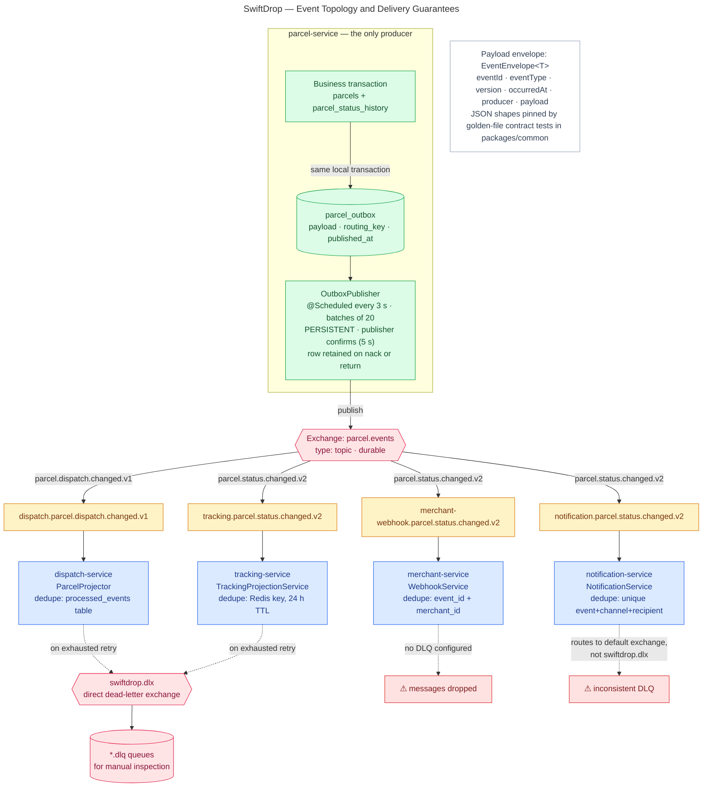

</details>

Every message is wrapped in a common envelope (`EventEnvelope<T>` in `packages/common`) carrying `eventId`, `eventType`, `version`, `occurredAt`, `producer` and the payload. The `eventId` is the deduplication key every consumer uses.

Naming is conventional and mechanical: routing keys are `<eventType>.v<version>`, and queues are `<consuming-service>.<routing-key>`, with `.dlq` appended for dead letters. Reading a queue name tells you who consumes it and what it carries.

The guarantee is **at-least-once**. The producer writes the outbox row in the business transaction, the publisher sends persistently and waits for a broker confirm before marking the row published, and on a nack or a return it stops the batch and leaves the row for the next cycle. Duplicates are therefore possible by design, which is why every consumer dedupes.

---

## 5. Sequence and activity diagrams

### 5.1 Creating a delivery

Two things in this flow are worth attention. First, the fee is quoted twice — once for display while the customer types, and again authoritatively inside the booking transaction. The browser's number is never trusted. Second, four writes and two outbox rows commit in a single local transaction, so an event can never be published for a parcel that failed to save, and a saved parcel can never silently fail to notify.

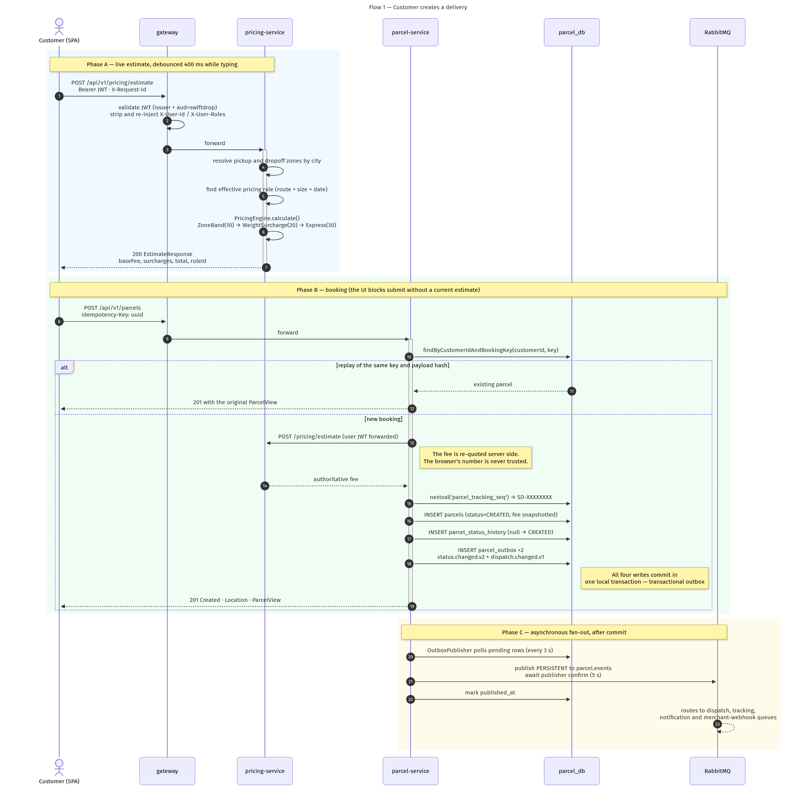

<details>
<summary>Diagram source — <code>seq-01-create-delivery.mmd</code></summary>

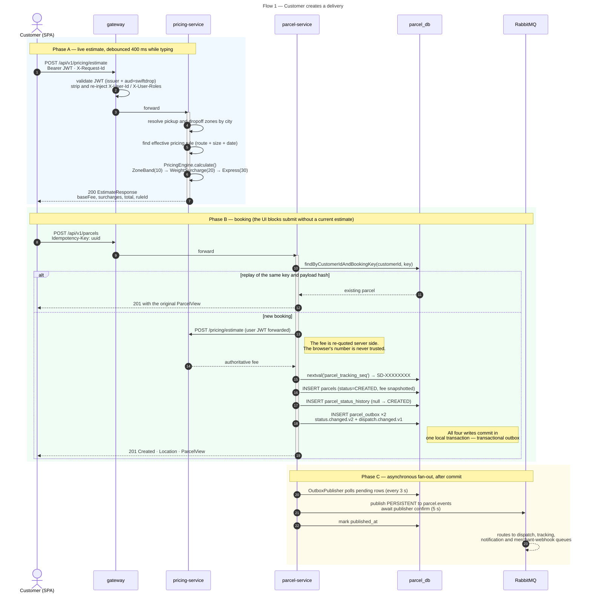

</details>

### 5.2 Merchant order creation via the API

The server-to-server path. The API key is never stored — only its SHA-256 hash and an 8-character prefix. Verification looks candidates up by prefix, filters by expiry and scope, and compares hashes in constant time to avoid leaking information through response timing.

Because no user is present, merchant-service obtains a short-lived service token from identity-service before calling parcel-service. The idempotency key it sends is *deterministic* — derived from the merchant id and the merchant's own reference — so a retry from the merchant's system reuses the same parcel rather than creating a second one.

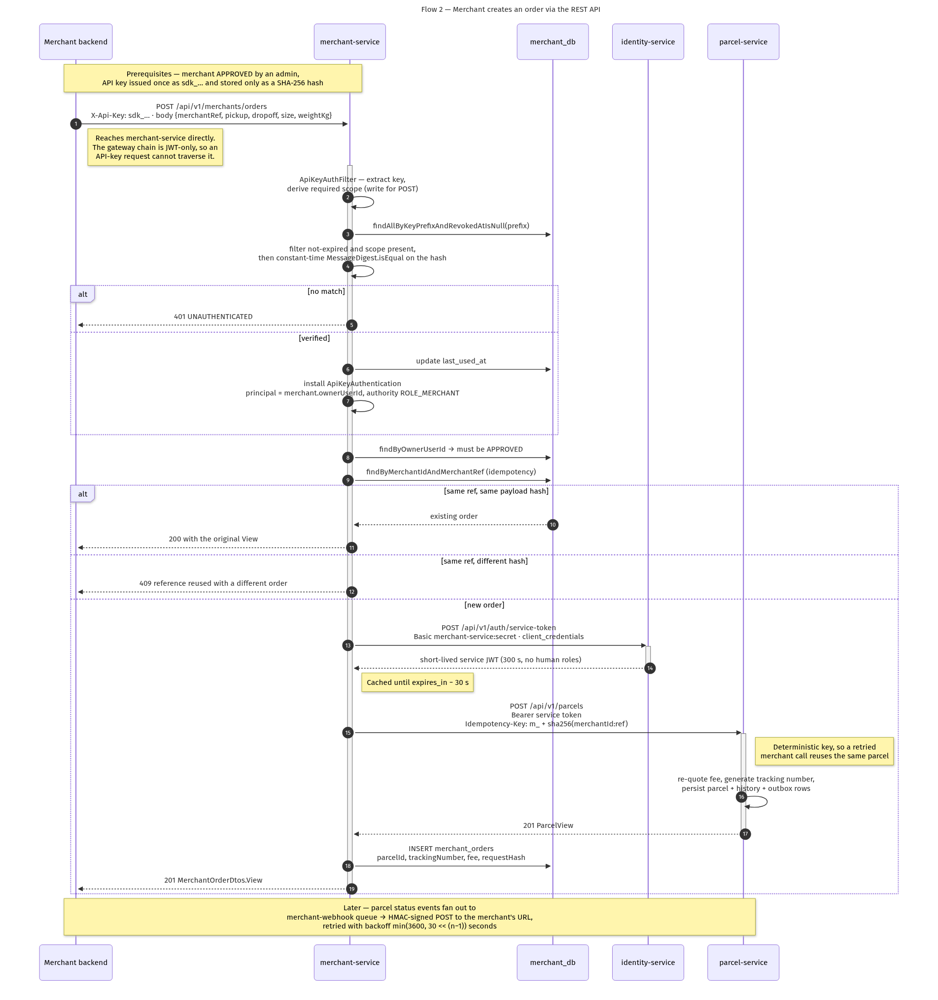

<details>
<summary>Diagram source — <code>seq-02-merchant-api-order.mmd</code></summary>

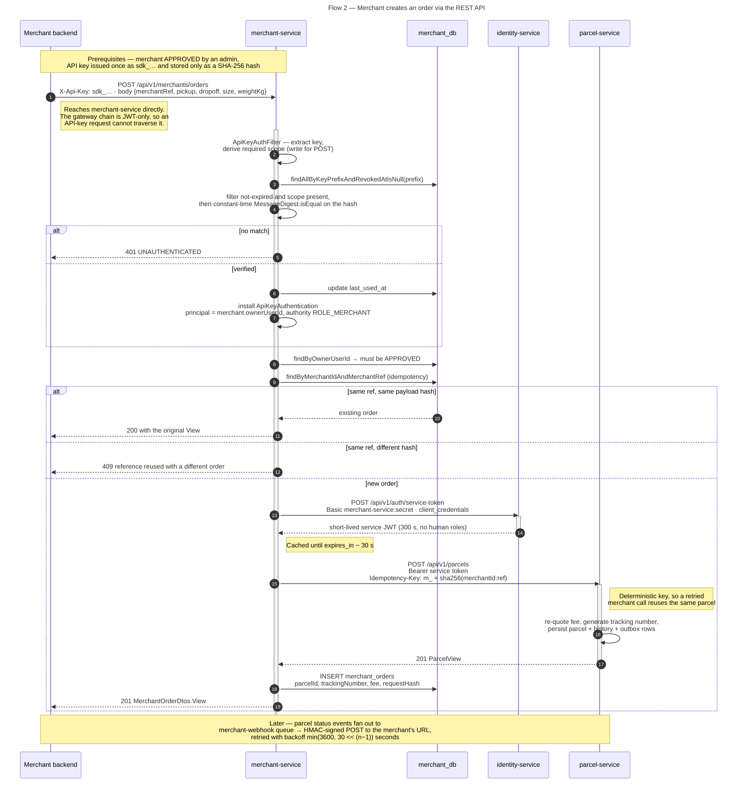

</details>

### 5.3 Courier status update triggering notifications

The clearest illustration of the publish/subscribe design: one status update fans out to three unrelated consumers, none of which the courier's request waits for.

Two deliberate orderings are visible. Proof of delivery is uploaded *before* the status change, so a failed upload leaves the parcel untouched and the courier can simply retry. And the notification recipient is taken from the event's `customerUserId` — the parcel's owner — not from `changedByUserId`, which is the courier who triggered it.

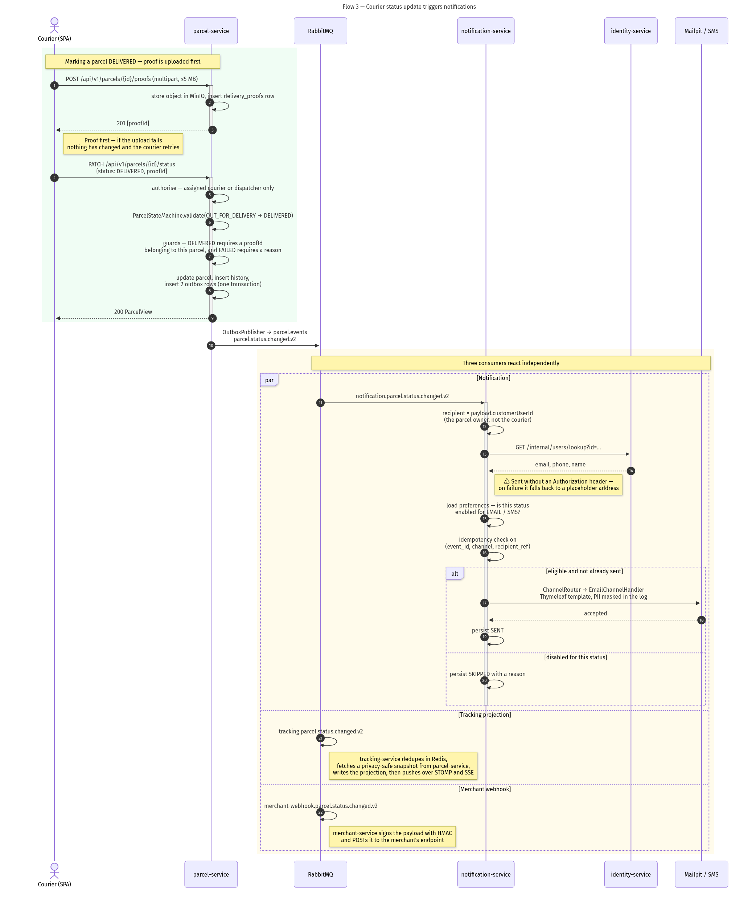

<details>
<summary>Diagram source — <code>seq-03-status-update-notification.mmd</code></summary>

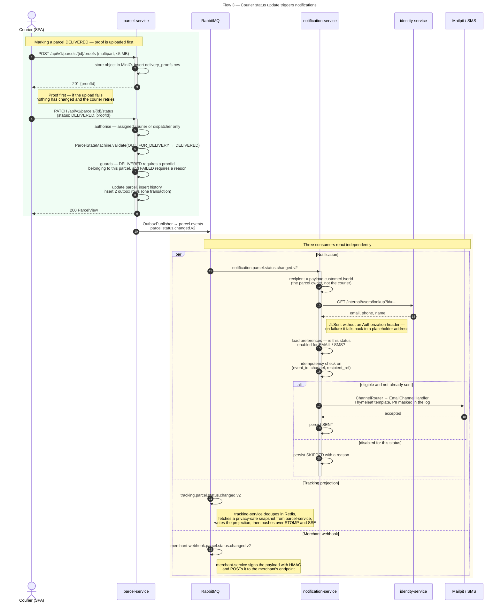

</details>

### 5.4 OAuth 2.0 login with Google

Authorization Code flow with PKCE. The browser is a public client and cannot hold a secret, so PKCE binds the authorization code to the client that requested it: the SPA generates a random verifier, sends only its SHA-256 hash, and must present the original verifier to redeem the code.

The defences worth naming: `state` is single-use and consumed atomically from Redis, so a replayed callback fails; the verifier is compared in constant time; the redirect URI is re-checked against the one recorded at authorization time; and the `id_token`'s issuer and audience are verified before any account is touched. An account provisioned through Google gets a null password hash, so password login against it can never succeed.

Refresh tokens rotate on every use and only their hashes are stored. Presenting an already-rotated token is treated as theft: the entire token family for that user is revoked.

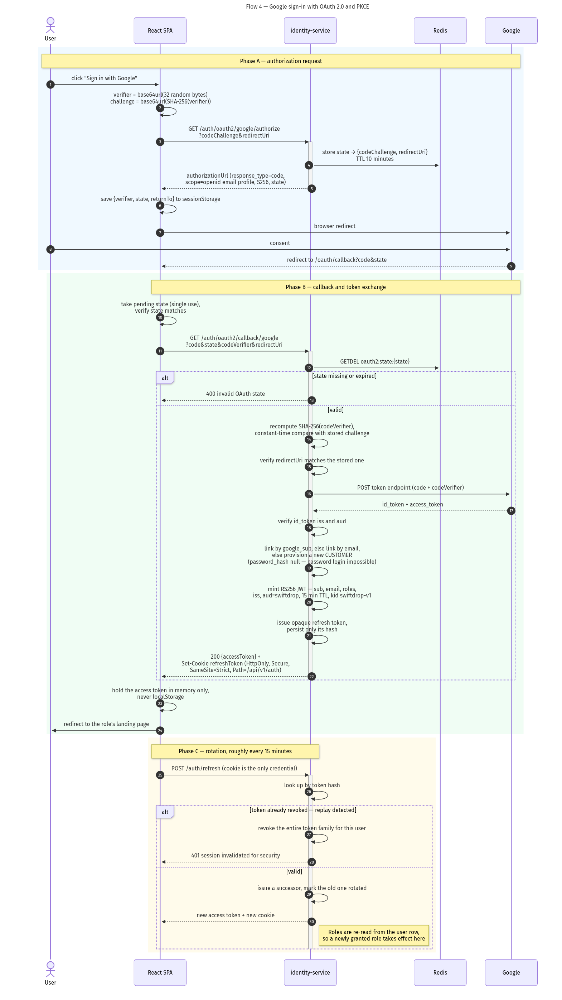

<details>
<summary>Diagram source — <code>seq-04-oauth-login.mmd</code></summary>

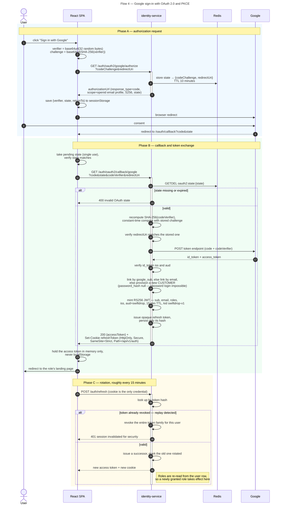

</details>

### 5.5 Parcel lifecycle

The activity view of the domain's central entity. The transitions are transcribed directly from `ParcelStateMachine.TRANSITIONS` — a single declarative table that every status change is validated against, rather than scattered conditionals.

Two properties matter. `FAILED` is **not** terminal: a failed delivery returns to `OUT_FOR_DELIVERY` for a reattempt, which is why the graph contains a cycle. And `CANCELLED` is reachable only from `CREATED`, so once a courier has collected a parcel the customer can no longer cancel it.

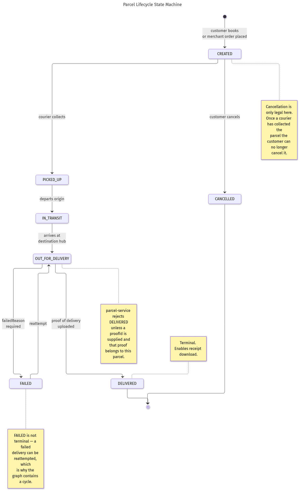

<details>
<summary>Diagram source — <code>act-01-parcel-lifecycle.mmd</code></summary>

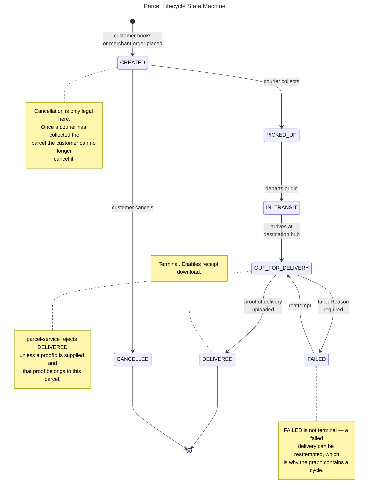

</details>

---

## 6. Design patterns and principles

### 6.1 Strategy — pricing

The clearest pattern application in the codebase. `PricingEngine` depends only on the `PricingStrategy` interface and receives every implementation as an injected list, sorted by each strategy's declared `order()`. Calculation reduces over that list, threading a breakdown through each strategy in turn.

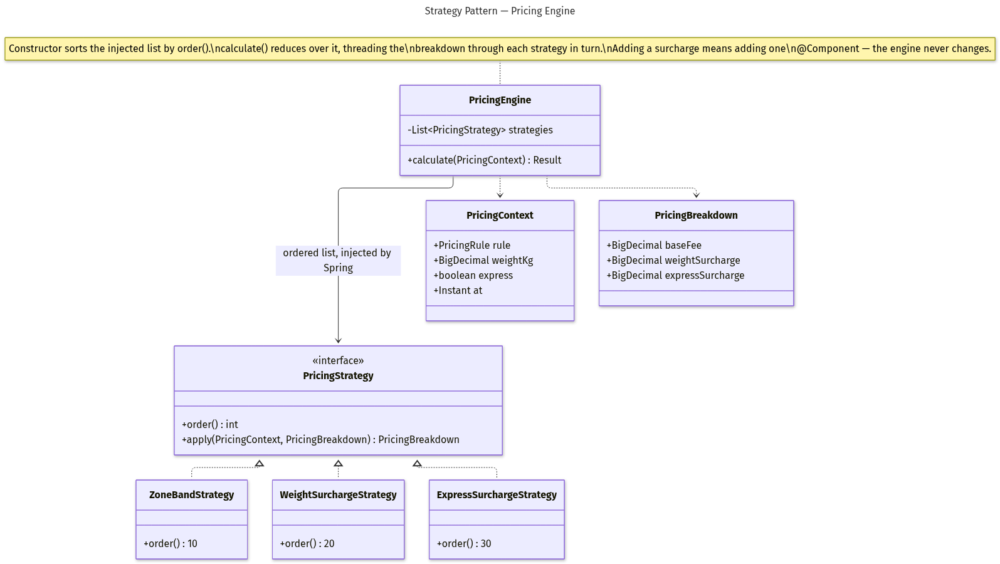

<details>
<summary>Diagram source — <code>pat-01-pricing-strategy.mmd</code></summary>

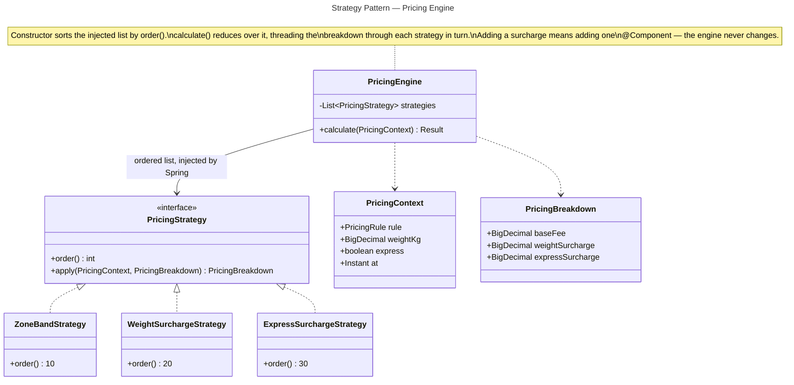

</details>

```java
public PricingEngine(List<PricingStrategy> strategies) {
    this.strategies = strategies.stream()
        .sorted(Comparator.comparingInt(PricingStrategy::order)).toList();
}

public Result calculate(PricingContext context) {
    PricingBreakdown breakdown = strategies.stream().reduce(PricingBreakdown.empty(),
        (current, strategy) -> strategy.apply(context, current), (left, right) -> right);
    ...
}
```

`ZoneBandStrategy` (order 10) sets the base fee, `WeightSurchargeStrategy` (20) charges only weight above the rule's included allowance, and `ExpressSurchargeStrategy` (30) adds a percentage. **Introducing a fuel surcharge means adding one `@Component` and nothing else** — `PricingEngine` does not change, and neither does any existing strategy.

The same shape appears again in notification-service, where `ChannelRouter` selects from an injected `List<NotificationChannelHandler>` by asking each whether it supports a channel. Adding SMS alongside email required no change to the router.

### 6.2 SOLID

| Principle | Where it holds | Evidence |
|---|---|---|
| **Single responsibility** | One bounded context per service; inside each, controllers handle HTTP, services hold rules, repositories handle persistence | `ParcelController` validates and delegates; `ParcelService` owns the transaction and the rules |
| **Open/closed** | The pricing engine and the notification channel router are open to new behaviour, closed to modification | §6.1 |
| **Liskov substitution** | Every `PricingStrategy` is interchangeable — the engine makes no assumption about which concrete strategy it holds | `PricingEngine.calculate` |
| **Interface segregation** | `PricingStrategy` has two methods; `ProofStorage` exposes only what parcel-service needs, so MinIO is swappable | `PricingStrategy.java`, `ProofStorage` / `MinioProofStorage` |
| **Dependency inversion** | High-level policy depends on abstractions the framework satisfies — the engine on the interface, services on Spring Data interfaces, parcel-service on a `PricingClient` interface rather than on an HTTP client | `HttpPricingClient` implements `PricingClient` |

### 6.3 Other patterns applied

| Pattern | Implementation | Purpose |
|---|---|---|
| **State machine** | `ParcelStateMachine` — a declarative `Map<ParcelStatus, Set<ParcelStatus>>` | Legal transitions are stated once, in a table a reader can check at a glance, instead of being spread across conditionals |
| **Repository** | Spring Data JPA interfaces throughout | Business code expresses intent (`findEffective(from, to, size, at)`) rather than SQL |
| **Transactional outbox** | `OutboxEvent` plus a scheduled `OutboxPublisher` | Atomic state change and event intent |
| **Observer / publish-subscribe** | `@RabbitListener` consumers | Services react to parcel events without the producer knowing them |
| **Chain of responsibility** | Spring Security filter chains; `ApiKeyAuthFilter` inserted ahead of the JWT filter; the gateway's ordered global filters | A request passes through independent, individually testable concerns |
| **Projection** | `ParcelProjector`, `RedisTrackingRepository` | Read models shaped for their consumer and reduced for privacy |
| **Builder** | Lombok `@Builder` on entities | Readable construction of entities with many optional fields |
| **DTO / assembler** | `*Dtos` classes and `View` records at every boundary | Entities never serialise directly, so the wire contract is deliberate and PII can be excluded |
| **Value object** | `TrackingNumber`, the embeddable `Address` | Validity is enforced at construction; an address is one concept, not six loose columns |
| **Optimistic locking** | `@Version` on `Parcel`, `Courier`, `Assignment`, `PricingRule` | Concurrent dispatcher edits conflict loudly instead of silently overwriting |

### 6.4 DRY

`packages/common` is the one place where cross-service contracts live: event payload records, the `EventEnvelope`, the exchange, queue and routing-key constants, the shared `Role`, `ParcelStatus` and `PackageSize` enums, and the `ErrorCode` catalogue behind RFC 7807 error responses. Queue names are *derived* from routing keys rather than written twice.

Golden-file tests pin each event's JSON shape, so a field rename that would break a consumer fails the producer's build.

The limit of this is worth stating: DRY holds for anything expressible as shared Java, but not for configuration. The JWT decoder setup is repeated in all eight services, and §7.1 is exactly the kind of defect that duplication allows.

### 6.5 Security practices

Not patterns in the Gang-of-Four sense, but deliberate and worth recording: API keys and refresh tokens are stored only as hashes; secret comparison is constant-time; recipient addresses are masked in notification logs; the tracking projection excludes addresses and phone numbers by construction; rate limiting uses Redis token buckets keyed by user or IP and fails open; and the gateway strips client-supplied identity headers before re-deriving them from a validated token.

---

## 7. Known gaps

Verifying this document against the implementation surfaced six defects. They are recorded here because the diagrams above describe the system as it actually behaves.

**7.1 — JWT claim name mismatch.** `identity-service` writes the merchant claim as `merchantId`; `parcel-service`, the gateway's identity filter and `tracking-service` all read `merchant_id`. Merchant-scoped operations performed with a real user token therefore cannot resolve a merchant. This is the concrete example cited in §3.4.

**7.2 — Dead bearer-token branch in merchant order creation.** `MerchantController.createOrder` tests `authentication instanceof Jwt`, but the authentication object is a `JwtAuthenticationToken` whose *principal* is the `Jwt`. The test never passes, so the user's token is never forwarded and even a browser-based merchant order falls through to the service-token path. Functionally benign today; wrong as written.

**7.3 — API-key requests cannot traverse the gateway.** The gateway's security chain is JWT-only with `anyExchange().authenticated()`, and has no API-key filter. A request carrying `X-Api-Key` is rejected at the edge, so the documented merchant REST integration only works against merchant-service directly. §5.2 draws it that way.

**7.4 — Unauthenticated identity lookup.** `notification-service` calls identity-service's internal lookup with no `Authorization` header. The endpoint requires a scoped service token, so the call fails and a catch-all fallback substitutes a synthetic `user-<prefix>@example.com` address — meaning notifications are dispatched to a placeholder rather than failing loudly.

**7.5 — Dashboard aggregates endpoints that do not exist.** The gateway's BFF endpoint calls `/summary` on parcel, dispatch and merchant. No such endpoint is implemented on any of them, so the dashboard always returns three `unavailable` sections.

**7.6 — Public tracking detail endpoint is not public.** The SPA calls `/api/v1/parcels/by-tracking/{tn}/details` as though it were anonymous, but parcel-service only permits `/by-tracking/*` without authentication.

---

## 8. Service-level design notes

Depth on the four services whose design was documented in detail during development. Sections §8.1–§8.4 were written by their respective owners and have been **reconciled against the implementation** while assembling this document; corrections are marked inline as `[corrected]`.

### 8.1 Notification service

**Owner:** Thiranjaya Siriwardhana (`@thirsturn`) — issues `NTF-1` … `NTF-4`

**Architecture and role.** An asynchronous, event-driven service responsible for customer and partner communication over email and SMS across the parcel lifecycle.

- **Broker integration.** Subscribes to the `parcel.events` topic exchange with queue `notification.parcel.status.changed.v2` bound to routing key `parcel.status.changed.v2`. `[corrected — the original note described the v1 queue and routing key, which are declared in the shared contracts but never bound]`
- **Dead-letter routing.** Unprocessable messages are diverted to a DLQ rather than blocking the consumer queue. Note that this service routes dead letters to the default exchange rather than the shared `swiftdrop.dlx` used by dispatch and tracking — see §7.

**Integration patterns and resilience (NTF-1).**

1. **Idempotency.** `notifications` carries a composite unique constraint:
   ```sql
   CONSTRAINT uq_event_channel_recipient UNIQUE (event_id, channel, recipient_ref)
   ```
   Duplicate events are detected before dispatch and skipped, so no duplicate email or SMS is sent.
2. **Identity resolution.** The service consumes only identifiers from events, never raw PII, and resolves contact details just-in-time from identity-service via `GET /api/v1/internal/users/lookup?id={uuid}` with a resilient fallback. `[corrected — parameter is id, not userId]` The recipient is the parcel's owner, taken from the event's `customerUserId`, not the actor who triggered the change. `[corrected]`
3. **Scheduled exponential backoff.** `NotificationRetryScheduler` retries `FAILED` notifications with a delay of 2^attempts seconds, capped at five attempts.

**Channel strategy and the open-closed principle (NTF-3).** Delivery follows the Strategy pattern. Business logic depends on the `NotificationChannelHandler` interface rather than on concrete delivery classes:

- `EmailChannelHandler` sends responsive multipart HTML via `EmailNotificationService`.
- `MockSmsChannelHandler` writes masked SMS logs, enabled by `@ConditionalOnProperty(name = "app.notification.sms.provider", havingValue = "mock", matchIfMissing = true)`. A real provider such as Twilio or Dialog can be dropped in as a Spring bean without touching listeners or business logic.
- `ChannelRouter` dispatches each request to the matching strategy bean.

This is the same shape as the pricing engine in §6.1.

**Email channel, templates and Mailpit (NTF-2).** Mailpit runs in `infra/docker-compose.yml` on SMTP port 1025 with a web UI on 8025. Status-specific Thymeleaf templates with plain-text alternatives live in `templates/email/`: `booking-confirmed.html` (`CREATED`), `picked-up.html`, `in-transit.html`, `out-for-delivery.html`, `delivered.html` (links to the receipt PDF) and `delivery-failed.html` (cause plus re-attempt notice). `NotificationRenderer` is verified by golden-file tests asserting zero unresolved `${...}` tokens.

**User preferences (NTF-3).** `notification_preferences` stores per-user delivery choices, exposed at `GET` and `PUT /api/v1/notifications/preferences`, with the caller resolved from the gateway-injected `X-User-Id` header. `[corrected — no userId query parameter]` Defaults: email enabled for all statuses; SMS restricted to `OUT_FOR_DELIVERY` and `DELIVERED`. A disabled channel records the row as `SKIPPED` with a reason rather than attempting delivery. `NOTIFICATIONS_ENABLED=false` is a global kill switch.

**PII hygiene and security (NTF-4).** Raw email addresses and phone numbers are never stored in plaintext. `recipient_ref` holds the user UUID; the `recipient` column stores a masked form for audit (`thiran@gmail.com` → `th****@gmail.com`, `+94771234567` → `+947****4567`). Raw contacts are resolved just-in-time at send and retry. A Logback `CompositeConverter` registered as `%maskPii` sanitises RFC 5322 emails and international phone numbers across every logger statement, so container stdout cannot leak PII.

**Delivery logs and admin API (NTF-4).**

- `GET /api/v1/notifications` — paginated log filterable by `status`, `channel`, `from`, `to`, with standard Spring Data paging (default `size=20, sort=createdAt,desc`). Filtering uses dynamic criteria queries via `NotificationLogSpecifications` and `JpaSpecificationExecutor`.
- `GET /api/v1/notifications/{trackingNumber}` — chronological audit trail for one parcel.
- `POST /api/v1/notifications/{id}/resend` — immediate re-dispatch; resolves live recipient details just-in-time, routes through `ChannelRouter`, increments `attempts` and updates `status` and `sentAt`.
- `GET /api/v1/notifications/me` — history for the authenticated user, resolved from `X-User-Id`.

### 8.2 Identity and authentication service

**Owner:** Amandi Arangala (`@AmandiArangala`) — issues `IDN-1` … `IDN-4`

**Architecture and role.** The central authority for authentication, token issuance and user management. Access tokens are RS256-signed JWTs; refresh tokens are cryptographically random opaque values held in HTTP-only cookies. Tokens are signed with an RSA private key (`IDENTITY_JWT_PRIVATE_KEY`) and the public key is published at `GET /.well-known/jwks.json`, so the gateway and every resource server verify independently — no shared secret, and no network call to identity-service per request.

**Access token contract.** Lifetime 15 minutes (900 s), algorithm RS256, header `{"alg":"RS256","typ":"JWT","kid":"swiftdrop-v1"}`.

| Claim | Type | Description |
|---|---|---|
| `sub` | UUID string | User identifier |
| `roles` | string[] | Roles from the shared `Role` enum |
| `email` | string | Verified address, lowercased |
| `merchantId` | UUID string, optional | Associated merchant — **see §7.1: consumers read `merchant_id`** |
| `iss` | string | Issuer URL |
| `aud` | string[] | `["swiftdrop"]` |
| `iat` / `exp` | numericDate | Issued-at and expiry (`iat + 900`) |

**JWKS and downstream configuration.** The JWKS endpoint is public and cached for 24 hours (`Cache-Control: max-age=86400, public`). Downstream services configure:

```yaml
spring:
  security:
    oauth2:
      resourceserver:
        jwt:
          jwk-set-uri: ${IDENTITY_JWKS_URI:http://identity-service:8080/.well-known/jwks.json}
```

and map the `roles` claim onto Spring authorities:

```java
var roles = new JwtGrantedAuthoritiesConverter();
roles.setAuthoritiesClaimName("roles");
roles.setAuthorityPrefix("ROLE_");

var converter = new JwtAuthenticationConverter();
converter.setJwtGrantedAuthoritiesConverter(roles);
```

This block is repeated in all eight services — the duplication noted in §3.4.

**Refresh token lifecycle, rotation and replay mitigation.** A 256-bit opaque URL-safe token, persisted only as a SHA-256 digest in `refresh_tokens.token_hash`, with a 7-day TTL. On `POST /api/v1/auth/refresh` the service issues a new access token and a new refresh token, atomically marks the presented token revoked and records `replaced_by`, forming a rotation chain. Presenting an already-revoked token is treated as theft: a security alert is logged, **the entire token family for that user is revoked**, and the request is rejected with `401`. Rotating for a `SUSPENDED` account returns `403`.

**Logout and cookie transport.** The `refreshToken` cookie is scoped `Path=/api/v1/auth`, `HttpOnly` (blocks XSS extraction), `Secure` (HTTPS only) and `SameSite=Strict` (blocks CSRF). `POST /api/v1/auth/logout` revokes the token and clears the cookie with `Max-Age=0`; it is idempotent, returning `204` even when the cookie is absent.

**Credential hygiene and timing defence (IDN-1).** BCrypt at work factor 10. A missing email still executes a constant-time dummy BCrypt verification, so account enumeration cannot be inferred from response timing, and invalid email and invalid password return an identical `401 INVALID_CREDENTIALS` problem document. A Redis token bucket caps authentication at five failed attempts per email per minute, returning `429 RATE_LIMITED`.

### 8.3 Dispatch service

**Security and concurrency verification.** `DispatchAuthorizationTest` verifies signed JWT claims, anonymous `401`, `CUSTOMER` `403`, courier ownership (`404` when querying another courier), and rejection of spoofed identity headers and query parameters. `AssignmentConcurrencyTest` proves capacity limits and unique-assignment protection against a real PostgreSQL instance — the `active_parcel_id` nullable-unique constraint described in §2.3. See `services/dispatch-service/README.md` for API contracts, service authentication, pending command recovery and DLQ behaviour.

### 8.4 Pricing service

**Pricing strategies and the open-closed principle.** Pricing follows an ordered Strategy chain; `PricingEngine` depends only on the strategy interface, so a new contribution is added without modifying the engine. The class diagram and a full discussion are in [§6.1](#61-strategy--pricing).

`ZoneBandStrategy` selects the rule's base fee, `WeightSurchargeStrategy` charges only weight above the configured included allowance, and `ExpressSurchargeStrategy` adds the configured percentage. Contributions and totals are LKR `BigDecimal` values rounded to two decimals, `HALF_UP`. See `services/pricing-service/README.md` for endpoint and deployment detail.

---

*Every diagram in this document ships as source (`.mmd` / `.puml`) plus rendered `.png` and `.svg` in [`docs/diagrams/`](./diagrams/).*
