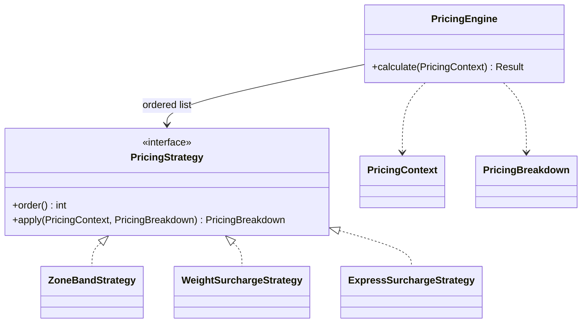

# SwiftDrop — System Design & Architecture Pack

> **Enterprise Application Development (EAD) Project**  
> **Team SwiftDrop** | University of Moratuwa

---

## 1. Notification Service (`services/notification-service`)
**Owner:** Thiranjaya Siriwardhana (`@thirsturn`)  
**Assigned Issues:** `[NTF-1]`, `[NTF-2]`, `[NTF-3]`, `[NTF-4]`

### 1.1 Architecture & Role
The **Notification Service** is an asynchronous, event-driven microservice in the SwiftDrop ecosystem responsible for customer and partner communication via Email and SMS across parcel lifecycle states (`CREATED`, `PICKED_UP`, `IN_TRANSIT`, `OUT_FOR_DELIVERY`, `DELIVERED`, `FAILED`).

- **Broker Integration:** Subscribes to RabbitMQ topic exchange `parcel.events` with queue `notifications.parcel-status-changed` bound to routing key `parcel.status.changed.v1`.
- **Dead Letter Routing:** Unprocessable / poison messages are diverted to DLQ `notifications.parcel-status-changed.dlq` without blocking the consumer queue.

---

### 1.2 Integration Patterns & Resilience (NTF-1)
1. **Idempotency Strategy:**
   - Database table `notifications` enforces a composite unique constraint:
     ```sql
     CONSTRAINT uq_event_channel_recipient UNIQUE (event_id, channel, recipient_ref)
     ```
   - Duplicate events are detected prior to dispatch and safely skipped with no duplicate emails or SMS messages dispatched.
2. **Identity Resolution:**
   - Consumes only `actorId` / `parcelId` from events (never raw PII).
   - Resolves email and phone securely via internal REST client to Identity Service:
     `GET /api/v1/internal/users/lookup?userId={uuid}` with offline resilient fallback.
3. **Scheduled Exponential Backoff Retry:**
   - A background `@Scheduled` worker (`NotificationRetryScheduler`) retries notifications with status `FAILED`.
   - Exponential delay: $2^{\text{attempts}}$ seconds, capping at 5 maximum attempts.

---

### 1.3 Channel Strategy & Open-Closed Principle (NTF-3)
The notification delivery architecture adheres strictly to the **Strategy Pattern** and **Open-Closed Principle (OCP)**:
- **`NotificationChannelHandler` Interface:**
  Core notification workflows depend on `NotificationChannelHandler` rather than concrete delivery classes.
- **Implementations:**
  - `EmailChannelHandler`: Dispatches responsive multipart HTML emails via `EmailNotificationService`.
  - `MockSmsChannelHandler`: Dispatches masked SMS logs. Pluggable and conditionally enabled via:
    `@ConditionalOnProperty(name = "app.notification.sms.provider", havingValue = "mock", matchIfMissing = true)`.
    Real SMS providers (e.g. Twilio, Dialog) can be dropped in as Spring beans without altering listeners or business logic.
- **`ChannelRouter`:**
  Dispatches notification requests dynamically to the matching channel strategy bean.

---

### 1.4 Email Channel, Templates & Mailpit (NTF-2)
- **Local Infrastructure:**
  Mailpit (`axllent/mailpit`) is integrated in `infra/docker-compose.yml` on SMTP port `1025` and Web UI port `8025`.
- **Thymeleaf Template Engine:**
  Status-specific responsive HTML email templates with plain-text alternatives in `templates/email/`:
  1. `booking-confirmed.html` (`CREATED`): Shows tracking number, fee snapshot, and tracking button.
  2. `picked-up.html` (`PICKED_UP`): Courier confirmation and transit link.
  3. `in-transit.html` (`IN_TRANSIT`): Live tracking portal button.
  4. `out-for-delivery.html` (`OUT_FOR_DELIVERY`): Arrival notice.
  5. `delivered.html` (`DELIVERED`): Direct link to delivery receipt PDF (`/api/v1/parcels/{tn}/receipt`).
  6. `delivery-failed.html` (`FAILED`): Failure cause and scheduled re-attempt notice.
- **`NotificationRenderer` Component:** Decoupled template rendering verified with golden-file unit tests ensuring zero unresolved `${...}` tokens.

---

### 1.5 User Notification Preferences (NTF-3)
- Database table `notification_preferences` stores user delivery preferences.
- REST Endpoints:
  - `GET /api/v1/notifications/preferences?userId={uuid}`
  - `PUT /api/v1/notifications/preferences`
- **Default Policy:**
  - Email: Enabled for all statuses.
  - SMS: Enabled strictly for `OUT_FOR_DELIVERY` and `DELIVERED`.
  - Disabling SMS in preferences records rows as `SKIPPED` without delivery attempts.
- **Global Kill Switch:**
  Supported via `NOTIFICATIONS_ENABLED=false` for emergency outage suppression or testing.

---

### 1.6 PII Hygiene & Security (NTF-4)
- **Zero-Raw-PII in Database (`notifications.recipient`):**
  - Raw email addresses and phone numbers are **never stored plaintext** in PostgreSQL.
  - The `recipient_ref` (UUID) references the user in Identity Service.
  - The `recipient` column stores masked identifiers for audit/admin tracking:
    - Emails: `thiran@gmail.com` $\rightarrow$ `th****@gmail.com` via `PiiMaskingConverter.maskEmail(...)`.
    - Phone Numbers: `+94771234567` $\rightarrow$ `+947****4567` via `smsProvider.maskPhoneNumber(...)`.
  - At delivery and retry time, raw contacts are securely resolved just-in-time via `IdentityClient.lookupUser(recipientRef)`.
- **Logback PII Redaction Filter (`logback-spring.xml` + `PiiMaskingConverter`):**
  - Custom Logback `CompositeConverter<ILoggingEvent>` registered as `%maskPii`.
  - Console and container stdout automatically sanitize regex patterns for RFC 5322 emails and international/local phone numbers across all logger statements.
- **Credential Hygiene:**
  - Passwords, API secrets, and raw personal identifiers are strictly excluded from git tracking, logs, and database tables.

---

### 1.7 Delivery Logs & Admin Query API (NTF-4)
- **Admin Paginated Delivery Log Endpoint:**
  - `GET /api/v1/notifications`
  - **Query Parameters:**
    - `status` (`Optional<NotificationStatus>`): e.g. `SENT`, `FAILED`, `SKIPPED`, `PENDING`
    - `channel` (`Optional<NotificationChannel>`): e.g. `EMAIL`, `SMS`
    - `from` (`Optional<Instant>`): ISO-8601 start timestamp
    - `to` (`Optional<Instant>`): ISO-8601 end timestamp
    - `page`, `size`, `sort`: Standard Spring Data pagination (defaults to `size=20, sort=createdAt,desc`)
  - **Filtering Engine:** Powered by dynamic criteria queries in `NotificationLogSpecifications` combined with `JpaSpecificationExecutor`.
- **Parcel Notification History:**
  - `GET /api/v1/notifications/{trackingNumber}`: Chronological delivery audit trail for a specific tracking number.
- **Manual Resend Trigger:**
  - `POST /api/v1/notifications/{id}/resend`: Triggers immediate re-dispatch of a notification by ID.
  - Resolves live unmasked recipient details just-in-time via `IdentityClient` and routes dynamically through `ChannelRouter`.
  - Increments `attempts`, updates `status` (`SENT` or `FAILED`), and sets `sentAt` timestamp upon successful transmission.
- **User Notification History:**
  - `GET /api/v1/notifications/me`: Retrieves notification delivery history for the currently authenticated user (`recipientRef`).
  - Supports resolution via `X-User-Id` gateway header or `userId` query parameter.

---

## 2. Identity & Authentication Service (`services/identity-service`)
**Owner:** Amandi Arangala (`@AmandiArangala`)  
**Assigned Issues:** `[IDN-1]`, `[IDN-2]`, `[IDN-3]`, `[IDN-4]`

### 2.1 Architecture & Role
The **Identity & Authentication Service** is the central authority for authentication, token issuance, cryptographic verification, and user management across the SwiftDrop microservices ecosystem.
- **Stateless Authorization:** Issues RS256-signed JSON Web Tokens (JWT) for access authentication and manages cryptographically secure opaque refresh tokens stored in HTTP-only cookies.
- **Asymmetric Cryptography:** Signs access tokens using an RSA private key (`IDENTITY_JWT_PRIVATE_KEY`) and publishes public keys via a standard JWKS endpoint (`GET /.well-known/jwks.json`), allowing the API Gateway and downstream resource servers to independently verify token validity without shared secrets or network calls per request.

---

### 2.2 RS256 JWT Access Token Contract (§4.3)
All microservices authenticate inbound requests by validating the RS256 Bearer JWT.

- **Token Lifetime:** 15 minutes (`900` seconds).
- **Algorithm:** `RS256` (RSA Signature with SHA-256).
- **Header:**
  ```json
  {
    "alg": "RS256",
    "typ": "JWT",
    "kid": "swiftdrop-v1"
  }
  ```
- **Standard Claims (§4.3):**
  | Claim | Type | Description | Example |
  |---|---|---|---|
  | `sub` | `string` (UUID) | Unique user identifier | `"c6891141-b656-403b-a0c9-e144b24836ed"` |
  | `roles` | `string[]` | Assigned system roles from `lk.ac.mrt.swiftdrop.contracts.domain.Role` | `["CUSTOMER"]` |
  | `email` | `string` | User's verified email address (lowercased) | `"amandi.arangala@swiftdrop.lk"` |
  | `merchantId` | `string` (UUID, optional) | Associated merchant ID for `MERCHANT_ADMIN` users | `"8f192b9d-4e94-4d82-b7e3-0c46b5a8e102"` |
  | `iss` | `string` | Token issuer URL | `"http://identity-service:8080"` |
  | `aud` | `string[]` | Token audience | `["swiftdrop"]` |
  | `iat` | `numericDate` | Issuance timestamp (epoch seconds) | `1700000000` |
  | `exp` | `numericDate` | Expiration timestamp (`iat + 900`) | `1700000900` |

---

### 2.3 Public JWKS & Downstream Resource Server Configuration
Downstream services (Gateway, Parcel, Pricing, Dispatch, Tracking, etc.) configure Spring Security OAuth 2.0 Resource Server to validate tokens using the JWKS URL without contacting the Identity database.

#### JWKS Endpoint:
- **URL:** `GET /.well-known/jwks.json`
- **Security:** Public, unauthenticated.
- **Caching:** `Cache-Control: max-age=86400, public` (24-hour cache TTL).
- **Example Response:**
  ```json
  {
    "keys": [
      {
        "kty": "RSA",
        "e": "AQAB",
        "use": "sig",
        "kid": "swiftdrop-v1",
        "alg": "RS256",
        "n": "u1P..."
      }
    ]
  }
  ```

#### Downstream Service `application.yaml` Configuration:
```yaml
spring:
  security:
    oauth2:
      resourceserver:
        jwt:
          jwk-set-uri: ${IDENTITY_JWKS_URI:http://identity-service:8080/.well-known/jwks.json}
```

#### Downstream Role Converter Mapping:
```java
@Bean
public SecurityFilterChain securityFilterChain(HttpSecurity http) throws Exception {
    var roles = new JwtGrantedAuthoritiesConverter();
    roles.setAuthoritiesClaimName("roles");
    roles.setAuthorityPrefix("ROLE_");

    var converter = new JwtAuthenticationConverter();
    converter.setJwtGrantedAuthoritiesConverter(roles);

    return http
            .sessionManagement(s -> s.sessionCreationPolicy(SessionCreationPolicy.STATELESS))
            .oauth2ResourceServer(oauth -> oauth.jwt(jwt -> jwt.jwtAuthenticationConverter(converter)))
            .build();
}
```

---

### 2.4 Refresh Token Lifecycle, Atomic Rotation & Replay Mitigation (§4.3)
- **Token Format:** Cryptographically strong 256-bit opaque random token (URL-safe Base64 encoded).
- **Storage:** Persisted exclusively as SHA-256 digests in PostgreSQL (`refresh_tokens.token_hash`). Raw tokens are never logged or persisted.
- **TTL:** 7 days (`604800` seconds).
- **Atomic Rotation (`POST /api/v1/auth/refresh`):**
  - Consumes `refreshToken` cookie.
  - Generates a new RS256 access token and a new refresh token.
  - Atomically marks the presenting refresh token as revoked (`revoked_at = NOW()`) and sets `replaced_by = new_token_id`.
  - Sets the new rotated refresh token in the response cookie.
- **Automatic Replay Attack Detection:**
  - If a client presents an already revoked refresh token (indicating token theft or replay), the service flags a security alert, **immediately revokes the entire token family/chain for that user**, and rejects the request with HTTP `401 Unauthorized` (`ErrorCode.UNAUTHENTICATED`).
- **Account Suspension Check:**
  - Attempting to rotate tokens for an account with status `SUSPENDED` is rejected with HTTP `403 Forbidden` (`ErrorCode.ACCESS_DENIED`).

---

### 2.5 Logout & Cookie Transport Security
- **Cookie Security Policy:**
  - `Name`: `refreshToken`
  - `Path`: `/api/v1/auth` (covers `/api/v1/auth/refresh` and `/api/v1/auth/logout`)
  - `HttpOnly`: `true` (prohibits JavaScript access; mitigates XSS token extraction)
  - `Secure`: `true` (enforces HTTPS transmission)
  - `SameSite`: `Strict` (prohibits cross-site request forgery attacks)
- **Logout Endpoint (`POST /api/v1/auth/logout`):**
  - Revokes the presenting refresh token in the database.
  - Clears the cookie from the user's browser by emitting `Set-Cookie: refreshToken=; Max-Age=0; Path=/api/v1/auth; HttpOnly; Secure; SameSite=Strict`.
  - Idempotent: returns HTTP `204 No Content` even if the cookie is expired or absent.

---

### 2.6 Credential Hygiene & Anti-Timing Attack Defense (IDN-1)
- **BCrypt Password Hashing:** BCrypt work factor `10` (`2^10 = 1024` rounds) using `SecureRandom`.
- **Anti-Timing Attack Protection:**
  - Missing email lookups execute a constant-time pre-computed dummy BCrypt hash verification to eliminate side-channel enumeration attacks.
  - Invalid email and invalid password return identical RFC 7807 problem details: `401 INVALID_CREDENTIALS`.
- **Distributed Rate Limiting:**
  - Redis token bucket / sliding counter limits authentication attempts per email to 5 failed requests per minute, throwing `429 RATE_LIMITED`.

---

## 3. Dispatch Service (`services/dispatch-service`)

### 3.1 Security & Concurrency Verification
`services/dispatch-service/src/test/java/lk/ac/mrt/swiftdrop/dispatch_service/DispatchAuthorizationTest.java`
verifies signed JWT claims, anonymous 401, CUSTOMER 403, courier ownership (404 for another courier),
and rejection of spoofed identity headers/query parameters. `AssignmentConcurrencyTest` proves capacity
and unique assignment protection with real PostgreSQL. See `services/dispatch-service/README.md` for
API contracts, service authentication, pending command recovery and RabbitMQ DLQ behavior.

---

## 4. Pricing Service (`services/pricing-service`)

### 4.1 Pricing Strategies & Open-Closed Principle
Pricing calculations follow an ordered Strategy chain. `PricingEngine` depends only on the strategy interface, so a new contribution can be added without modifying the engine.



`ZoneBandStrategy` selects the rule base fee, `WeightSurchargeStrategy` charges only weight above the configured included weight, and `ExpressSurchargeStrategy` adds the configured percentage. Contributions and totals use LKR `BigDecimal` values with two-decimal `HALF_UP` rounding. See `services/pricing-service/README.md` for endpoint and deployment details.
