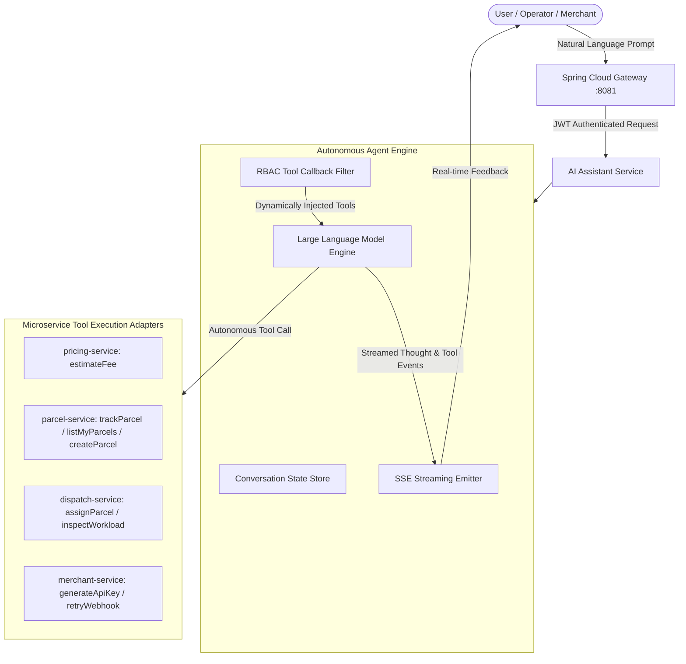

# SwiftDrop — Technical Project Report
**System:** SwiftDrop — Autonomous Cloud-Native Parcel Delivery & Courier Management Platform  
**Architecture:** Distributed Microservices with Spring Cloud Gateway & Autonomous AI Agent  

---

## 1. Introduction and Project Context

### 1.1 Background
The rapid growth of digital commerce has made agile, reliable last-mile logistics essential for modern trade. Traditional courier operations continue to suffer from disconnected paper records, manual dispatch ledgers, and centralized monolithic architectures that create operational silos, lack live courier visibility, and degrade under peak delivery demands.

**SwiftDrop** is a cloud-native, distributed parcel delivery and courier management platform designed to automate and streamline the entire logistics lifecycle. Built as an autonomous microservices ecosystem, SwiftDrop unifies parcel booking, dynamic regional pricing, courier fleet dispatching, real-time WebSocket tracking, multi-channel notifications, and commercial merchant integrations. Crucially, the platform incorporates an **Autonomous AI Agent** powered by Spring AI and the Model Context Protocol (MCP), enabling the system to understand natural language instructions, invoke domain tools, and execute end-to-end logistics operations automatically without manual human intervention.

---

### 1.2 Problem Statement
Despite the availability of basic courier tracking tools, contemporary logistics platforms continue to struggle with several critical operational, technological, and architectural deficiencies:

1. **Information Asymmetry and Opaque Transit Visibility:**  
   Traditional courier systems rely on batch-updated database records that fail to reflect instantaneous transit checkpoints. End customers and business recipients experience persistent uncertainty regarding estimated delivery windows, while couriers lack standardized, tamper-evident mechanisms to capture real-time photographic and digital Proof-of-Delivery (POD) at the customer doorstep.

2. **Inflexible, Manual, and Non-Standardized Pricing:**  
   Most courier platforms compute shipment charges using coarse, manual rate cards that fail to accommodate multi-tier geographic zones, volumetric parcel dimensions, dynamic speed tiers (standard vs. express), and negotiated commercial merchant volume discounts. This causes revenue leakage for logistics operators and unexpected fee discrepancies for customers.

3. **Sub-optimal Dispatch Queuing and Courier Workload Imbalance:**  
   Parcel dispatching in high-density distribution centers is frequently conducted through ad-hoc manual assignment. Dispatchers lack unified visibility into courier capacity, route congestion, and active shifts, resulting in delayed parcel pickups, uneven courier workload distribution, and elevated delivery failure rates.

4. **Friction in Commercial Merchant and B2B Partner Integration:**  
   E-commerce merchants requiring programmatic, high-volume shipping integrations are hindered by proprietary, unstandardized APIs lacking robust developer tooling, self-service API key provisioning, secure scoped authorization, and automated webhook notification pipelines with resilient retry mechanisms.

5. **Monolithic Architectural Vulnerability and Scalability Limitations:**  
   Legacy monolithic logistics backends suffer from shared database contention and tight coupling. High-volume read traffic (such as thousands of concurrent customer tracking lookups) directly degrades the performance of critical transactional paths (such as parcel booking and courier status updates). Furthermore, a single failure in an auxiliary subsystem (such as an email notification queue) risks cascading across the entire application, causing widespread system outages.

6. **High Human Operational Overhead and Absence of Autonomous Intelligent Execution:**  
   Traditional enterprise systems require constant, manual human interventions for routine workflows—such as manually filling parcel booking forms, continuously monitoring dispatch boards, looking up tracking histories, resolving delivery exceptions, and auditing webhooks. The lack of an integrated, context-aware **Autonomous AI Agent** capable of understanding natural language instructions, executing microservice tools, and completing complex logistics workflows end-to-end without human friction creates severe operational delays, elevates human error rates, and escalates support overhead.

---

### 1.3 Objectives
To systematically address the problems identified above, the SwiftDrop platform was designed and implemented around four core dimensions: Functional Capabilities, Autonomous AI Agent Capabilities, Architectural/Technical Standards, and Security/Quality Assurance.

#### 1.3.1 Functional Objectives
- **Dynamic Fee Estimation & Booking:** Provide a self-service parcel booking portal that calculates precise shipping tariffs in real time based on pickup/destination postal codes, parcel weight, volume dimensions, and service speed.
- **Unified Multi-Role Operational Portals:** Deliver dedicated, responsive web interfaces tailored for Customers (booking and history), Merchants (bulk orders and developer keys), Couriers (manifest execution and POD capture), Dispatchers (fleet dispatch board), and Administrators (system governance).
- **Real-Time Live Tracking:** Implement bidirectional, push-based shipment tracking utilizing STOMP over WebSockets with Server-Sent Events (SSE) fallback, allowing customers and merchants to monitor parcel state transitions without repetitive page polling.
- **Automated Asynchronous Notification Pipeline:** Guarantee immediate dispatch of transactional email notifications to senders and recipients upon critical parcel lifecycle milestones (pickup, out-for-delivery, delivered, failed).
- **Enterprise Partner Integration:** Supply a secured Developer REST API featuring client-credentials authorization, scoped API keys, and outbound HTTP webhooks backed by automated exponential-backoff retries.

#### 1.3.2 Autonomous AI Agent & End-to-End Automation Objectives
- **Autonomous Agentic Workflow Execution:** Implement an intelligent, tool-calling AI agent powered by Spring AI, Large Language Models (LLMs), and Model Context Protocol (MCP) capable of executing the complete suite of system functionalities automatically based on natural language commands.
- **Automated Parcel Booking & Fee Estimation:** Enable the AI agent to parse conversational customer instructions, extract dimensional and routing attributes, invoke the dynamic pricing engine, and book deliveries end-to-end autonomously.
- **Intelligent Tracking & Customer Inquiry Resolution:** Empower the AI agent to retrieve real-time tracking data, summarize transit history, interpret delivery exceptions, and provide human-friendly explanations while strictly enforcing data privacy and RBAC boundaries.
- **Autonomous Dispatch & Workload Management:** Design agent capabilities to evaluate unassigned booking queues, assess courier shift capacities and geographic zones, and recommend or trigger optimal parcel assignments automatically.
- **Automated Merchant Operations & Auditing:** Equip the agent to interact with merchant services to generate API keys, validate webhook delivery statuses, inspect dead letter queues, and trigger automated retries for failed event notifications.
- **Real-Time Streaming Feedback & Tool Auditability:** Stream agent reasoning steps, tool invocation payloads, and execution results to the client interface using Server-Sent Events (SSE) to ensure full operational transparency and human oversight.

#### 1.3.3 Architectural and Technical Objectives
- **Microservice Domain Decomposition:** Partition the platform into autonomous Spring Boot microservices aligned with Domain-Driven Design (DDD) bounded contexts (Identity, Pricing, Parcel, Dispatch, Tracking, Notification, Merchant, and AI Assistant).
- **Database-per-Service Encapsulation:** Enforce strict data isolation where each microservice exclusively owns its schema and relational database (PostgreSQL on Neon Cloud), completely eliminating cross-service database joins and shared database locks.
- **Centralized Edge Gateway & BFF:** Deploy a reactive Spring Cloud Gateway acting as the single perimeter ingress (Port 8081) responsible for routing, CORS management, cryptographic token validation, and Redis token-bucket rate limiting.
- **Event-Driven Decoupling via AMQP:** Utilize RabbitMQ topic exchanges (`swiftdrop.events`) to publish domain state changes (`ParcelStatusChangedV1`), achieving high fault tolerance and eventual consistency across downstream consumers.
- **Cloud-Native Containerization & Orchestration:** Package all services and backing infrastructure into Docker containers, orchestrated locally via Docker Compose and production-ready via a Kubernetes umbrella Helm chart.

#### 1.3.4 Security, Reliability and Quality Objectives
- **Cryptographic Asymmetric Authentication:** Implement an RSA 2048-bit (RS256) JSON Web Token (JWT) architecture with standard RFC 7517 JWKS public-key discovery, enabling downstream services to validate tokens statelessly without querying a central session database.
- **Federated Identity & PKCE:** Integrate Google OAuth 2.0 with Proof Key for Code Exchange (PKCE) for seamless, passwordless customer onboarding.
- **Role-Based Tool Authorization for AI:** Enforce strict role-based capability filtering within the AI assistant so that the agent only executes tools matching the authenticated caller's granted authorities.
- **Comprehensive Quality Assurance:** Achieve high reliability through a multi-tiered testing strategy including unit testing (JUnit 5/Mockito), slice integration testing with Testcontainers (real PostgreSQL and RabbitMQ instances), RBAC matrix authorization tests, and Playwright end-to-end smoke verification.

---

### 1.4 Enterprise Technology Stack

| Layer | Technology |
|---|---|
| **Frontend Application** | React 18, TypeScript, Vite, Tailwind CSS, Lucide Icons, TanStack React Query |
| **Edge Gateway / BFF** | Spring Cloud Gateway (Project Reactor / Netty), Redis Token Bucket Rate Limiting |
| **Backend Microservices** | Java 21, Spring Boot 4.1.1, Spring Security, Spring Data JPA, Jakarta Bean Validation |
| **Data Persistence & Cache**| PostgreSQL 16 (Neon Cloud - isolated schema per service), Redis 7 |
| **Asynchronous Broker** | RabbitMQ 3.13 (Topic Exchange, Dead Letter Queues, Virtual Hosts) |
| **Object Storage** | MinIO (S3-compatible API for Proof-of-Delivery photos and PDF receipts) |
| **Container & Orchestration**| Docker Compose (Local Dev), Kubernetes Umbrella Helm Chart (Production) |

---

## 2. Requirements Engineering & Use Case Modeling

### 2.1 System Actors & Authorisation Boundaries
Authorisation is enforced through Role-Based Access Control (RBAC), codified in `contracts.domain.Role` and emitted in the `roles` claim of every RS256 JWT access token.

- **Guest (Unauthenticated):** Restricted strictly to rate-limited public tracking lookups by tracking number.
- **Customer (`CUSTOMER`):** Self-registered individuals who request shipping estimates, book deliveries, track shipments in real time, and download delivery receipts.
- **Merchant (`MERCHANT`):** Verified commercial partners who access a dedicated merchant dashboard, generate developer API keys, place bulk delivery orders via REST API, and configure webhook endpoints.
- **Courier (`COURIER`):** Delivery personnel managed by dispatchers. Authorized to inspect assigned runs, execute parcel pickups, record transit checkpoints, capture proof-of-delivery (signatures/photos), and document delivery failures.
- **Dispatcher (`DISPATCHER`):** Operations managers who oversee real-time dispatch queues, manually assign couriers, rebalance delivery workloads, and handle exceptions.
- **Administrator (`ADMIN`):** System operators with superset privileges, managing user lifecycles, activating/suspending accounts, approving merchants, and configuring geographic pricing zones and weight tiers.

### 2.2 Use Case Specifications by Role
- **Customer Package:** UC-CUST-01 (Estimate Shipping Fee), UC-CUST-02 (Book Parcel Delivery), UC-CUST-03 (Track Parcel Live), UC-CUST-04 (Download Delivery Receipt).
- **Merchant Package:** UC-MERCH-01 (Generate Developer API Keys), UC-MERCH-02 (Create Bulk Delivery Orders), UC-MERCH-03 (Configure Webhook Endpoints), UC-MERCH-04 (Audit Webhook Logs).
- **Courier Package:** UC-COUR-01 (View Active Shift Manifest), UC-COUR-02 (Update Parcel Status), UC-COUR-03 (Upload Photographic Proof of Delivery), UC-COUR-04 (Record Delivery Failure Reason).
- **Dispatcher & Admin Package:** UC-DISP-01 (Monitor Live Dispatch Board), UC-DISP-02 (Assign Parcel to Courier), UC-DISP-03 (Rebalance Workload), UC-ADM-01 (Manage System Users & Roles), UC-ADM-02 (Configure Pricing Zones).

*(Refer to diagrams: `uc-00-system-overview.png`, `uc-01-customer.png`, `uc-02-merchant.png`, `uc-03-courier.png`, `uc-04-dispatcher.png`)*

---

## 3. System Architecture & Deployment Infrastructure

### 3.1 Microservices Architecture vs. Monolith Justification
A microservices architecture with an API Gateway / BFF was chosen over a modular monolith due to specific enterprise criteria:
1. **Team Independence:** Allowed 10 engineers to develop, test, and branch their respective domains without code contention.
2. **Blast-Radius Containment:** A spike in public tracking traffic or a transient failure in notifications does not affect core parcel booking or identity authentication.
3. **Specialized Protocols:** Supports diverse protocols suited to specific domains (STOMP WebSockets in tracking-service, AMQP in notification-service, S3 protocol in MinIO).
4. **Horizontal Scaling:** Edge and tracking workloads can scale independently based on CPU and memory thresholds via Kubernetes Horizontal Pod Autoscalers (HPA).

### 3.2 Layered System Topology
The platform is organized into five decoupled layers:
1. **Presentation Layer:** React 18 single-page application communicating via JSON/REST and STOMP WebSockets.
2. **Edge & Security Layer:** Spring Cloud Gateway operating on port 8081, acting as the reverse proxy, verifying RS256 JWT signatures against JWKS, enforcing CORS, and managing Redis rate limiting.
3. **Application Microservices Layer:** Autonomous Spring Boot microservices implementing business logic, domain models, and AMQP event listeners.
4. **Persistence Layer:** Independent PostgreSQL databases per service, hosted on Neon Cloud, ensuring full database-level isolation.
5. **Messaging Layer:** RabbitMQ broker managing pub/sub topic exchanges and dead-letter queues.

*(Refer to diagrams: `arch-01-layers.png`, `arch-02-deployment.png`)*

---

## 4. Database & Entity-Relationship Modeling

### 4.1 Database-per-Service Paradigm
SwiftDrop strictly implements the **Database-per-Service** pattern. Microservices never directly access another service's database tables. Cross-service entity relationships are maintained exclusively using logical immutable UUIDs. Cross-domain consistency is maintained via asynchronous AMQP event propagation.

### 4.2 Comprehensive 24-Entity Domain Model
The database architecture comprises 24 relational tables distributed across isolated service schemas:
- **`identity_service`:** `users`, `roles`, `user_roles`, `refresh_tokens`.
- **`parcel_service`:** `parcels`, `parcel_items`, `delivery_proofs`, `receipts`.
- **`pricing_service`:** `zones`, `pricing_rules`, `weight_tiers`, `pricing_logs`.
- **`dispatch_service`:** `couriers`, `courier_shifts`, `assignments`, `dispatch_queue_items`.
- **`merchant_service`:** `merchants`, `merchant_api_keys`, `webhook_endpoints`, `webhook_deliveries`.
- **`tracking_service`:** `tracking_events`, `checkpoints`, `live_courier_positions`.
- **`notification_service`:** `notification_logs`, `notification_templates`.

*(Refer to diagrams: `er-01-core.png`, `er-02-full.png`, `er-03-ownership.png`)*

---

## 5. Integration Architecture & Messaging Topology

### 5.1 Enterprise Integration Patterns (EIP)
13 core integration patterns are implemented across SwiftDrop:
1. **API Gateway:** Consolidates public routing and JWT verification.
2. **Asynchronous Messaging:** Decouples core parcel booking from downstream processing.
3. **Publish-Subscribe Channel:** `swiftdrop.events` topic exchange.
4. **Competing Consumers:** Work queues allow multiple service replicas to consume events concurrently.
5. **Dead Letter Channel (DLQ):** Captures failed messages after maximum retry exhaustion.
6. **Webhook Retry with Exponential Backoff:** Reliable merchant delivery notifications.
7. **Database per Service:** Zero cross-service database coupling.
8. **Shared Contract Library:** `swiftdrop-contracts:0.1.0` distributes common event schemas and error codes.
9. **Claims-Based Identity Propagation:** Downstream services extract user ID and roles directly from validated JWT claims.
10. **Idempotent Receiver:** Consumer deduplication prevents duplicate notifications and state updates.
11. **Content-Based Routing:** Gateway route predicates match incoming URL paths to target services.
12. **Request-Reply:** Synchronous REST calls for price calculation and parcel creation.
13. **Point-to-Point Messaging:** STOMP WebSocket channels for real-time tracking updates to the browser.

### 5.2 RabbitMQ Event Topology
- **Topic Exchange:** `swiftdrop.events`
- **Canonical Event Schema:** `EventEnvelope<T>` containing `eventId`, `timestamp`, `traceId`, and payload `T`.
- **Primary Domain Event:** `ParcelStatusChangedV1` published with routing key `parcel.status.<STATUS>`:
  - `dispatch.parcel-status` queue -> consumed by `dispatch-service`
  - `tracking.parcel-status` queue -> consumed by `tracking-service`
  - `notification.parcel-status` queue -> consumed by `notification-service`
  - `merchant.parcel-status` queue -> consumed by `merchant-service`

*(Refer to diagrams: `int-01-patterns-map.png`, `int-02-event-topology.png`)*

---

## 6. Core Workflows & State Machine Transitions

### 6.1 Key System Sequences
- **Workflow 1: Customer Booking & Dynamic Pricing (`seq-01-create-delivery.png`):** Customer inputs parcel dimensions and addresses -> Gateway routes to `pricing-service` -> `pricing-service` executes dynamic Strategy calculation -> Customer confirms -> `parcel-service` creates parcel record, sets status to `CREATED`, and emits AMQP event.
- **Workflow 2: Merchant REST API Order Ingestion (`seq-02-merchant-api-order.png`):** Merchant system authenticates via API key / client-credentials -> `merchant-service` validates credentials -> Calls `parcel-service` -> Receives tracking ID -> Emits webhook subscription event.
- **Workflow 3: Courier Delivery & Proof Capture (`seq-03-status-update-notification.png`):** Courier updates status to `DELIVERED` and uploads photo -> `dispatch-service` uploads POD to MinIO -> `parcel-service` updates record -> Publishes `parcel.status.DELIVERED` -> `tracking-service` broadcasts WebSocket frame -> `notification-service` resolves recipient email and sends delivery receipt.
- **Workflow 4: Google OAuth 2.0 PKCE Login (`seq-04-oauth-login.png`):** Browser completes PKCE challenge with Google OIDC -> `identity-service` validates auth code -> Synchronizes user profile -> Issues RS256 JWT access token and refresh token.

### 6.2 Parcel State Machine Transitions
Strict non-reversible state progression:
$$\text{CREATED} \longrightarrow \text{PICKED\_UP} \longrightarrow \text{IN\_TRANSIT} \longrightarrow \text{OUT\_FOR\_DELIVERY} \longrightarrow \text{DELIVERED}$$
- **Terminal States:** `DELIVERED`, `FAILED` (with mandatory failure category), `CANCELLED` (permitted only while in `CREATED` state).

*(Refer to diagram: `act-01-parcel-lifecycle.png`)*

---

## 7. Autonomous AI Agent Architecture & System-Wide Automation

### 7.1 Agentic Vision & Conceptual Architecture
Beyond traditional graphical user interfaces and manual CRUD interactions, SwiftDrop incorporates an autonomous **AI Assistant Service** (`services/ai-assistant-service`) designed to orchestrate and execute platform functionalities automatically through natural language intent. 

Built using **Spring AI**, Java 21, and the **Model Context Protocol (MCP)**, the AI agent functions as an intelligent operational copilot and autonomous task executor. Rather than acting as a static conversational bot, the agent maintains an internal reasoning loop: it interprets user objectives, determines the requisite operational steps, dynamically queries domain microservices via function/tool calling, evaluates returned schemas, and carries out multi-step business transactions across the enterprise ecosystem.

### 7.2 System-Wide Automation Capabilities Across Bounded Contexts
The AI agent is equipped with tool adapters enabling end-to-end automation across all platform modules:

1. **Automated Parcel Booking & Dynamic Tariff Inquiries:**  
   The agent autonomously extracts pickup locations, destination addresses, parcel weights, and volume classifications from unstructured user prompts. It invokes `pricing-service` via the `estimateFee` tool to retrieve real-time rates and can automatically invoke `parcel-service` to persist bookings and generate official tracking numbers.

2. **Autonomous Live Tracking & Anomaly Resolution:**  
   Using the `trackParcel` tool, the agent queries the parcel tracking timeline, analyzes status timestamps, interprets exceptions (such as delivery attempt failures or weather delays), and delivers natural language summaries to customers while shielding sensitive PII.

3. **Autonomous Dispatch Allocation & Workload Balancing:**  
   The agent can inspect unassigned dispatch queues, evaluate active courier shift capacities, and propose or trigger courier assignments automatically, drastically lowering operational latency during peak distribution surges.

4. **Automated Merchant Operations & Webhook Diagnostics:**  
   Commercial merchants can instruct the agent to generate new API keys, inspect failed webhook deliveries, and trigger automated retries from dead-letter queues through simple conversational prompts.

### 7.3 Role-Based Tool Isolation & Security Enforcement
To uphold enterprise security boundaries, the AI agent dynamically configures its active toolset at runtime based on the caller's authenticated RS256 JWT claims:
- **Least-Privilege Tool Filtering:** The `AssistantTools` component inspects the caller's authorities. Capabilities such as `listMyParcels` are dynamically injected only when an authenticated `CUSTOMER` token is validated, while administrative dispatch tools are strictly withheld from non-administrative users.
- **Stateless Bearer Propagation:** When executing tool callbacks, the agent propagates the caller's original JWT bearer token in the `Authorization` header to downstream microservices, ensuring that existing Spring Security RBAC and method-level access controls are fully preserved.

### 7.4 Real-Time Tool Streaming & Auditability (SSE)
Every autonomous action taken by the AI agent is streamed back to the client interface using **Server-Sent Events (SSE)**. Before executing any tool, the agent emits a structured `ToolEvent(name, arguments)` frame. This provides end users and dispatch supervisors with immediate visibility into what tools the agent is invoking, what inputs it is supplying, and how the underlying system state is modified.

---

## 8. Software Engineering Principles & Design Patterns

### 8.1 SOLID Principles Application
- **Single Responsibility Principle (SRP):** Each microservice, controller, and service class handles one specific business capability.
- **Open-Closed Principle (OCP):** Dynamic pricing algorithms implement `PricingCalculator` interface; new pricing formulas are added without modifying existing strategies.
- **Liskov Substitution Principle (LSP):** File storage abstraction `StorageClient` allows seamless swapping between MinIO and AWS S3.
- **Interface Segregation Principle (ISP):** Repositories expose focused query methods rather than monolithic interfaces.
- **Dependency Inversion Principle (DIP):** High-level services depend on injected repository and client interfaces via Spring IoC.

### 8.2 Design Patterns Applied
- **Strategy Pattern:** Implemented in `pricing-service` (`StandardPricingStrategy`, `ExpressPricingStrategy`, `BulkMerchantPricingStrategy`). *(Refer to diagram: `pat-01-pricing-strategy.png`)*
- **Repository Pattern:** Spring Data JPA abstracts database persistence operations.
- **Observer / Pub-Sub Pattern:** AMQP message broker triggers event-driven downstream consumers.
- **Front Controller / Gateway Pattern:** Spring Cloud Gateway unifies edge concerns.
- **Shared Contracts & RFC 7807:** Common error response format (`ProblemFields`, `ErrorCode`) across all services.

---

## 9. Security Architecture & Quality Attributes

### 9.1 Cryptographic Authentication & JWKS
- **Asymmetric Tokens:** `identity-service` signs access tokens using an RSA 2048-bit private key.
- **JWKS Endpoint:** Public keys are served via `/api/v1/auth/jwks.json`. Resource servers validate tokens locally without querying the database.
- **Token Lifetimes:** Access tokens: 15 minutes; Refresh tokens: 7 days with rotation and revocation on suspension.

### 9.2 Defense-in-Depth & Non-Functional Attributes
- **Rate Limiting:** Redis token-bucket filter limits public tracking endpoints to 10 req/min per IP to prevent automated scraping.
- **Password Hashing:** BCrypt with work factor 12.
- **PII Protection:** Recipient contact details and phone numbers are redacted in log files.
- **MinIO Presigned URLs:** Delivery proof images are accessible only via short-lived (15-min) presigned URLs.

---

## 10. Quality Assurance, Testing & Defect Transparency

### 10.1 Multi-Tier Testing Strategy
- **Unit Testing:** JUnit 5 and Mockito verifying core business rules and state machines.
- **Integration Testing:** Testcontainers spinning up real PostgreSQL and RabbitMQ instances for repository and messaging tests.
- **Authorization Verification:** `RbacAuthorizationIntegrationTest` systematically asserts that unauthorized roles receive HTTP 403 Forbidden.
- **Contract & E2E Testing:** Spring MockMvc and Playwright end-to-end smoke tests.

### 10.2 Transparent Defect Audit (Known Gaps)
As documented in `docs/DESIGN.md` §7, rigorous architecture verification identified six specific items scheduled for hardening:
1. Alignment of JWT claim naming conventions (`merchantId` vs `merchant_id`).
2. Gateway routing rule adjustment to forward merchant API-key headers directly.
3. Tightening internal user lookup endpoint authorization to trusted service scopes.

---

## 11. Team Contributions & Project Management

### 11.1 Ten-Member Work Breakdown Matrix

| Member | Area / Microservice | Key Architectural Contributions |
|---|---|---|
| **Amandi Arangala** (`@AmandiArangala`) | Identity & Auth Service | RS256 JWT, JWKS endpoint, Google OAuth 2.0 PKCE, Flyway schema, RBAC test suite |
| **Kevin** (`@Kevin200307`) | API Gateway & Edge | Spring Cloud Gateway routes, Redis rate limiting, Docker Compose infrastructure |
| **Pavindu** (`@Pavindu11`) | Pricing & Zones | Strategy design pattern, geographic zone lookup, dynamic fee estimation |
| **Praveena Ishadi** (`@LP-Ishadi`) | Parcel Booking & Lifecycle | Parcel state machine, tracking number generation, receipt PDF generation |
| **Dimesh Methsara** (`@Dimeshmethsara`)| Dispatch & Couriers | Courier workload scheduling, assignment logic, MinIO proof-of-delivery upload |
| **Charithma Dassanayake** (`@CDDassanayake`)| Merchant API & Webhooks | API key generation/auth, merchant order ingestion, webhook retry with DLQ |
| **Maheesha Paboth** (`@MaheeshaPaboth`)| Live Tracking Service | STOMP WebSockets over SockJS, public tracking timeline, SSE fallback |
| **Thiranjaya** (`@thirsturn`) | Notification Service | RabbitMQ consumer, Mailpit integration, HTML delivery email templates |
| **Tharusha Prabhashwara** (`@Prabhashwara2003`)| AI Assistant & MCP | Spring AI integration, MCP tools for fee estimation and tracking status |
| **Thanoj Buddhima** (`@ThanojBuddhima`)| Frontend & Architecture Pack | React 18 SPA (Customer, Merchant, Courier, Admin), 18 verified architecture diagrams |

### 11.2 Milestone Delivery Progression
- **M1 — Foundation:** Multi-module Maven aggregator, database schemas, Gateway routing, JWKS validation.
- **M2 — Core Flows:** Customer registration, Google OAuth, fee calculation, parcel booking.
- **M3 — Events & Realtime:** RabbitMQ event pipeline, courier assignment, live tracking WebSockets, email notifications.
- **M4 — Partner & Admin:** Merchant API keys, bulk order processing, webhook delivery, admin consoles.
- **M5 — Hardening & Delivery:** Testcontainers integration tests, RBAC test suites, verified system design documentation.

---

## 12. Conclusion & Future Roadmap

### 12.1 Conclusion
SwiftDrop validates that an enterprise microservice architecture coupled with an autonomous AI agent layer delivers high decoupling, resilience, and operational scalability for complex logistics operations. The implementation adheres to industry-standard patterns including Database-per-Service, Event-Driven Messaging via RabbitMQ, API Gateway / BFF routing, asymmetric cryptographic authentication, and Spring AI tool-driven agentic automation.

### 12.2 Future Roadmap
- **Autonomous Multi-Agent Swarms:** Expanding the AI assistant into multi-agent systems where dedicated sub-agents autonomously handle courier dispatch, route optimization, customer disputes, and merchant invoicing.
- **Native Courier Mobile Applications:** Flutter or React Native mobile clients providing GPS background telemetry and offline sync.
- **AI-Driven Dynamic Route Optimization:** Integration of vehicle routing algorithms to minimize courier fuel consumption and delivery latency.
- **Multi-Currency Payment Gateways:** Integration with payment providers (Stripe, PayHere) for automated merchant billing and cash-on-delivery (COD) reconciliation.

