# SwiftDrop — Technical Project Report

**System:** SwiftDrop — Cloud-Native Parcel Delivery & Courier Management Platform
**Architecture:** Distributed Microservices with Spring Cloud Gateway and an AI Assistant Service

> **Formatted submission copy:** [`SwiftDrop_Project_Report.pdf`](./SwiftDrop_Project_Report.pdf)
> (49 pages, all 18 diagrams embedded). LaTeX source: [`SwiftDrop_Project_Report.tex`](./SwiftDrop_Project_Report.tex).
>
> **Accuracy note.** Every claim in this report has been verified against the project source code.
> Capabilities that were designed but are **not yet implemented are retained here and marked
> `Planned`** rather than removed. See §10.3 for the consolidated status matrix and §10.2 for the
> defects found during verification.

**Status legend:** `Implemented` — running and verified · `Partial` — partially built · `Planned` — designed, not yet built

---

## 1. Introduction and Project Context

### 1.1 Background

The rapid growth of digital commerce has made agile, reliable last-mile logistics essential to modern trade. Traditional courier operations still rely on disconnected records, manual dispatch ledgers and monolithic backends that create operational silos, offer no live visibility, and degrade under peak demand.

**SwiftDrop** is a cloud-native, distributed parcel delivery and courier management platform that unifies parcel booking, zone-based pricing, courier dispatch, real-time tracking, multi-channel notification and commercial merchant integration. The platform additionally includes an **AI assistant service** built on Spring AI, which exposes read-oriented domain tools to a large language model so users can query the system in natural language.

### 1.2 Problem Statement

1. **Opaque transit visibility.** Batch-updated records do not reflect instantaneous transit checkpoints. Customers experience uncertainty about delivery windows, and couriers lack a standardised mechanism to capture tamper-evident proof of delivery.
2. **Inflexible, manual pricing.** Coarse rate cards fail to accommodate multi-tier geographic zones, parcel size bands, weight allowances and express tiers, causing revenue leakage and unexpected charges.
3. **Sub-optimal dispatch and workload imbalance.** Ad-hoc manual assignment leaves dispatchers without unified visibility of courier capacity, producing delayed pickups and elevated failure rates.
4. **Friction in B2B partner integration.** Merchants needing programmatic shipping are hindered by proprietary APIs lacking self-service key provisioning, scoped authorisation and resilient webhook pipelines.
5. **Monolithic fragility.** Shared-database contention means high-volume read traffic degrades critical transactional paths, and a failure in an auxiliary subsystem can cascade.
6. **Manual operational overhead.** Routine enquiries — tracking lookups, fee quotations, delivery history — consume support capacity that a natural-language interface can absorb.

### 1.3 Objectives and Delivery Status

#### 1.3.1 Functional Objectives

| Objective | Status | Note |
|---|---|---|
| Self-service booking with real-time fee estimation (zone, size band, weight, express) | `Implemented` | Fee re-quoted server-side at booking |
| Volumetric (L×W×H) dimension-based pricing | `Planned` | Pricing uses discrete size bands |
| Negotiated merchant volume discounts | `Planned` | No discount logic implemented |
| Multi-role responsive portals (Customer, Merchant, Courier, Dispatcher, Admin) | `Implemented` | React SPA with role-guarded routes |
| Real-time tracking: STOMP over WebSocket → SSE → polling | `Implemented` | Three-stage transport ladder |
| Asynchronous transactional email on lifecycle milestones | `Implemented` | Event-driven via RabbitMQ |
| Notification to the **recipient** as well as the sender | `Planned` | Currently addresses the parcel owner only |
| SMS notification channel | `Partial` | Channel abstraction and preferences exist; mock provider only |
| Partner REST API with scoped API keys and signed webhooks with backoff retry | `Implemented` | HMAC-signed, retried up to one hour |

#### 1.3.2 AI Assistant Objectives

| Objective | Status | Note |
|---|---|---|
| Tool-calling assistant over domain services (Spring AI) | `Implemented` | Three tools exposed |
| Conversational fee estimation (`estimateFee`) | `Implemented` | Calls pricing-service |
| Conversational tracking (`trackParcel`) and history (`listMyParcels`) | `Implemented` | Privacy-reduced responses |
| Autonomous parcel booking (`createParcel`) | `Planned` | No write tool exists; the assistant cannot book |
| Autonomous dispatch allocation and workload balancing | `Planned` | No dispatch tools exist |
| Automated merchant operations and webhook diagnostics | `Planned` | No merchant tools exist |
| MCP server exposing the same tools | `Partial` | `spring-ai-starter-mcp-server-webmvc` declared as a dependency; no server wiring in source |
| Streaming of tool invocations over SSE | `Implemented` | Structured tool events emitted before execution |
| Role-based tool filtering | `Partial` | A single-role check gates `listMyParcels`; general per-authority filtering not implemented |

#### 1.3.3 Architectural Objectives

| Objective | Status | Note |
|---|---|---|
| Bounded-context microservice decomposition | `Implemented` | Eight services plus a gateway |
| Database-per-service isolation on managed PostgreSQL | `Implemented` | Six independent databases |
| Reactive edge gateway and BFF on port 8081 | `Implemented` | Routing, CORS, JWT, rate limiting, circuit breaking |
| Event-driven decoupling over a RabbitMQ topic exchange | `Implemented` | Exchange `parcel.events` |
| Containerisation via Docker Compose | `Implemented` | Full local stack |
| Kubernetes umbrella Helm chart | `Planned` | `infra/k8s/` does not exist in the repository |
| Horizontal Pod Autoscaling | `Planned` | Depends on the Kubernetes deployment |

#### 1.3.4 Security and Quality Objectives

| Objective | Status | Note |
|---|---|---|
| RSA 2048-bit RS256 JWT with RFC 7517 JWKS discovery | `Implemented` | Stateless downstream validation |
| Google OAuth 2.0 with PKCE | `Implemented` | Single-use state, constant-time verifier comparison |
| Refresh-token rotation with replay-family revocation | `Implemented` | Hash-only storage |
| Unit testing (JUnit 5, Mockito) | `Implemented` | Pricing, state machine, retry policy |
| Integration testing with Testcontainers | `Implemented` | Real PostgreSQL and RabbitMQ |
| RBAC authorisation test matrix | `Implemented` | `RbacAuthorizationIntegrationTest`, `DispatchAuthorizationTest`, `PricingAuthorizationTest` |
| Playwright end-to-end smoke tests | `Planned` | Not present in the web application manifest |

### 1.4 Technology Stack

| Layer | Technology |
|---|---|
| **Frontend** | React 18.3, TypeScript, Vite, Tailwind CSS, TanStack React Query, React Router |
| **Edge Gateway / BFF** | Spring Cloud Gateway (Reactor, Netty), Redis token-bucket rate limiting, Resilience4j circuit breakers |
| **Backend microservices** | Java 21, Spring Boot 4.1.1, Spring Security, Spring Data JPA, Jakarta Bean Validation |
| **Persistence** | PostgreSQL on Neon Cloud — **one database per service** (six), Flyway-managed, `ddl-auto: validate` |
| **Cache & projection** | Redis 7 — rate-limit buckets, login throttling, the entire tracking read projection |
| **Asynchronous broker** | RabbitMQ 3 — topic exchange `parcel.events`, dead-letter exchange `swiftdrop.dlx` |
| **Object storage** | MinIO — proof-of-delivery photographs. PDF receipts are generated on demand and not stored |
| **Mail transport** | Mailpit locally; SMTP in deployed environments |
| **AI assistant** | Spring AI with an OpenAI-compatible model provider |
| **Local orchestration** | Docker Compose |
| **Kubernetes** | `Planned` — umbrella Helm chart not yet authored |

---

## 2. Requirements and Use Case Modelling

### 2.1 Actors and Authorisation Boundaries

Authorisation is role-based, declared once in `contracts.domain.Role` and carried in the `roles` claim of every access token.

| Actor | Role | Capability boundary |
|---|---|---|
| Guest | — | Rate-limited public tracking lookup only; the sole unauthenticated capability |
| Customer | `CUSTOMER` | Estimate fees, book deliveries, track parcels, download receipts, manage preferences |
| Merchant | `MERCHANT` | Granted only after admin approval. Console, API keys, orders, webhooks |
| Courier | `COURIER` | Inspect manifest, execute guarded transitions, capture proof, record failures |
| Dispatcher | `DISPATCHER` | Dispatch queue, workload, assignment/unassignment, courier roster |
| Administrator | `ADMIN` | Generalises Dispatcher; adds merchant approval, user/role admin, zones, pricing, notification audit |

A merchant's **backend system** is a second, non-human actor authenticating with a scoped API key rather than a user session.

### 2.2 Use Case Specifications

- **Customer** — register; sign in with password or Google; estimate fee; book delivery; view deliveries; track parcel; download receipt; cancel delivery; manage notification preferences; apply to become a merchant.
- **Merchant** — register organisation; await approval; create order via console; create order via REST API; list and inspect orders; issue, list and revoke API keys; configure webhook; inspect and replay deliveries.
- **Courier** — view manifest; mark picked up, in transit, out for delivery; upload proof; mark delivered; record failure with mandatory reason; reattempt a failed delivery.
- **Dispatcher / Admin** — monitor queue; inspect workload; request assignment suggestion; assign and unassign; manage roster. Admins additionally approve merchants, manage users and roles, configure zones and pricing, and audit notifications.

### 2.3 Use Case Diagrams

**Figure 1 — System-level use case overview.** All actors, the generalisation of `DISPATCHER` by `ADMIN`, and shared capabilities.

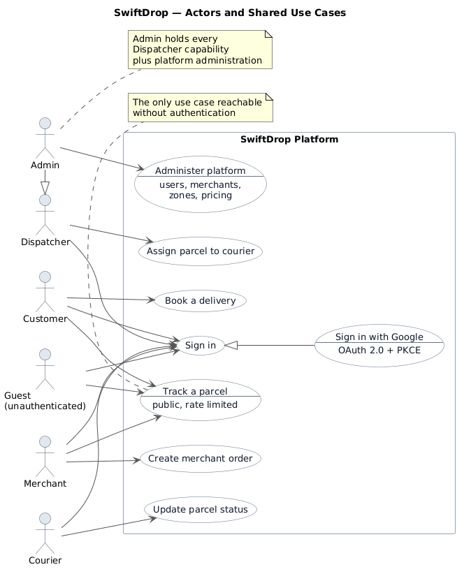

**Figure 2 — Customer.** Booking *includes* fee estimation because the server re-quotes the price during booking rather than trusting the browser.

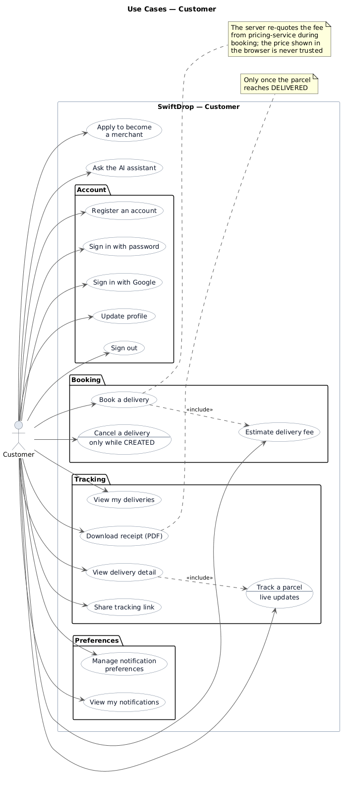

**Figure 3 — Merchant.** Distinguishes the human console path from the server-to-server REST API path authenticated by a scoped API key.

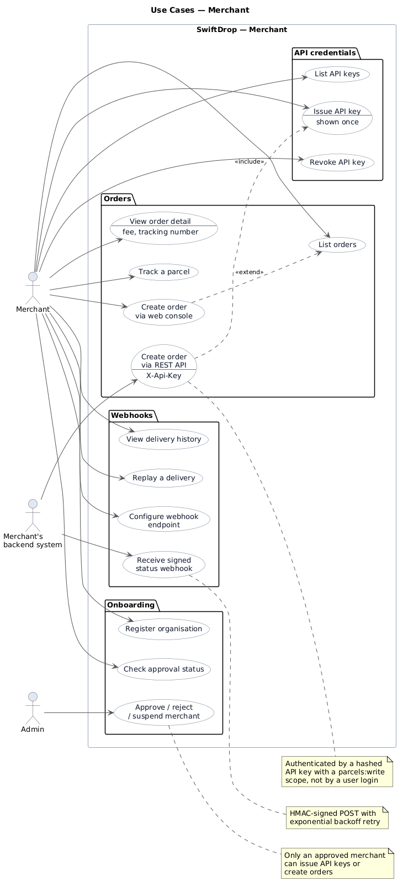

**Figure 4 — Courier.** Every transition is guarded; marking a parcel delivered *includes* uploading proof of delivery.

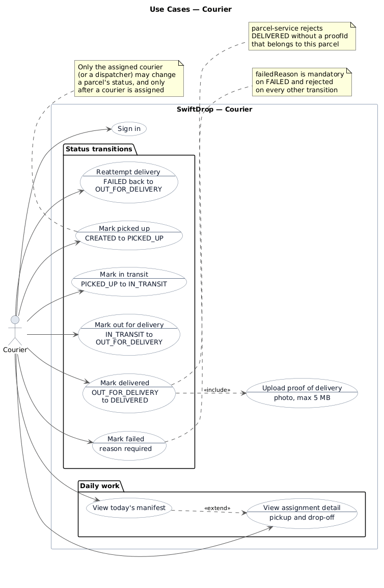

**Figure 5 — Dispatcher and Administrator.** The administrator-only region is shaded.

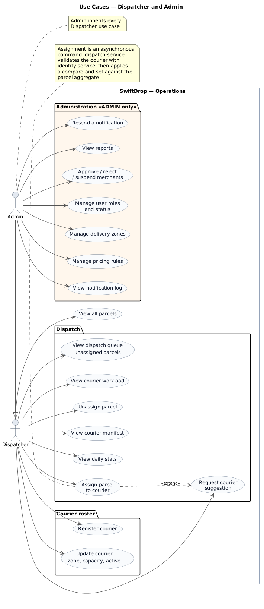

---

## 3. System Architecture

### 3.1 Architectural Style and Justification

SwiftDrop is built as **microservices behind an API gateway that also serves as a backend-for-frontend**, with a strict three-layer structure inside every service. Boundaries were derived from the domain, not the technical layering — there is no "controller service" or "database service".

1. **Team independence** — ten engineers developed and released their domains without code contention.
2. **Blast-radius containment** — a spike in tracking traffic or a notification failure does not affect booking or authentication.
3. **Storage fit per context** — tracking needs a fast, expiring, read-optimised projection and uses Redis with a TTL.
4. **Independent scaling** — read-heavy tracking and write-heavy booking scale on different curves.

#### Honest cost of this choice

A modular monolith with the same internal boundaries would have been defensible — arguably better — at this stage.

| Cost | Where it appears |
|---|---|
| No cross-service transactions | Merchant order creation writes to two databases over HTTP; consistency recovered with a transactional outbox, deterministic idempotency keys and compensating reads |
| User-visible eventual consistency | The dispatch board and tracking page are event-fed projections; correct eventually, and the UI must tolerate the gap |
| Duplicated cross-cutting config | Every service repeats JWT decoder setup; a change to token validation is an eight-service change |
| Contracts not compiler-checked | One service writes `merchantId` while three read `merchant_id` (§10.2); in a single codebase this is a compile error |
| Operational surface | Six databases, a broker, Redis, an object store and a mail server must all run |

### 3.2 Layered Topology

The platform is organised into **four** layers:

1. **Presentation** — React SPA. No business rules; route guards mirror server roles for UX only. The access token is held in memory, never in browser storage.
2. **Edge** — Spring Cloud Gateway on WebFlux: the only publicly reachable component, implementing JWT validation (issuer and audience), CORS, security headers, Redis token-bucket rate limiting, Resilience4j circuit breakers, request-id propagation and identity header injection. Internal routes are denied at the edge.
3. **Business logic** — eight services, each internally layered `api → service → repository → domain`. Dependencies point inward only; entities never leave the service layer.
4. **Data** — six PostgreSQL databases, Redis, RabbitMQ and MinIO.

**Figure 6 — Layered architecture.** Presentation, edge, business-logic and data layers; synchronous calls solid, event flow dashed.

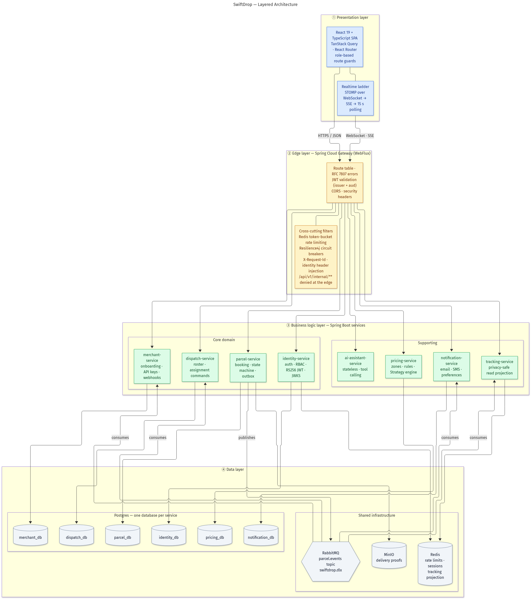

**Figure 7 — Deployment topology.** Container boundaries, host port mappings and external dependencies.

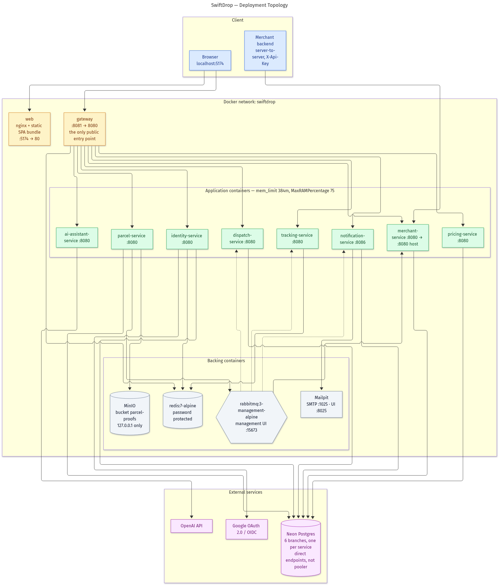

### 3.3 Service Inventory

| Service | Responsibility |
|---|---|
| gateway | Edge routing, JWT validation, CORS, rate limiting, circuit breaking, identity header injection, aggregated API docs |
| identity-service | Registration, login, Google OIDC, RS256 issuance, JWKS, refresh rotation, role administration |
| parcel-service | Parcel aggregate, booking, guarded state machine, proof upload, PDF receipts, transactional outbox |
| pricing-service | Zones, city resolution, temporal pricing rules, Strategy-based fee engine |
| dispatch-service | Courier roster, dispatch queue projection, assignment commands, workload accounting |
| merchant-service | Merchant onboarding and approval, API key lifecycle, order ingestion, signed webhooks with retry |
| tracking-service | Privacy-reduced read projection in Redis; STOMP and SSE push |
| notification-service | Event-driven email and SMS, per-user preferences, delivery log, retry scheduler |
| ai-assistant-service | Stateless conversational assistant exposing read-oriented tools over SSE |

---

## 4. Database and Entity-Relationship Modelling

### 4.1 Database-per-Service

Six services own a PostgreSQL database each; tracking-service holds its projection entirely in Redis, and ai-assistant-service has no persistence.

**No service holds a foreign key into another service's database.** Cross-boundary relationships exist only as UUID columns enforced in application code. `identity.users.id` is the most-referenced value in the system — thirteen columns across four other databases point at it — and it has no inbound foreign keys.

> **Diagram convention:** a solid line is a real foreign key enforced by PostgreSQL; a dashed line is a cross-database logical reference enforced only by application code.

### 4.2 The 24-Table Domain Model

| Service | Database | Tables |
|---|---|---|
| identity-service | `identity_db` | `users`, `roles`, `user_roles`, `refresh_tokens` |
| parcel-service | `parcel_db` | `parcels`, `parcel_status_history`, `delivery_proofs`, `parcel_outbox`, `parcel_assignment_commands` |
| merchant-service | `merchant_db` | `merchants`, `api_keys`, `oauth_clients`, `merchant_orders`, `webhook_deliveries` |
| dispatch-service | `dispatch_db` | `couriers`, `dispatch_parcels`, `assignments`, `assignment_commands`, `processed_events` |
| pricing-service | `pricing_db` | `zones`, `zone_cities`, `pricing_rules` |
| notification-service | `notification_db` | `notifications`, `notification_preferences` |
| tracking-service | Redis only | `tracking:parcel:*`, `tracking:timeline:*` (90-day TTL) |
| ai-assistant-service | None | In-memory conversations, 24-hour expiry |

Points worth drawing out:

- **RBAC** uses the classic three-table design; role identifiers are the enumeration names themselves, so a token's `roles` claim maps directly onto rows.
- **`parcels` snapshots its fee** — re-reading a parcel later yields the price actually charged.
- **`parcel_status_history` is an append-only audit trail** recording from-status, to-status, acting user, and an optional proof or failure reason.
- **`couriers.id` is not `users.id`** — `parcels.assignee_id` points at the *user*, so parcel↔courier joins pass through the user identifier.
- **Pricing is temporal** — each rule carries an effective period, and a trigger forbids overlapping active periods for the same route and size band.

### 4.3 Entity-Relationship Diagrams

**Figure 8 — Core domain model.** Users, roles, merchants, parcels, status history, couriers, zones and pricing.

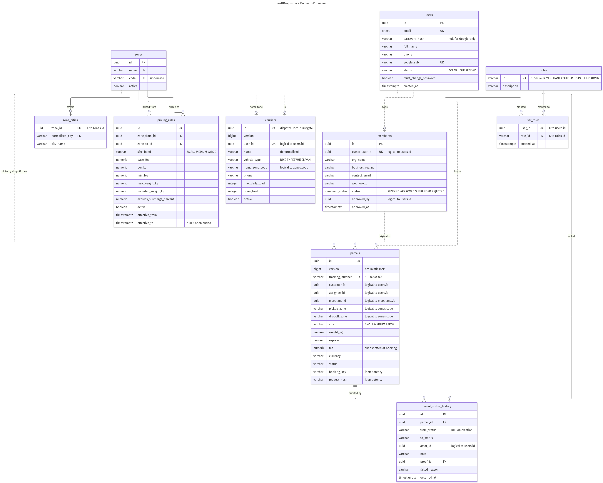

**Figure 9 — Data ownership map.** Which service owns which tables, and every logical reference crossing a database boundary.

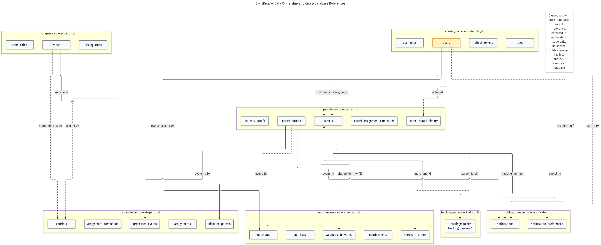

**Figure 10 — Complete 24-table model.** Includes the infrastructure tables that make the asynchronous integration safe: the transactional outbox, the inbox deduplication table, the webhook delivery log and the assignment command tables.

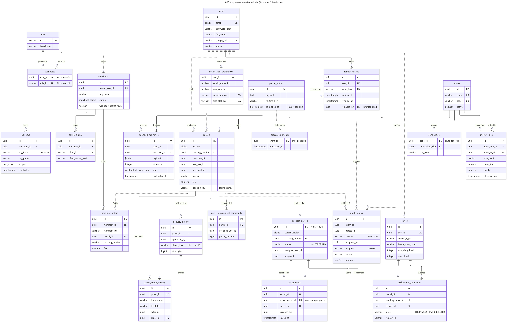

### 4.4 Known Model Drift

1. `dispatch_parcels.status` rejects `CANCELLED` while `parcels.status` accepts it, so a cancelled parcel cannot be projected into the dispatch read model.
2. `parcels.pickup_zone` is `VARCHAR(80)` while its logical source `zones.code` is `VARCHAR(12)` — the consumer's column is wider than the producer's.

---

## 5. Integration Architecture and Messaging

### 5.1 Integration Patterns

| Pattern | Where used | Why this pattern |
|---|---|---|
| Request/reply | parcel→pricing; dispatch→identity and parcel; gateway→all | The caller cannot proceed without the answer — a parcel cannot be persisted before an authoritative fee exists |
| Publish/subscribe | `parcel.events` topic exchange: one producer, four consumers | A status change has several independent audiences; the producer should not know who they are |
| Message broker | RabbitMQ topic exchange plus `swiftdrop.dlx` | Durable, routable fan-out with retry and dead-lettering |
| Transactional outbox | `parcel_outbox` written in the business transaction, drained by a scheduled publisher | Removes the dual-write problem: state change and publish intent commit atomically |
| Idempotent consumer | `processed_events`; a Redis key with TTL; a unique constraint on event/channel/recipient | At-least-once delivery means every consumer must tolerate replay |
| Idempotency key | `Idempotency-Key` on booking; deterministic key for merchant orders | A retried booking returns the original parcel |
| CQRS read model | `dispatch_parcels`; the Redis tracking projection | Fast reads in a different shape, without querying the owning service |
| API gateway / BFF | Spring Cloud Gateway and the dashboard fan-out | One edge for authn, CORS, rate limiting and circuit breaking |
| Circuit breaker | Resilience4j on every gateway route | Prevents a sick upstream from cascading |
| Client credentials | `POST /api/v1/auth/service-token` | Internal calls authenticate as a service, carrying no human roles |
| Token forwarding | parcel→pricing; assistant→parcel and pricing | Preserves the user's own authorisation instead of escalating |
| Outbound webhook | merchant-service → merchant endpoint, HMAC-signed | Push integration for partners who cannot poll |
| Fallback ladder | STOMP → SSE → 15-second polling | Live updates must survive proxies that break WebSockets |

**Figure 11 — Integration patterns map.** Thick solid edges are synchronous request/reply; dashed edges are asynchronous publish/subscribe through the broker.

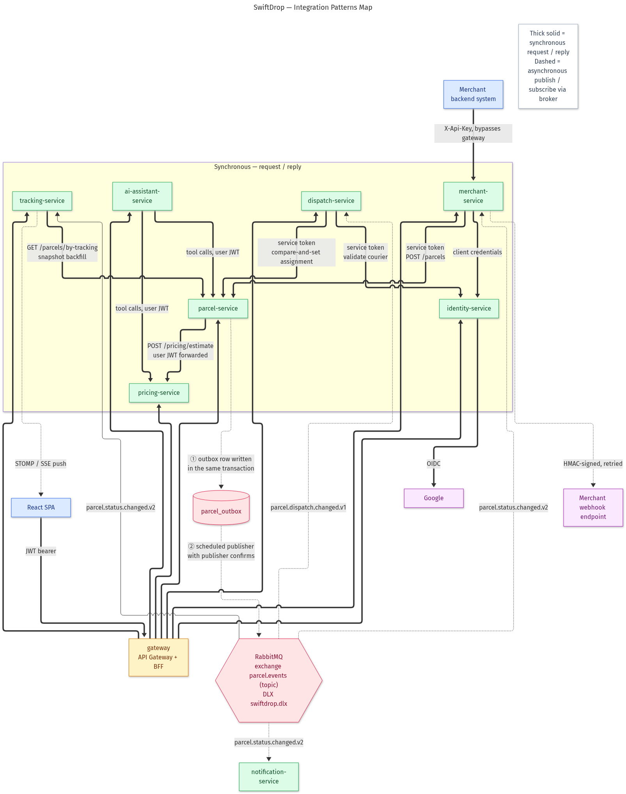

### 5.2 Messaging Topology and Delivery Guarantees

Every message is wrapped in `EventEnvelope<T>` carrying `eventId`, `eventType`, `version`, `occurredAt`, `producer` and the payload. The `eventId` is the deduplication key every consumer uses.

Naming is mechanical: routing keys are `<eventType>.v<version>` and queues are `<consuming-service>.<routing-key>`, with `.dlq` for dead letters.

| Routing key | Queue | Consumer |
|---|---|---|
| `parcel.dispatch.changed.v1` | `dispatch.parcel.dispatch.changed.v1` | dispatch-service |
| `parcel.status.changed.v2` | `tracking.parcel.status.changed.v2` | tracking-service |
| `parcel.status.changed.v2` | `notification.parcel.status.changed.v2` | notification-service |
| `parcel.status.changed.v2` | `merchant-webhook.parcel.status.changed.v2` | merchant-service |

> A version 1 status event (`parcel.status.changed.v1`) is declared in the shared contracts module but is **never bound or consumed**. Version 2 is the event actually produced. Note also that dispatch-service consumes a different event entirely — `parcel.dispatch.changed.v1` — rather than the status event.

The guarantee is **at-least-once**. The producer writes the outbox row inside the business transaction; the publisher sends persistently and awaits a broker confirmation before marking the row published; on a negative acknowledgement it stops the batch and leaves the row for the next cycle. Duplicates are therefore possible by design, which is why every consumer deduplicates.

**Figure 12 — Event topology.** From the transactional outbox through the topic exchange to the four bound queues and the dead-letter exchange.

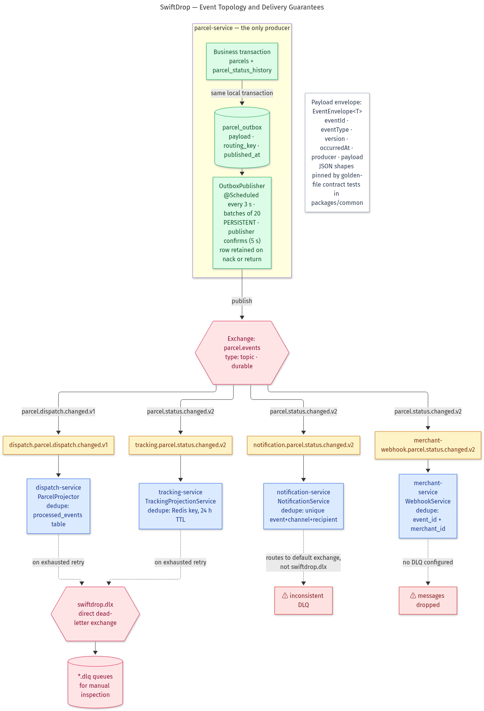

---

## 6. Core Workflows and State Transitions

### 6.1 Customer Booking and Dynamic Pricing

The fee is quoted twice — once for display while the customer types, and again authoritatively inside the booking transaction, so the browser's number is never trusted. Four writes and two outbox rows commit in a single local transaction, so an event can never be published for a parcel that failed to save, and a saved parcel can never silently fail to notify.

**Figure 13 — Create delivery.**

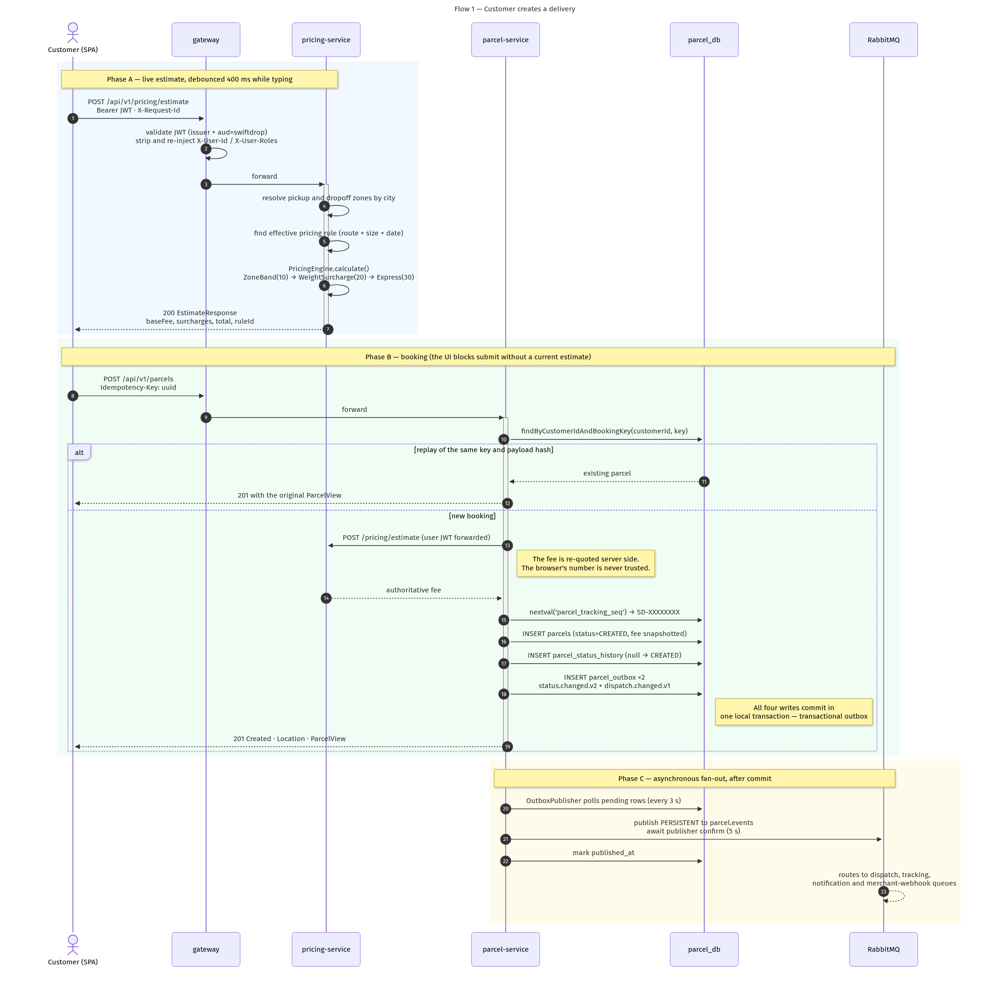

### 6.2 Merchant Order Creation via the REST API

The API key is never stored — only its SHA-256 hash and an eight-character prefix. Verification looks candidates up by prefix, filters by expiry and scope, and compares hashes in constant time.

Because no user is present, merchant-service obtains a short-lived service token from identity-service before calling parcel-service. The idempotency key is **deterministic**, derived from the merchant identifier and the merchant's own reference, so a retry from the partner's system reuses the same parcel.

**Figure 14 — Merchant API order ingestion.**

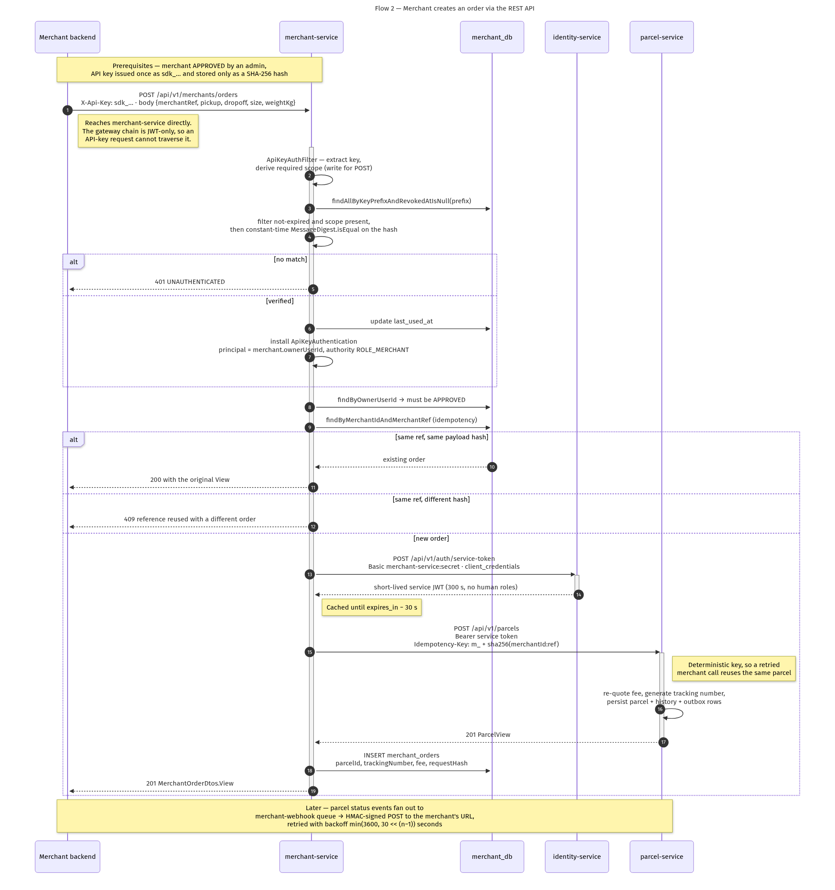

### 6.3 Courier Status Update Triggering Notifications

One status update fans out to three unrelated consumers, none of which the courier's request waits for.

Proof of delivery is uploaded *before* the status change, so a failed upload leaves the parcel untouched. The notification recipient is taken from the event's `customerUserId` — the parcel's owner — not the courier who triggered the change.

> Proof-of-delivery objects are uploaded to MinIO by **parcel-service**, which owns the `ProofStorage` abstraction. Dispatch-service is not involved in the upload path.

**Figure 15 — Status update and notification fan-out.**

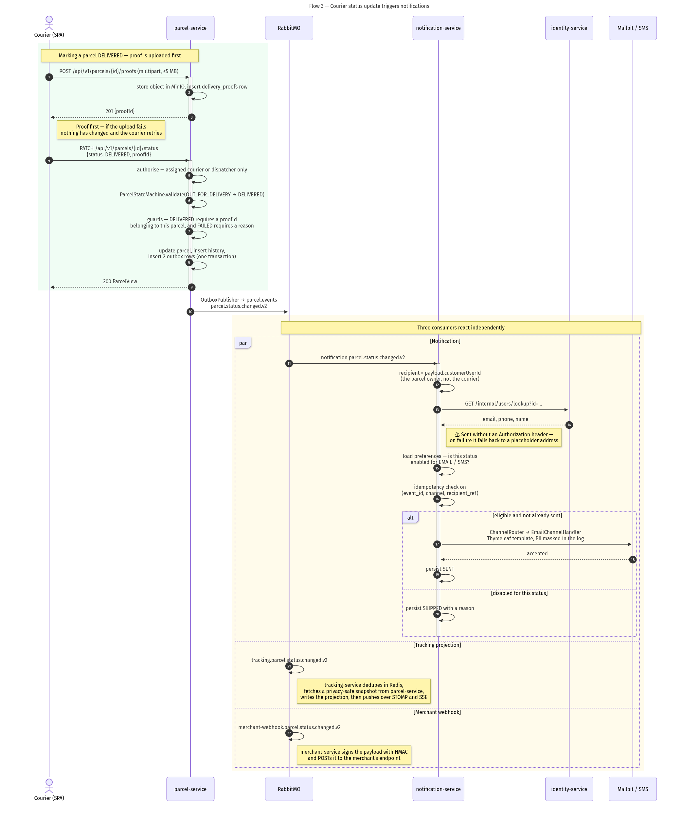

### 6.4 Google OAuth 2.0 Login with PKCE

The browser is a public client and cannot hold a secret, so PKCE binds the authorisation code to the client that requested it. `state` is single-use and consumed atomically from Redis; the verifier is compared in constant time; the redirect URI is re-checked against the one recorded at authorisation time; and the identity token's issuer and audience are verified before any account is touched. An account provisioned through Google receives a null password hash, so password login against it can never succeed.

**Figure 16 — OAuth 2.0 PKCE login.**

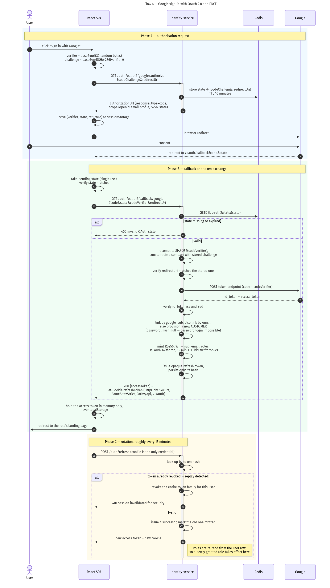

### 6.5 Parcel Lifecycle State Machine

Transitions are validated against a single declarative table in `ParcelStateMachine`.

| From | Permitted to | Guard |
|---|---|---|
| `CREATED` | `PICKED_UP`, `CANCELLED` | Cancellation is legal only here |
| `PICKED_UP` | `IN_TRANSIT` | — |
| `IN_TRANSIT` | `OUT_FOR_DELIVERY` | — |
| `OUT_FOR_DELIVERY` | `DELIVERED`, `FAILED` | `DELIVERED` requires a `proofId` belonging to this parcel; `FAILED` requires a reason |
| `FAILED` | `OUT_FOR_DELIVERY` | Reattempt |
| `DELIVERED` | — | Terminal; enables receipt download |
| `CANCELLED` | — | Terminal |

> **`FAILED` is not a terminal state.** A failed delivery returns to `OUT_FOR_DELIVERY` for a reattempt, so the transition graph contains a cycle and the progression is **not** strictly linear. Only `DELIVERED` and `CANCELLED` are terminal.

**Figure 17 — Parcel lifecycle.**

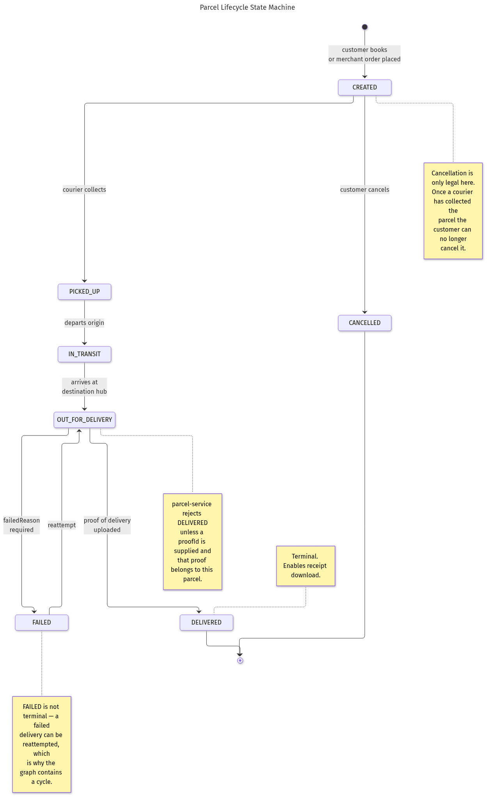

---

## 7. AI Assistant Service

### 7.1 Architecture

A large language model is given a set of callable domain tools; the model decides which to invoke in response to a natural-language prompt, and the service streams both its reasoning and each tool invocation back to the browser over SSE. The service is stateless with respect to durable storage: conversations are held in memory with a 24-hour expiry, scoped to the calling user.

### 7.2 Implemented Tools

| Tool | Status | Behaviour |
|---|---|---|
| `estimateFee` | `Implemented` | Quotes a fee from origin, destination, size band, weight and express flag |
| `trackParcel` | `Implemented` | Retrieves the tracking timeline, returning a privacy-reduced view without contact or street-address detail |
| `listMyParcels` | `Implemented` | Lists the authenticated customer's own parcels; injected only when the caller holds the customer role |

All three are **read-oriented**. The assistant can answer questions about the system but cannot presently modify state.

### 7.3 Designed but Not Yet Implemented

Retained as roadmap items. None is currently callable.

| Capability | Status | Intended behaviour |
|---|---|---|
| `createParcel` | `Planned` | Parse a conversational booking instruction and persist a parcel end to end |
| `assignParcel`, `inspectWorkload` | `Planned` | Evaluate the unassigned queue and courier capacity, then propose or trigger assignments |
| `generateApiKey`, `retryWebhook` | `Planned` | Let merchants provision keys and re-drive failed webhook deliveries conversationally |
| MCP server exposure | `Partial` | The MCP starter dependency is declared, but no server wiring exists |
| General per-authority tool filtering | `Partial` | A single-role check gates `listMyParcels`; a caller holding several roles loses that tool |

### 7.4 Security of the Tool Path

When the model invokes a tool, the service propagates the caller's original bearer token downstream. Existing Spring Security authorisation therefore applies unchanged — the assistant cannot read anything the user could not read directly through the API. Tool invocations are streamed to the client before execution, giving visibility of exactly what the assistant is doing.

---

## 8. Design Patterns and Engineering Principles

### 8.1 Strategy Pattern in the Pricing Engine

`PricingEngine` depends only on the `PricingStrategy` interface and receives every implementation as an injected list, sorted by each strategy's declared order. Calculation reduces over that list, threading a breakdown through each strategy in turn.

| Strategy | Order | Contribution |
|---|---|---|
| `ZoneBandStrategy` | 10 | Sets the base fee from the matched pricing rule |
| `WeightSurchargeStrategy` | 20 | Charges only weight above the rule's included allowance |
| `ExpressSurchargeStrategy` | 30 | Adds the configured express percentage |

Introducing a fuel surcharge means adding one Spring component and nothing else — the engine does not change, and neither does any existing strategy. The same shape appears in notification-service, where a channel router selects from an injected list of channel handlers.

**Figure 18 — Pricing Strategy chain.**

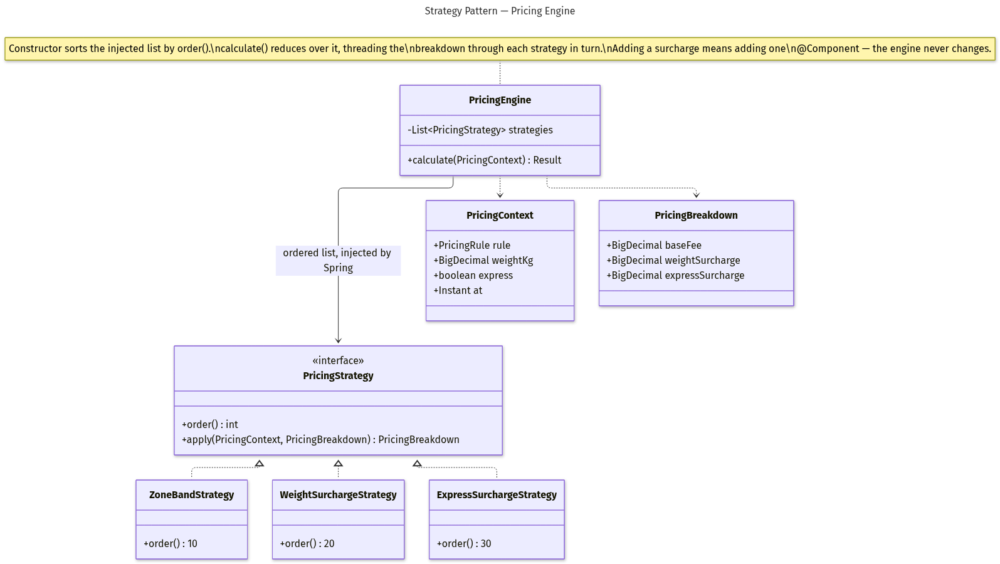

### 8.2 SOLID Principles

| Principle | Evidence in the codebase |
|---|---|
| Single responsibility | One bounded context per service; controllers handle HTTP, services hold rules, repositories handle persistence |
| Open/closed | The pricing engine and the notification channel router accept new behaviour without modification |
| Liskov substitution | Every `PricingStrategy` is interchangeable; the engine makes no assumption about which concrete strategy it holds |
| Interface segregation | `PricingStrategy` declares two methods; `ProofStorage` exposes only what parcel-service needs, which is what makes the MinIO backend swappable |
| Dependency inversion | The engine depends on the strategy interface, services on Spring Data interfaces, and parcel-service on a pricing client interface rather than an HTTP client |

### 8.3 Further Patterns Applied

| Pattern | Implementation | Purpose |
|---|---|---|
| State machine | `ParcelStateMachine` | Legal transitions declared once in a verifiable table |
| Repository | Spring Data JPA interfaces | Business code expresses intent rather than SQL |
| Transactional outbox | `OutboxEvent` + scheduled publisher | Atomic state change and event intent |
| Observer / pub-sub | AMQP listeners | Services react without the producer knowing them |
| Chain of responsibility | Spring Security filter chains; API key filter ahead of the JWT filter | Independent, individually testable concerns |
| Projection | Dispatch projector, Redis tracking repository | Read models shaped for their consumer and reduced for privacy |
| Data transfer object | View records at every boundary | Entities never serialise directly; PII can be excluded |
| Value object | Tracking number, embeddable address | Validity enforced at construction |
| Optimistic locking | Version columns on parcel, courier, assignment, pricing rule | Concurrent edits conflict loudly |

### 8.4 Don't Repeat Yourself

A shared contracts module is the single place where cross-service contracts live: event payload records, the envelope, exchange and queue constants, shared enumerations, and the error-code catalogue behind RFC 7807 responses. Queue names are *derived* from routing keys rather than written twice, and golden-file tests pin each event's JSON shape.

The limit: this holds for anything expressible as shared Java, but not for configuration. JWT decoder setup is repeated in all eight services, and the claim-name defect in §10.2 is exactly the kind of error duplication permits.

---

## 9. Security Architecture

### 9.1 Cryptographic Authentication

| Control | Implementation |
|---|---|
| Token signing | RSA 2048-bit, RS256, key identifier `swiftdrop-v1` |
| Key discovery | RFC 7517 JWKS at **`/.well-known/jwks.json`**, cached 24 hours; resource servers validate locally |
| Access token lifetime | 15 minutes |
| Refresh token | 7 days, opaque, stored only as a SHA-256 digest, rotated on every use |
| Replay detection | Presenting an already-rotated token revokes the entire token family for that user |
| Cookie transport | `HttpOnly`, `Secure`, `SameSite=Strict`, path-scoped to the auth endpoints |

### 9.2 Defence in Depth

| Control | Implementation |
|---|---|
| Password hashing | BCrypt at **work factor 10** with a secure random salt |
| Credential enumeration | A missing email still executes a constant-time dummy verification; invalid email and invalid password return an identical problem document |
| Rate limiting | Redis token buckets: **5/min login, 30/min public tracking, 100/min other API routes**. Keyed by user when authenticated, by address otherwise; fails open if Redis is unreachable |
| API key storage | SHA-256 hash and an eight-character prefix only; constant-time comparison |
| Proof-of-delivery access | MinIO presigned URLs valid for **300 seconds** |
| PII protection | Recipient addresses masked in the notification log; a log converter redacts emails and phone numbers; the tracking projection excludes addresses and phone numbers by construction |
| Identity header integrity | The gateway strips any client-supplied identity header and re-derives it from a validated token |
| Transport hardening | CORS allowlist, `X-Frame-Options`, `nosniff`, HSTS, content security policy |

---

## 10. Quality Assurance and Defect Transparency

### 10.1 Testing Strategy

| Tier | Status | Coverage |
|---|---|---|
| Unit | `Implemented` | JUnit 5 and Mockito over pricing strategies, the parcel state machine and webhook retry policy |
| Integration | `Implemented` | Testcontainers providing real PostgreSQL and RabbitMQ |
| Authorisation | `Implemented` | `RbacAuthorizationIntegrationTest`, `DispatchAuthorizationTest`, `PricingAuthorizationTest` |
| Concurrency | `Implemented` | `AssignmentConcurrencyTest` proves capacity limits and unique-assignment protection |
| Contract | `Implemented` | Golden-file tests pin every event's JSON shape |
| API | `Implemented` | Spring MockMvc and WebTestClient slices |
| End-to-end browser | `Planned` | Playwright smoke tests specified but not present in the web manifest |

### 10.2 Defect Audit

Verifying this report against the implementation surfaced **six** defects. They are recorded because the diagrams depict the system as it actually behaves.

1. **JWT claim name mismatch.** identity-service writes the merchant claim as `merchantId`; parcel-service, the gateway identity filter and tracking-service all read `merchant_id`. Merchant-scoped operations with a user token cannot resolve a merchant.
2. **Dead bearer-token branch in merchant order creation.** The controller tests whether the authentication object is a `Jwt`, but it is a `JwtAuthenticationToken` whose *principal* is the `Jwt`. The test never passes, so even a console-originated order falls through to the service-token path. Functionally benign today; incorrect as written.
3. **API-key requests cannot traverse the gateway.** The gateway chain is JWT-only with no API-key filter, so the documented merchant integration works only against merchant-service directly — which is how Figure 14 draws it.
4. **Unauthenticated internal identity lookup.** notification-service calls the internal user lookup with no authorisation header; the endpoint requires a scoped service token, so a catch-all fallback substitutes a synthetic placeholder address rather than failing loudly.
5. **Dashboard aggregates endpoints that do not exist.** The gateway BFF calls a summary route on parcel, dispatch and merchant. None implements it, so the dashboard always returns unavailable sections.
6. **Public tracking detail endpoint is not public.** The web app calls a detail-by-tracking route as though anonymous, but parcel-service permits only the summary route without authentication.

### 10.3 Consolidated Implementation Status

| Capability | Status | Remark |
|---|---|---|
| Identity, RBAC, JWT, JWKS, Google OAuth PKCE | `Implemented` | Including refresh rotation and replay revocation |
| Zone-based pricing with Strategy engine | `Implemented` | Temporal rules with overlap protection |
| Parcel booking, state machine, receipts | `Implemented` | Idempotent booking |
| Proof-of-delivery capture to object storage | `Implemented` | Presigned retrieval |
| Courier dispatch, assignment, workload | `Implemented` | Command-based with compare-and-set |
| Merchant onboarding, API keys, orders | `Implemented` | Scoped keys, hashed at rest |
| Outbound signed webhooks with retry | `Implemented` | Exponential backoff to one hour |
| Real-time tracking ladder | `Implemented` | STOMP, SSE, polling |
| Email notification pipeline | `Implemented` | Preference-aware, idempotent |
| SMS notification channel | `Partial` | Mock provider only |
| AI assistant read tools | `Implemented` | Three tools |
| AI assistant write/automation tools | `Planned` | Booking, dispatch, merchant operations |
| MCP server exposure | `Partial` | Dependency declared, wiring absent |
| Volumetric dimension pricing | `Planned` | Size bands today |
| Merchant volume discounts | `Planned` | No discount logic |
| Recipient-addressed notifications | `Planned` | Owner-addressed today |
| Docker Compose local orchestration | `Implemented` | Full stack |
| Kubernetes Helm chart and autoscaling | `Planned` | Directory absent |
| Playwright end-to-end tests | `Planned` | Not in the manifest |

---

## 11. Team Contributions and Project Management

### 11.1 Work Breakdown

| Index No. | Member | Area | Key contributions |
|---|---|---|---|
| _(to be filled)_ | Amandi Arangala (`@AmandiArangala`) | Identity & Auth | RS256 token service, JWKS endpoint, Google OAuth PKCE, refresh rotation, RBAC test suite |
| _(to be filled)_ | Kevin (`@Kevin200307`) | Gateway & Edge | Spring Cloud Gateway routes, Redis rate limiting, circuit breakers, Docker Compose infrastructure |
| _(to be filled)_ | Pavindu (`@Pavindu11`) | Pricing & Zones | Strategy chain, zone and city resolution, temporal pricing rules |
| _(to be filled)_ | Praveena Ishadi (`@LP-Ishadi`) | Parcel Lifecycle | Parcel state machine, tracking number generation, receipt generation, transactional outbox |
| _(to be filled)_ | Dimesh Methsara (`@Dimeshmethsara`) | Dispatch & Couriers | Courier roster, workload accounting, assignment commands, proof-of-delivery upload |
| _(to be filled)_ | Charithma Dassanayake (`@CDDassanayake`) | Merchant API | API key lifecycle, order ingestion, HMAC-signed webhooks with retry and dead-lettering |
| _(to be filled)_ | Maheesha Paboth (`@MaheeshaPaboth`) | Live Tracking | STOMP over SockJS, SSE fallback, Redis projection, public tracking timeline |
| _(to be filled)_ | Thiranjaya Siriwardhana (`@thirsturn`) | Notifications | AMQP consumer, Mailpit integration, Thymeleaf templates, preference engine, PII masking |
| _(to be filled)_ | Tharusha Prabhashwara (`@Prabhashwara2003`) | AI Assistant | Spring AI integration, tool callbacks, SSE streaming of tool invocations |
| _(to be filled)_ | Thanoj Buddhima (`@ThanojBuddhima`) | Frontend & Design | React SPA for all four personas, realtime transport ladder, verified architecture documentation and the eighteen diagrams in this report |

### 11.2 Milestone Progression

- **M1 — Foundation:** Multi-module Maven aggregator, database schemas, gateway routing, JWKS validation.
- **M2 — Core flows:** Registration, Google OAuth, fee calculation, parcel booking.
- **M3 — Events:** RabbitMQ pipeline, courier assignment, live tracking, email notification.
- **M4 — Partner & admin:** Merchant API keys, order ingestion, webhook delivery, admin consoles.
- **M5 — Hardening:** Testcontainers integration tests, RBAC suites, and the verified design documentation on which this report is based.

---

## 12. Conclusion and Roadmap

### 12.1 Conclusion

SwiftDrop demonstrates that a microservice architecture with an API gateway, database-per-service isolation, and event-driven integration delivers meaningful decoupling and resilience for a logistics domain. The implementation applies recognised patterns — transactional outbox, idempotent consumers, CQRS projections, Strategy-based pricing, circuit breaking and asymmetric authentication — and backs them with an automated test suite including real-infrastructure integration tests.

The report is deliberate about what is not finished. Three substantial items — Kubernetes orchestration, browser end-to-end testing, and write-capable AI tooling — remain designed rather than delivered, and six defects found during verification are recorded in §10.2. Documenting these alongside the working system is a more useful engineering artefact than a report claiming uniform completeness.

### 12.2 Roadmap

1. **Close the six recorded defects**, beginning with the JWT claim-name mismatch, which silently disables merchant-scoped operations.
2. **Author the Kubernetes umbrella Helm chart** with deployments, services, config maps, secrets, ingress and horizontal autoscaling.
3. **Add Playwright end-to-end smoke tests** covering booking, courier status update and public tracking.
4. **Extend the AI assistant with write-capable tools** — booking, dispatch assignment, merchant operations — behind per-authority filtering, and complete the MCP server wiring.
5. **Introduce volumetric pricing and merchant volume discounts** as additional strategies in the existing ordered chain, which requires no change to the pricing engine.
6. **Address the recipient** as well as the sender in the notification pipeline.
7. **Integrate a production SMS provider** behind the existing channel abstraction.
8. **Longer term:** route optimisation, native courier mobile clients with offline sync, and payment gateway integration for merchant billing and cash-on-delivery reconciliation.
